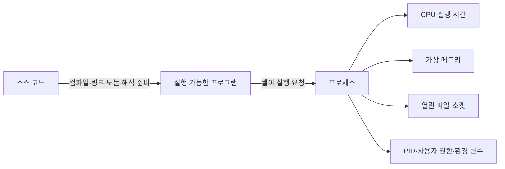
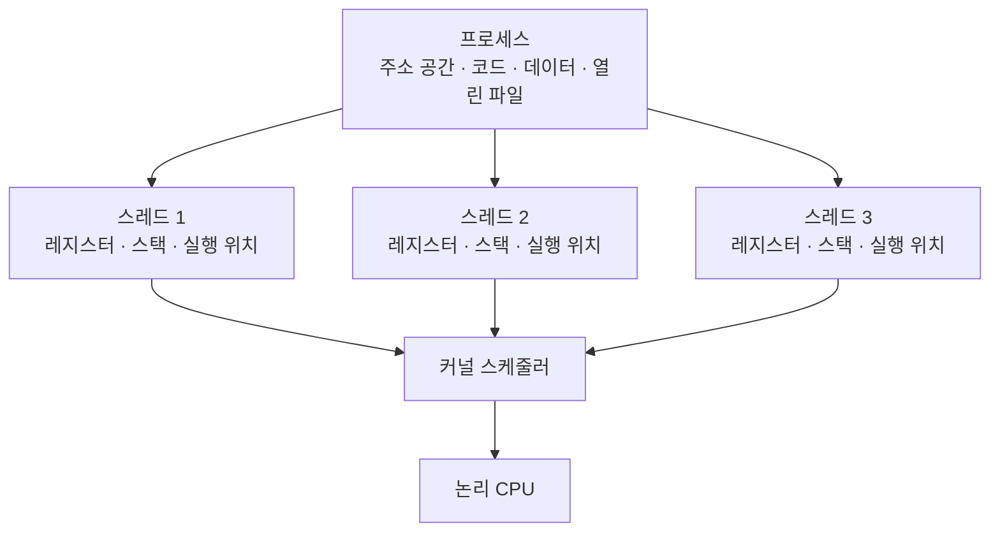
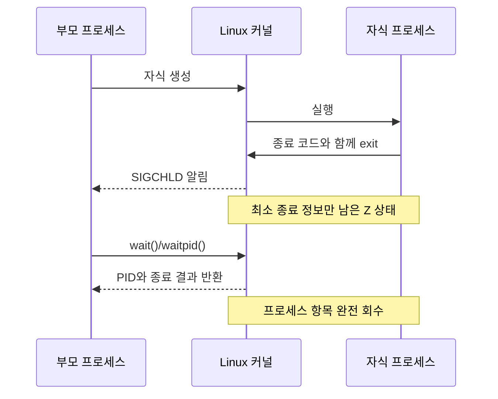

## 목차

- [[#1. 개요|1. 개요]]
- [[#2. 프로그램이 프로세스가 되는 흐름|2. 프로그램이 프로세스가 되는 흐름]]
- [[#3. 부모와 자식|3. 부모와 자식]]
- [[#4. 프로세스·스레드·태스크의 관계|4. 프로세스·스레드·태스크의 관계]]
- [[#5. CPU 코어보다 많은 프로세스가 동작하는 원리|5. CPU 코어보다 많은 프로세스가 동작하는 원리]]
- [[#6. 짧게 실행되는 프로그램과 계속 실행되는 프로그램|6. 짧게 실행되는 프로그램과 계속 실행되는 프로그램]]
- [[#7. 셸의 작업과 백그라운드 실행|7. 셸의 작업과 백그라운드 실행]]
- [[#8. 신호와 종료 요청|8. 신호와 종료 요청]]
- [[#9. 프로세스 상태|9. 프로세스 상태]]
- [[#10. 좀비와 고아|10. 좀비와 고아]]
- [[#11. 관련 문서와 출처|11. 관련 문서와 출처]]

## 1. 개요

Program(프로그램)은 실행할 명령과 데이터를 담은 정적인 코드이고, Process(프로세스)는 운영체제가 그 프로그램을 실행하며 메모리·CPU 시간과 식별자 같은 자원을 부여한 동적인 실행 단위이다.

`/usr/bin/ls` 파일은 프로그램이고, 사용자가 `ls`를 실행해 잠시 존재하는 실행 상태는 프로세스이다. 같은 프로그램을 여러 번 실행하면 서로 다른 PID와 메모리 공간을 가진 여러 프로세스가 될 수 있다.

## 2. 프로그램이 프로세스가 되는 흐름



Linux에서는 셸이 외부 프로그램을 실행할 때 개념적으로 자식 프로세스를 만들고 새 프로그램 이미지로 교체하는 흐름을 사용한다. `fork()`는 새 프로세스를 만들고, `execve()`는 현재 프로세스가 실행할 프로그램 이미지를 바꾼다. 구현과 상황에 따라 최적화된 다른 경로도 사용할 수 있다.[^fork]

## 3. 부모와 자식

프로세스를 만든 프로세스를 부모, 새로 생긴 프로세스를 자식이라고 한다. 자식은 고유 PID를 받고 부모의 환경과 열린 파일 기술자 등 일부 실행 문맥을 상속할 수 있지만 별도의 프로세스이다. 부모는 `wait` 계열 기능으로 자식의 종료 결과를 회수할 수 있다.

커널은 이 관계의 최상위 부모 프로세스가 아니다. 커널이 부팅 후 시작한 첫 사용자 공간 프로세스가 PID 1이며, 고아 프로세스 회수 같은 특별한 역할을 수행한다.

## 4. 프로세스·스레드·태스크의 관계

프로세스는 실행 중인 프로그램에 자원을 제공하는 실행 환경이고, 스레드는 그 프로세스 안에서 CPU 명령을 실제로 이어서 수행하는 실행 흐름이다. 하나의 프로세스는 최소 한 개의 스레드를 가지며 필요하면 여러 스레드를 만들 수 있다.



같은 프로세스의 스레드들은 일반적으로 코드·전역 데이터·힙과 열린 파일을 공유한다. 그러나 각 스레드는 어디까지 실행했는지를 나타내는 CPU 레지스터 상태, 함수 호출과 지역 변수를 담는 스택, 스레드 식별자와 실행 상태를 따로 가진다. 자원 공유 덕분에 통신은 빠르지만 한 스레드의 잘못된 메모리 접근이 같은 프로세스 전체에 영향을 줄 수 있다.

Linux 커널은 스케줄링할 수 있는 실행 단위를 내부적으로 태스크(task)라는 관점에서 다룬다. 각 태스크는 `task_struct`라는 커널 자료구조로 표현되며, 독립된 주소 공간을 가진 프로세스의 주 실행 흐름도, 다른 실행 흐름과 주소 공간을 공유하는 스레드도 커널에는 각각 스케줄링 가능한 태스크로 보인다. 따라서 Linux 문맥에서 `task`는 프로세스와 스레드를 포괄하는 구현상의 표현으로 쓰인다.

| 구분 | 핵심 의미 | 주로 따로 가지는 것 | 같은 프로세스 안에서 공유하는 것 |
|---|---|---|---|
| 프로그램 | 디스크 등에 저장된 실행 코드 | 실행 전에는 PID나 실행 상태가 없음 | 해당 없음 |
| 프로세스 | 프로그램이 실행되는 자원·격리 단위 | 주소 공간, 프로세스 식별 정보 | 내부 스레드가 코드·데이터·열린 파일 등을 공유 |
| 스레드 | 프로세스 안의 실제 실행 흐름 | 레지스터 상태, 스택, 실행 위치, 스레드 ID | 프로세스 주소 공간과 여러 자원 |
| 태스크 | Linux 커널이 관리하는 스케줄링 가능 실행 단위 | `task_struct`, 실행 상태, 스케줄링 정보 | 구성 방식에 따라 다른 태스크와 자원 공유 |

Linux에서는 프로세스와 스레드를 완전히 다른 종류의 객체로 구현하기보다, 태스크를 만들 때 주소 공간·파일·신호 처리 같은 자원을 무엇까지 공유할지 정하는 방식으로 표현한다. 사용자 관점에서는 자원을 분리한 실행 환경을 프로세스, 그 자원을 함께 쓰는 실행 흐름을 스레드라고 구분하는 것이 이해하기 쉽다.

## 5. CPU 코어보다 많은 프로세스가 동작하는 원리

CPU 코어 수보다 프로세스가 많아도 실행할 수 있는 핵심 이유는 [[Kernel|커널]]의 스케줄링이다. 스케줄러는 실행할 준비가 된 스레드에 CPU 시간을 나누어 주고, 매우 짧은 시간 간격으로 실행 대상을 바꾼다. 전환이 빠르기 때문에 사용자는 여러 작업이 동시에 진행된다고 느낀다.


2개의 논리 CPU만 사용할 수 있다면 한 순간에 실제 명령을 실행하는 스레드는 최대 2개이지만, 더 많은 스레드가 짧게 번갈아 실행될 수 있다. 하이퍼스레딩이 켜진 2코어 CPU처럼 물리 코어 수와 운영체제가 보는 논리 CPU 수가 다른 경우도 있으므로 실제 동시 실행 단위는 논리 CPU 구성을 함께 확인해야 한다.

모든 프로세스가 항상 CPU를 요구하는 것도 아니다. `sshd`는 새 연결을, NGINX는 네트워크 요청을, 셸은 사용자의 입력을 기다리는 시간이 길다. 이렇게 I/O나 이벤트를 기다리는 작업은 대기 상태에 들어가 CPU를 사용하지 않으며, 조건이 충족되면 다시 실행 가능한 상태가 된다. I/O가 CPU보다 느린 점은 여러 작업을 겹쳐 처리할 기회를 늘리지만, CPU 계산만 수행하는 프로세스가 많아도 스케줄러는 CPU 시간을 나누어 준다.

- **동시성**: 여러 작업이 같은 기간에 진행되도록 번갈아 처리하는 성질
- **병렬성**: 여러 CPU 실행 단위가 같은 순간에 서로 다른 작업을 실제로 처리하는 성질

스케줄러는 각 논리 CPU의 실행 대기열에서 실행 가능한 태스크를 선택한다. 실행 중인 태스크의 시간이 끝나거나, 더 우선해서 실행해야 할 태스크가 깨어나거나, 현재 태스크가 I/O를 기다리며 스스로 잠들면 다른 태스크로 바꿀 수 있다. 이때 기존 태스크의 레지스터와 실행 위치를 저장하고 다음 태스크의 상태를 복원하는 일을 문맥 교환(context switch)이라고 한다.

엄밀히 말하면 스케줄러가 배정하는 실행 단위는 프로세스 안의 스레드 또는 Linux 커널이 관리하는 태스크이다. 단일 스레드 프로세스를 처음 배울 때는 ‘프로세스를 스케줄링한다’고 이해해도 큰 흐름은 맞다.

## 6. 짧게 실행되는 프로그램과 계속 실행되는 프로그램

`ls`는 디렉터리 정보를 읽고 출력하면 목적을 달성하므로 종료되는 단기 프로세스이다. 반면 `sshd`나 NGINX는 요청이 언제 올지 모르기 때문에 대기와 처리를 반복하도록 설계된 장기 실행 프로그램이다.

```text
ls:     시작 → 디렉터리 조회 → 출력 → 종료

sshd:   시작 → 연결 대기 → 접속 처리 ─┐
                       ↑               │
                       └───────────────┘

NGINX:  시작 → 요청 대기 → 요청 처리 ─┐
                       ↑               │
                       └───────────────┘
```

`sshd`는 SSH 접속을 받아들이는 대표적인 데몬이다. 데몬은 사용자 화면에 계속 붙어 있기보다 시스템에서 장시간 실행되며 요청이나 사건을 기다리는 프로세스를 뜻한다. 서비스는 사용자나 다른 시스템에 제공하는 기능 또는 그 기능을 운영체제가 관리하는 단위를 가리킨다. 따라서 `sshd`는 **SSH 서비스를 제공하는 데몬 프로세스**라고 표현할 수 있고, systemd 환경에서는 `ssh.service` 또는 `sshd.service` 같은 서비스 단위가 시작·중지·재시작과 상태 감시를 담당할 수 있다.

백그라운드에서 계속 실행되는 것은 단순히 명령 뒤에 `&`를 붙였기 때문만은 아니다. 프로그램 자체가 소켓이나 이벤트를 기다리고 요청을 반복 처리하도록 작성되어 있으며, 운영 환경에서는 systemd 같은 서비스 관리자가 부팅 시 시작하고 장애 시 재시작하도록 구성할 수 있다. 컨테이너에서는 같은 서버 프로그램을 포그라운드 방식으로 실행하기도 하므로 ‘오래 실행되는 서버 프로그램’과 ‘전통적인 데몬화 방식’은 완전히 같은 개념은 아니다.

NGINX는 설정에 따라 정적 파일을 제공하는 웹 서버, 요청을 다른 서버로 전달하는 리버스 프록시, 여러 서버에 요청을 분산하는 애플리케이션 계층 로드밸런서 역할을 맡을 수 있다. 따라서 NGINX 자체를 항상 로드밸런서라고 단정하기보다 **설정에 따라 여러 역할을 수행할 수 있는 장기 실행 서버 프로그램**이라고 이해하는 것이 정확하다.

장기 실행 프로세스의 역할, 전통적 데몬화와 `systemd` 관리 방식은 [[Daemon|데몬]]에서 자세히 다룬다.

## 7. 셸의 작업과 백그라운드 실행

```bash
sleep 300 &
```

`300`은 PID가 아니라 기다릴 초이고, `&`는 셸이 자식 프로세스의 종료를 기다리지 않고 프롬프트를 돌려주게 하는 문법이다. Bash가 다음처럼 표시할 수 있다.

```text
[1] 1234
```

- `1`: 현재 셸이 관리하는 작업 번호
- `1234`: 운영체제가 부여한 프로세스 PID

`jobs`는 현재 셸의 작업을, `ps`는 운영체제가 관리하는 프로세스의 순간 목록을 보여 준다. 하나의 셸 작업은 파이프라인처럼 여러 프로세스로 구성될 수 있으므로 작업 번호와 PID는 같은 개념이 아니다.

```bash
jobs
fg %1       # 1번 작업을 포그라운드로
bg %1       # 멈춘 1번 작업을 백그라운드에서 계속
```

`Ctrl+Z`는 보통 포그라운드 작업에 정지 신호를 보내고, `Ctrl+C`는 인터럽트 신호를 보낸다. 백그라운드 작업은 셸과의 관계를 설명할 뿐, 지속적인 시스템 서비스를 제공하는 데몬과 같지 않다.

## 8. 신호와 종료 요청

신호(signal)는 커널이 프로세스에 비동기 사건을 알리는 방법이다. `kill`이라는 이름과 달리 기본 동작은 프로세스의 즉시 종료가 아니라 신호 전송이다.[^signal]

```bash
kill 1234       # 기본값 SIGTERM(15)
kill -15 1234   # 정리할 기회를 주는 종료 요청
kill -9 1234    # SIGKILL, 커널이 강제 종료
```

| 신호 | 일반적 의미 |
|---|---|
| `SIGHUP(1)` | 터미널 단절 알림, 일부 데몬은 설정 재읽기로 사용 |
| `SIGINT(2)` | 터미널의 인터럽트 요청, 일반적으로 `Ctrl+C` |
| `SIGKILL(9)` | 잡거나 무시할 수 없는 강제 종료 |
| `SIGTERM(15)` | 정상 정리를 요청하는 기본 종료 신호 |
| `SIGCONT(18)` | 정지한 프로세스 계속 실행 |
| `SIGSTOP(19)` | 잡거나 무시할 수 없는 정지 |

가능하면 `SIGTERM`으로 파일·연결·임시 상태를 정리할 기회를 주고, 응답하지 않을 때 원인을 확인한 뒤 `SIGKILL`을 검토한다. 번호는 Linux의 일반적인 값이며 이식성이 필요한 스크립트에서는 이름을 사용하는 편이 분명하다.

## 9. 프로세스 상태

```text
R  Running/Runnable      실행 중이거나 CPU를 기다림
S  Interruptible sleep  사건을 기다리며 신호로 깨어날 수 있음
D  Uninterruptible wait 주로 커널 I/O 완료를 기다림
T  Stopped               신호나 디버깅으로 정지
Z  Zombie                종료했지만 부모가 결과를 회수하지 않음
```

`S` 상태의 프로세스는 소켓·타이머·입력을 기다리며 정상적으로 잠든 경우가 많다. `D` 상태에서는 요청한 커널 작업이 안전한 지점에 도달할 때까지 일반 신호로 중단할 수 없으므로 `kill -9`도 즉시 완료되지 않을 수 있다. 장시간 쌓이는 `D`는 디스크·SAN·NFS·드라이버 경로를 조사할 단서이지만 짧은 `D` 자체가 곧 장애는 아니다.[^proc-stat]

## 10. 좀비와 고아

자식 프로세스가 종료하면 커널은 대부분의 메모리와 열린 자원을 회수하지만 PID·종료 코드·일부 회계 정보는 부모가 `wait()` 계열 호출로 결과를 받을 때까지 남긴다.



좀비는 이미 종료했으므로 CPU를 실행하거나 일반 사용자 메모리를 계속 사용하는 프로세스가 아니다. `kill -9`을 보내도 죽일 실행 흐름이 없다. 다만 장시간 많은 좀비가 쌓이면 PID와 커널 프로세스 관리 항목을 소모한다. 부모 프로그램이 자식 종료 결과를 제대로 회수하도록 작성·구성해야 한다.[^wait]

고아는 부모가 먼저 종료했지만 자식은 아직 실행 중인 상태이다. PID 1 또는 지정된 subreaper가 자식을 인계받아 나중에 종료 결과를 회수할 수 있다. **종료한 자식이 남은 좀비**와 **부모 없이 실행 중인 고아**는 다른 개념이다.

## 11. 관련 문서와 출처

- [[Linux]], [[Linux Structure|리눅스 구조]], [[Kernel|커널]], [[Shell|셸]], [[Compilation|컴파일]]
- [[Daemon|데몬]] · [[CPU Monitoring|CPU 모니터링]] · [[Memory Monitoring|메모리 모니터링]] · [[Linux Logging|Linux 로그]]

[^fork]: [Linux man-pages — `fork(2)`](https://man7.org/linux/man-pages/man2/fork.2.html), [`execve(2)`](https://man7.org/linux/man-pages/man2/execve.2.html)
[^signal]: Linux man-pages, [`signal(7)`](https://man7.org/linux/man-pages/man7/signal.7.html), [`kill(2)`](https://man7.org/linux/man-pages/man2/kill.2.html).
[^proc-stat]: Linux man-pages, [`proc_pid_stat(5)`](https://man7.org/linux/man-pages/man5/proc_pid_stat.5.html).
[^wait]: Linux man-pages, [`wait(2)`](https://man7.org/linux/man-pages/man2/wait.2.html).

## 둘러보기

[[Knowledge Base/index|전체 개념 목록]] · [[Compute 분류|Compute]]
