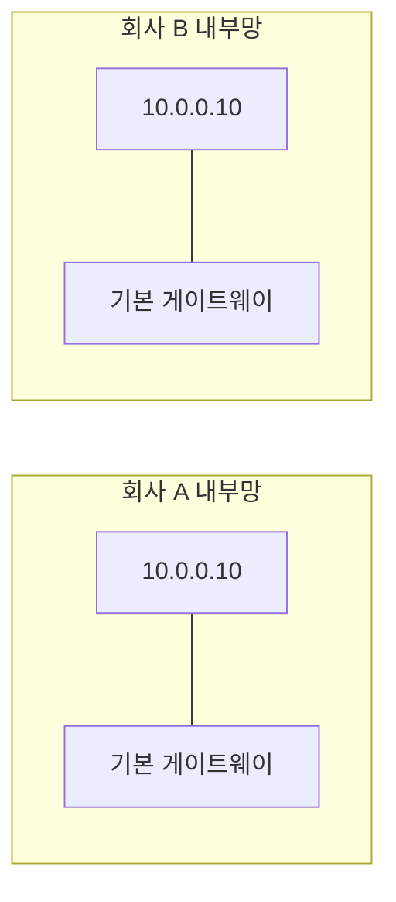
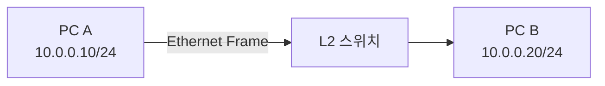
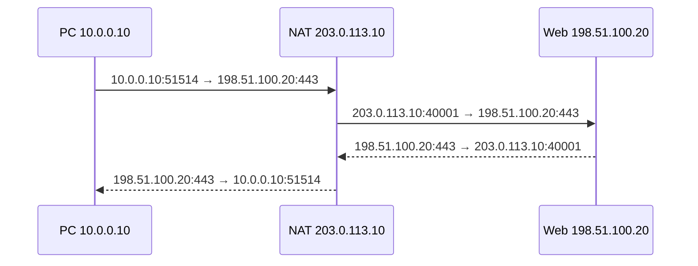

## 목차

- [[#1. 개요|1. 개요]]
- [[#2. 전역 고유성과 내부 고유성|2. 전역 고유성과 내부 고유성]]
- [[#3. 사설 IPv4 주소 범위|3. 사설 IPv4 주소 범위]]
- [[#4. 주소 할당과 인터넷 경로|4. 주소 할당과 인터넷 경로]]
- [[#5. 사설 주소의 로컬 통신|5. 사설 주소의 로컬 통신]]
- [[#6. 인터넷 통신과 NAT|6. 인터넷 통신과 NAT]]
- [[#7. VPN 연결과 중복 대역|7. VPN 연결과 중복 대역]]
- [[#8. 보안과 도달 가능성의 구분|8. 보안과 도달 가능성의 구분]]
- [[#9. 관련 문서|9. 관련 문서]]
- [[#10. 출처|10. 출처]]

## 1. 개요

공인 IP는 공용 인터넷에서 목적지를 구별할 수 있도록 전역적으로 조정되는 주소이고, 사설 IP는 조직 내부에서 중복 사용을 허용한 주소이다. `공인`은 안전하다는 뜻이 아니며 `사설`도 자동으로 보호된다는 뜻이 아니다. 두 용어는 주로 주소가 유일해야 하는 범위와 공용 인터넷 라우팅 가능성을 구분한다.

IPv4 사설 주소는 여러 조직이 별도 협의 없이 같은 값을 사용할 수 있다. 서로 연결되지 않은 두 회사가 모두 `10.0.0.10`을 사용해도 각 네트워크 안에서는 모순이 없다. 문제가 생기는 시점은 두 네트워크를 VPN·전용선 등으로 연결하여 하나의 라우팅 영역에서 두 주소를 동시에 구별해야 할 때이다.[^rfc1918]

## 2. 전역 고유성과 내부 고유성

주소는 통신 범위 안에서 목적지를 하나로 식별할 수 있어야 한다.



두 내부망이 분리되어 있으면 각 스위치와 라우터는 자기 영역의 `10.0.0.10`만 다루므로 충돌하지 않는다. 반면 공용 인터넷에서는 같은 목적지 주소가 서로 다른 두 조직을 동시에 가리킬 수 없기 때문에 전역적으로 고유한 주소와 경로가 필요하다.

## 3. 사설 IPv4 주소 범위

RFC 1918은 다음 세 블록을 사설 IPv4 용도로 예약한다.[^rfc1918]

| 주소 블록 | 범위 | 흔한 오기 |
|---|---|---|
| `10.0.0.0/8` | `10.0.0.0`–`10.255.255.255` | 전체 10번 대역이 하나의 실제 LAN이라는 뜻은 아님 |
| `172.16.0.0/12` | `172.16.0.0`–`172.31.255.255` | `172.168.0.0`은 사설 범위가 아님 | <!-- ip-check: allow -->
| `192.168.0.0/16` | `192.168.0.0`–`192.168.255.255` | 보통 더 작은 `/24` 등으로 나누어 사용 |

이 블록은 공용 인터넷에서 일반 목적지로 광고하지 않는다. `172.0.0.0/8` 전체가 사설인 것은 아니며 `172.16.0.0/12`만 해당한다. <!-- ip-check: allow -->

문서와 교육 예시에는 실제 시스템으로 오해되지 않도록 `192.0.2.0/24`, `198.51.100.0/24`, `203.0.113.0/24` 같은 문서용 주소를 사용하는 편이 안전하다.[^iana]

## 4. 주소 할당과 인터넷 경로

IANA는 최상위 주소 공간을 관리하고, 지역 인터넷 등록기관(RIR)에 큰 블록을 배분한다. RIR과 ISP·조직은 정책에 따라 더 작은 블록을 할당한다. 인터넷 라우터는 주소의 소유 조직 이름을 매 패킷마다 조회하지 않는다. [[BGP]]로 교환된 IP 프리픽스 경로와 라우팅 정책을 바탕으로 다음 홉을 선택한다.


공인 주소가 할당되어도 방화벽·라우팅·서비스 수신 설정이 없으면 인터넷에서 접속할 수 없다. 반대로 사설 주소는 공용 인터넷에서 직접 목적지로 쓰지 못하지만 NAT·Proxy·VPN 같은 경계 기능을 통해 외부 서비스와 통신할 수 있다.

## 5. 사설 주소의 로컬 통신

사설 주소끼리 통신하는 데 NAT가 반드시 필요한 것은 아니다. 같은 서브넷의 두 호스트는 자신의 마스크로 목적지가 로컬이라고 판단하고, [[ARP]]로 상대 MAC 주소를 알아내어 스위치를 통해 직접 통신한다.



서로 다른 사설 서브넷도 라우터가 양쪽 경로를 알고 있으면 NAT 없이 통신할 수 있다. NAT의 본질은 사설 주소를 사용 가능하게 만드는 것이 아니라, 서로 다른 주소 영역의 경계에서 패킷의 주소·포트를 변환하는 데 있다.

## 6. 인터넷 통신과 NAT

사설 주소는 공용 인터넷에서 전역적으로 의미가 없으므로 일반적인 IPv4 인터넷 접속에서는 경계 장비가 출발지 주소를 공인 주소로 변환한다.



NAT 장비는 변환 상태를 기억하여 응답을 원래 호스트로 돌려보낸다. 이 상태 관리와 포트 변환은 [[NAT]]에서 자세히 설명한다.

## 7. VPN 연결과 중복 대역

두 사설망을 VPN으로 연결하면 양쪽 경계 장비가 터널 종단이자 라우터 역할을 할 수 있다. 터널이 생겼다고 모든 호스트가 자동으로 상대 사이트를 찾아가는 것은 아니며, 양쪽 라우팅 테이블에 상대 프리픽스 경로가 필요하다.

두 사이트가 같은 대역을 사용하면 문제가 생긴다.

```text
사이트 A PC: 10.0.0.10/8
목적지:      10.20.30.40

PC의 판단: 목적지가 내 10.0.0.0/8 안에 있음
결과: VPN 게이트웨이가 아니라 로컬 네트워크에서 ARP 시도
```

호스트는 목적지가 로컬이라고 판단하면 기본 게이트웨이로 보내지 않는다. 경계 라우터까지 패킷이 오지 않으므로 BGP나 VPN 경로가 있어도 사용할 기회가 없다. 양쪽 네트워크의 주소가 겹치면 다음 방법을 검토한다.

- 한쪽 대역의 재주소 지정
- 더 구체적인 경로와 인터페이스 설계
- 경계에서 NAT를 이용한 주소 변환
- VRF·별도 라우팅 영역을 통한 격리

어떤 방법도 중복 주소가 사라진 것처럼 자동 해결하지는 않는다. 애플리케이션이 IP를 저장하는 방식, DNS와 방화벽 정책까지 함께 검토해야 한다.

## 8. 보안과 도달 가능성의 구분

- 사설 IP는 인터넷에서 직접 라우팅하지 않는 주소이며 방화벽을 대신하지 않는다.
- 공인 IP는 전역적으로 구분 가능한 주소이며 모든 포트가 열렸다는 뜻이 아니다.
- NAT는 주소 변환 기능이며 허용·차단 정책 전체를 의미하지 않는다.
- VPN은 떨어진 네트워크 사이에 보호된 경로를 만들지만 중복 주소와 내부 권한 문제를 자동으로 해결하지 않는다.

## 9. 관련 문서

- [[IP Address and Subnet|IP 주소와 서브넷]] · [[Default Gateway|기본 게이트웨이]] · [[ARP]]
- [[Router|라우터]] · [[Internet Routing|인터넷의 통신 구조]] · [[BGP]]
- [[NAT]] · [[Firewall]] · [[Security Group]]

## 10. 출처

[^rfc1918]: IETF, [RFC 1918, Address Allocation for Private Internets](https://www.rfc-editor.org/rfc/rfc1918.html). 사설 IPv4 블록, 내부 고유성, 공용 경로 광고 제한과 사설망 결합 시 주소 중복 문제.
[^iana]: IANA, [IPv4 Special-Purpose Address Space](https://www.iana.org/assignments/iana-ipv4-special-registry). 사설·문서용 등 특수 목적 IPv4 주소 등록 현황.

## 둘러보기

[[Knowledge Base/index|전체 개념 목록]] · [[Networking 분류|Networking]]
