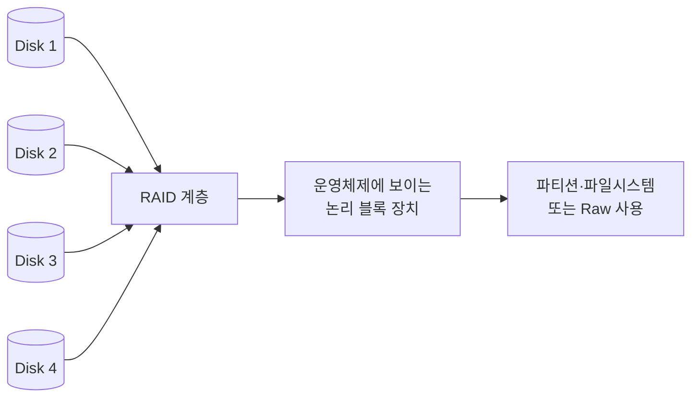

## 목차

- [[#1. 개요|1. 개요]]
- [[#2. 스트라이핑·미러링·패리티|2. 스트라이핑·미러링·패리티]]
- [[#3. 주요 RAID 수준|3. 주요 RAID 수준]]
- [[#4. 1TB 디스크 6개의 비교|4. 1TB 디스크 6개의 비교]]
- [[#5. 장애와 재구축|5. 장애와 재구축]]
- [[#6. RAID와 백업의 차이|6. RAID와 백업의 차이]]
- [[#7. 구현 위치|7. 구현 위치]]
- [[#8. 관련 문서|8. 관련 문서]]
- [[#9. 출처|9. 출처]]

## 1. 개요

RAID(Redundant Array of Independent Disks)는 여러 물리 디스크를 하나의 논리 장치로 묶어 용량·성능·디스크 장애 대응 능력을 조정하는 기술이다.

RAID 수준마다 세 요소의 균형이 다르다. 모든 용량을 사용하면서 어떤 디스크 장애도 견디고 쓰기 성능까지 손해 보지 않는 구성은 없으므로, 워크로드와 복구 전략에 맞춰 선택한다.



## 2. 스트라이핑·미러링·패리티

### 스트라이핑

스트라이핑(Striping)은 데이터를 여러 디스크에 나누어 기록한다.

```text
          Disk 1  Disk 2  Disk 3  Disk 4
첫 묶음      A       B       C       D
둘째 묶음    E       F       G       H
```

여러 디스크가 병렬로 작업하고 전체 용량을 활용할 수 있지만, 별도 중복 정보가 없으면 디스크 하나의 손실로 전체 데이터가 불완전해질 수 있다.

### 미러링

미러링(Mirroring)은 같은 데이터를 두 개 이상의 디스크에 기록한다.

```text
Disk 1          Disk 2
A B C D    =    A B C D
```

한 사본이 손상되어도 다른 사본으로 운영할 수 있지만 같은 데이터를 중복 저장하므로 사용 가능한 용량이 줄어든다.

### 패리티

패리티(Parity)는 원본 전체를 한 벌 더 복사하는 대신 손실된 조각을 계산할 수 있는 복구 정보를 저장한다. 단순화한 XOR 예는 다음과 같다.

```text
A XOR B XOR C = P
B = A XOR C XOR P
```

실제 RAID의 패리티 배치와 계산은 수준·구현에 따라 다르지만, 원본 데이터와 복구 정보를 여러 디스크에 분산한다는 원리를 이해하는 데 도움이 된다.

## 3. 주요 RAID 수준

| 수준 | 핵심 원리 | 이론 용량 | 일반적인 장애 허용 |
|---|---|---:|---|
| RAID 0 | 스트라이핑 | `N × S` | 없음 |
| RAID 1 | 미러링 | 미러 한 벌의 용량 | 다른 사본이 남는 범위 |
| RAID 5 | 스트라이핑 + 단일 패리티 | `(N-1) × S` | 디스크 1개 |
| RAID 6 | 스트라이핑 + 이중 패리티 | `(N-2) × S` | 디스크 2개 |
| RAID 10 | 미러 쌍을 스트라이핑 | `(N/2) × S` | 고장 난 디스크의 위치에 따라 다름 |

`N`은 디스크 수, `S`는 가장 작은 디스크의 용량이다. 실제 용량에는 RAID 메타데이터와 파일시스템 등의 오버헤드가 추가된다.

RAID 10은 서로 다른 미러 쌍에서 한 개씩 고장 나면 여러 디스크의 장애를 견딜 수 있지만, 같은 미러 쌍의 두 디스크를 모두 잃으면 실패한다.

## 4. 1TB 디스크 6개의 비교

| 구성 | 사용 가능 용량 | 장애 허용의 핵심 |
|---|---:|---|
| RAID 0 | 6TB | 하나만 고장 나도 전체 손상 가능 |
| 6중 RAID 1 | 1TB | 동일 사본이 하나 남는 범위에서 운영 가능 |
| RAID 5 | 5TB | 어떤 디스크든 1개 |
| RAID 6 | 4TB | 어떤 디스크든 2개 |
| RAID 10 | 3TB | 각 미러 쌍의 사본이 하나 이상 남아야 함 |

실무에서 디스크 6개를 모두 같은 RAID 1 사본으로 구성하는 경우는 드물다. 두 개씩 세 미러 쌍을 만들고 스트라이핑하는 RAID 10이나, 용량 효율을 높이는 RAID 5·6을 워크로드에 따라 검토한다.

## 5. 장애와 재구축

디스크가 고장 난 RAID는 중복 정보로 서비스를 계속할 수 있지만 보호 수준이 낮아진 상태이다. 교체 디스크에 데이터를 다시 만드는 작업을 재구축(Rebuild)이라고 한다.


재구축은 남은 디스크를 많이 읽고 쓰며, 그동안 성능 저하와 추가 장애 위험이 생길 수 있다. 디스크 용량이 크다고 재구축 시간이 단순 비례한다고 단정할 수는 없으며 실제 사용량·부하·컨트롤러·오류 상태가 영향을 준다.

## 6. RAID와 백업의 차이

RAID는 현재 데이터를 여러 디스크에 배치하여 **디스크 장애 중에도 서비스를 유지**하는 데 초점을 둔다. 백업은 별도 사본과 보존 이력으로 **과거의 정상 상태를 복구**하는 데 초점을 둔다.


RAID는 실수로 삭제한 파일, 랜섬웨어 암호화, 파일시스템 손상, 장비 전체의 고장, 화재·침수 같은 사이트 장애를 모두 해결하지 않는다.

> RAID는 가용성을 높이고, 백업은 데이터를 되돌릴 수 있게 한다.

## 7. 구현 위치

RAID는 전용 스토리지 컨트롤러, 운영체제 소프트웨어, 스토리지 어레이 등 여러 계층에서 구현될 수 있다. Linux의 `md` 드라이버는 여러 장치에 RAID 메타데이터를 기록하고 가상 `md` 블록 장치로 조립한다.[^md]

하드웨어 RAID 위에 ZFS·Ceph처럼 자체 데이터 배치와 보호를 수행하는 시스템을 무조건 겹치는 것은 적절하지 않을 수 있다. 각 계층이 디스크 오류와 쓰기 완료를 어떻게 처리하는지 제품의 지원 구성을 확인한다.

## 8. 관련 문서

- [[Disk|디스크]]
- [[Block Storage|블록 스토리지]]
- [[Storage|스토리지]]
- [[Filesystem|파일시스템]]

## 9. 출처

[^md]: [Linux Kernel Documentation — RAID arrays](https://docs.kernel.org/admin-guide/md.html)

## 둘러보기

[[Knowledge Base/index|전체 개념 목록]] · [[Storage 분류|Storage]]
