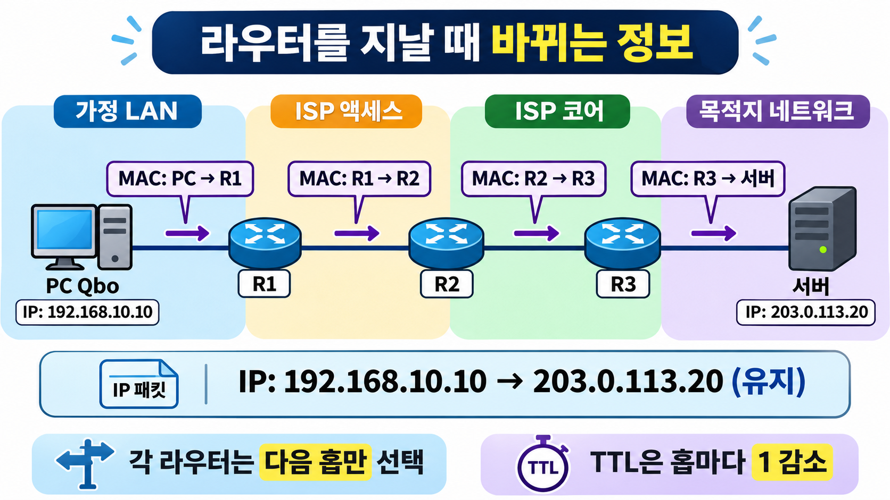

## 목차

- [[#1. 개요|1. 개요]]
- [[#2. 실제 장비의 모습과 내부 구성|2. 실제 장비의 모습과 내부 구성]]
- [[#3. 패킷 전달 과정|3. 패킷 전달 과정]]
- [[#4. 라우팅 테이블과 다음 홉|4. 라우팅 테이블과 다음 홉]]
- [[#5. 기본 게이트웨이와 라우터의 관계|5. 기본 게이트웨이와 라우터의 관계]]
- [[#6. 라우터의 역할별 구분|6. 라우터의 역할별 구분]]
- [[#7. 가정용 공유기와 기업용 장비|7. 가정용 공유기와 기업용 장비]]
- [[#8. 가상 라우터|8. 가상 라우터]]
- [[#9. 관련 문서|9. 관련 문서]]
- [[#10. 출처|10. 출처]]

## 1. 개요

Router(라우터)는 목적지 IP 주소와 라우팅 테이블을 바탕으로 서로 다른 IP 네트워크 사이에 패킷을 전달하는 장비 또는 소프트웨어이다.

스위치가 같은 L2 네트워크 안에서 MAC 주소를 보고 프레임을 전달한다면, 라우터는 IP 프리픽스를 보고 다음 네트워크를 선택한다. 라우터가 목적지까지의 전체 물리 경로를 한 번에 제어하는 것은 아니다. 각 라우터가 자신이 맡은 한 구간의 다음 홉을 선택하면서 패킷이 이어진다.

## 2. 실제 장비의 모습과 내부 구성


기업용 라우터는 여러 종류의 WAN·LAN 인터페이스, 전원, 냉각 장치와 관리 포트를 갖춘다. 사진: Maraguache, [Wikimedia Commons 원본](https://commons.wikimedia.org/wiki/File:Router_Cisco_1900_series.jpg), [CC BY-SA 4.0](https://creativecommons.org/licenses/by-sa/4.0/). 추가 편집 없이 사용했다.


소형 무선 라우터의 내부 모습이다. 중앙의 시스템 반도체와 메모리·플래시 메모리·Ethernet 포트 회로가 한 기판에 배치되어 있다. 기업용 라우터는 전용 Forwarding Engine, 교체형 Line Card, 더 큰 메모리와 이중화 전원 등을 갖출 수 있어 구성이 훨씬 크지만, 프로세서·메모리·인터페이스가 함께 동작한다는 기본 원리는 같다. 사진: Malcolm Koo(Mk2010), [Wikimedia Commons 원본](https://commons.wikimedia.org/wiki/File:Wireless_router,_internal_components_(LevelOne_WBR-6002).jpg), [CC BY 4.0](https://creativecommons.org/licenses/by/4.0/). 추가 편집 없이 사용했다.

라우터 역시 특수 목적의 컴퓨터이다.

- **인터페이스와 PHY**: Ethernet·광회선 등의 신호를 송수신한다.
- **ASIC·NPU·Forwarding Engine**: 경로 조회와 패킷 전달을 빠르게 처리한다.
- **TCAM·고속 메모리**: 많은 프리픽스와 정책을 병렬로 조회하는 데 사용될 수 있다.
- **CPU·RAM·운영체제**: BGP·OSPF 같은 라우팅 프로토콜, 설정, 로그와 관리 기능을 수행한다.
- **패킷 버퍼와 스위칭 패브릭**: 입력 인터페이스에서 출력 인터페이스로 패킷을 옮긴다.

제어 평면은 경로를 배우고 최적 경로를 정하며, 데이터 평면은 그 결과를 이용해 실제 패킷을 빠르게 전달한다.

## 3. 패킷 전달 과정

라우터를 지날 때 IP 패킷은 유지되지만 Ethernet 프레임은 링크마다 새로 만들어진다. NAT가 없다면 출발지·목적지 IP는 종단 간 유지되고, 출발지·목적지 MAC 주소는 각 구간의 장비에 맞게 바뀐다.



일반적인 처리 순서는 다음과 같다.[^rfc1812]

1. 인터페이스가 프레임을 받고 자신에게 전달된 L2 헤더를 확인한다.
2. 프레임에서 IP 패킷을 꺼내 목적지 IP 주소를 확인한다.
3. 라우팅 테이블에서 가장 구체적으로 일치하는 프리픽스를 찾는다.
4. TTL을 1 줄이고, 0이 되면 패킷을 폐기한다.
5. 선택된 출력 인터페이스와 다음 홉에 맞는 새 L2 프레임을 만든다.
6. 다음 링크로 전송한다.

MAC 주소를 바꾸기 때문에 라우팅하는 것이 아니다. 링크마다 새 프레임이 필요하므로 다음 홉의 MAC 주소를 사용한다. 라우팅 판단의 기준은 목적지 IP와 경로표이다.

## 4. 라우팅 테이블과 다음 홉

라우팅 테이블은 “어떤 목적지 프리픽스는 어느 인터페이스와 다음 홉으로 보낼 것인가”를 기록한다.

```text
192.0.2.0/24   → 직접 연결
203.0.113.0/24 → 192.0.2.2
0.0.0.0/0      → 192.0.2.1
```

목적지가 `203.0.113.20`이면 `/24` 경로가 기본 경로 `/0`보다 구체적이므로 선택된다. 이를 최장 프리픽스 일치(Longest Prefix Match)라고 한다. 라우터는 Google 서버까지 이어진 모든 장비의 MAC 주소를 알 필요가 없다. 현재 링크에서 바로 넘길 다음 홉만 알면 된다.

경로는 다음과 같이 만들어질 수 있다.

- 인터페이스를 설정하면 생기는 직접 연결 경로
- 관리자가 지정하는 정적 경로와 기본 경로
- [[IGP]]인 [[OSPF]]·[[IS-IS]] 같은 내부 라우팅 프로토콜로 배운 경로
- [[BGP]]로 다른 AS에서 배운 인터넷 프리픽스

## 5. 기본 게이트웨이와 라우터의 관계

Default Gateway(기본 게이트웨이)는 장비 이름이 아니라 호스트가 자신의 로컬 네트워크 밖으로 보낼 때 선택하는 첫 번째 L3 다음 홉이다. 그 역할을 라우터, L3 스위치, 방화벽 또는 가상 어플라이언스가 맡을 수 있다.

PC 한 대를 라우터에 직접 연결해도 두 인터페이스의 주소·서브넷·경로가 맞으면 통신할 수 있다. 스위치는 여러 장치를 효율적으로 연결하고 VLAN을 구성해야 할 때 필요하다.

## 6. 라우터의 역할별 구분

라우터는 모두 IP 패킷을 전달하지만 설치 위치와 책임이 다르다.

- **가정용 공유기·CPE**: 가입자 네트워크와 통신 사업자 회선을 연결한다.
- **가입자 수용 장비·BNG**: 많은 가입자의 접속·주소·정책을 관리한다.
- **집선 라우터**: 여러 액세스 구간의 트래픽을 모은다.
- **코어 라우터**: 사업자 [[Backbone Network|백본]] 안에서 대용량 트래픽을 빠르게 전달한다.
- **PE·인터넷 경계 라우터**: 고객망, 다른 AS, [[IXP Peering and Transit|IXP·피어링·트랜짓]]과 연결한다.
- **가상 라우터**: VM·네임스페이스·클라우드 네트워크에서 같은 기능을 소프트웨어로 수행한다.

IXP나 트랜짓은 라우터 종류가 아니다. IXP는 여러 사업자가 만나는 상호접속 기반 시설이고, Transit은 다른 네트워크까지 도달할 수 있게 경로와 운송을 제공하는 서비스이다.

## 7. 가정용 공유기와 기업용 장비

가정용 공유기 한 대에는 라우터, L2 스위치, Wi-Fi AP, NAT, 방화벽과 DHCP 서버가 함께 들어가는 경우가 많다. 그래서 “라우터가 Wi-Fi를 제공한다”거나 “라우터가 NAT를 한다”는 표현이 익숙하다.

그러나 라우팅·NAT·방화벽은 서로 다른 기능이다. 기업망에서는 성능, 장애 범위, 보안 정책과 운영 책임을 나누기 위해 별도 장비나 별도 가상 어플라이언스로 배치할 수 있다. 반대로 소규모 환경에서는 한 장비에 통합하는 편이 단순하고 경제적일 수 있다.

## 8. 가상 라우터

가상 라우터는 일반 서버의 CPU와 가상 NIC를 사용하여 라우팅 기능을 수행한다. Linux network namespace, FRRouting, 클라우드 VPC 라우터, 가상 방화벽 등이 사례이다. 물리 장비가 사라지는 것은 아니다. 가상 패킷은 결국 하이퍼바이저, 물리 NIC와 물리 스위치를 지나 다른 호스트나 외부망으로 나간다.

전용 ASIC을 쓰는 장비는 매우 높은 처리량과 예측 가능한 전달에 유리하고, 소프트웨어 라우터는 배포와 변경이 유연하다. 실제 선택은 처리량, 지연, 기능, 고가용성, 자동화와 비용을 함께 비교한다.

## 9. 관련 문서

- [[Switch|스위치]] · [[Internet Routing|인터넷의 통신 구조]] · [[BGP]]
- [[IGP]] · [[OSPF]] · [[IS-IS]]
- [[IXP Peering and Transit|IXP·피어링·트랜짓]] · [[Backbone Network|백본 네트워크]]
- [[Networking]] · [[NIC]]

## 10. 출처

[^rfc1812]: IETF, [RFC 1812 — Requirements for IP Version 4 Routers](https://www.rfc-editor.org/rfc/rfc1812.html). IPv4 라우터의 전달 처리와 TTL 등 기본 요구사항.

- Cisco, [Catalyst 8300 Series Edge Platforms Data Sheet](https://www.cisco.com/c/en/us/products/collateral/routers/catalyst-8300-series-edge-platforms/datasheet-c78-744088.pdf). 기업용 라우터의 실제 하드웨어와 인터페이스 사례.
- Cisco, [Broadband Network Gateway Overview](https://www.cisco.com/c/en/us/td/docs/routers/asr9000/software/711x/bng/configuration/guide/b-bng-cg-asr9000-711x/bng-overview.html). BNG의 가입자 수용 역할.

## 둘러보기

[[Knowledge Base/index|전체 개념 목록]] · [[Networking 분류|Networking]]
