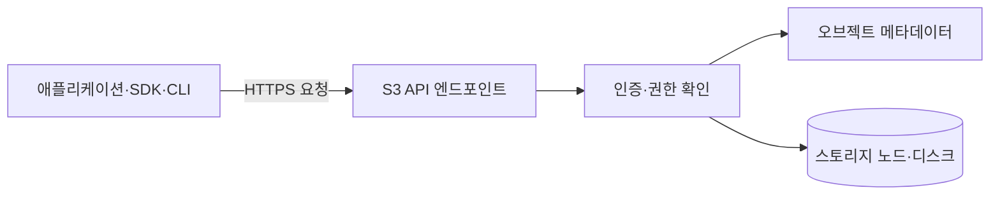
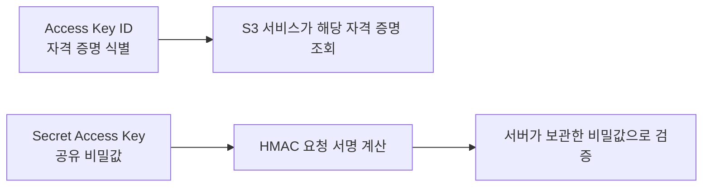
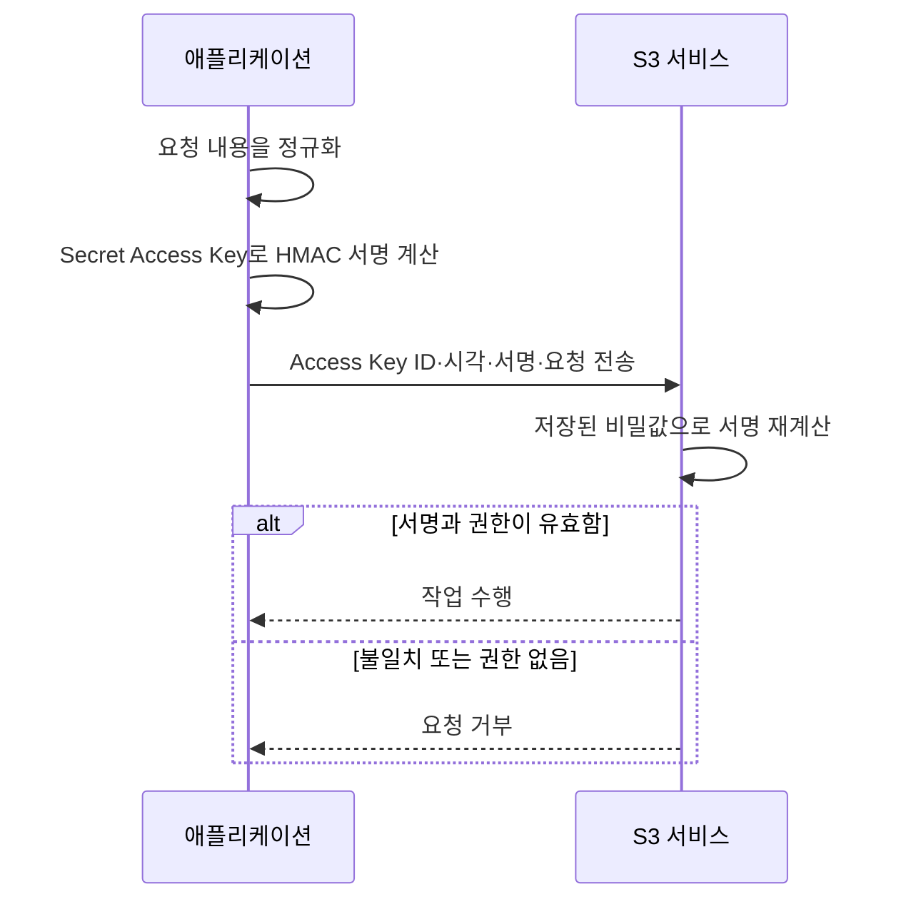
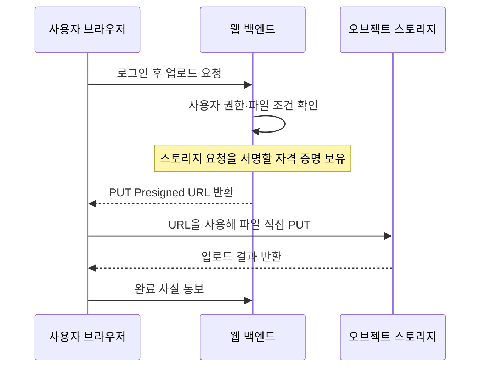
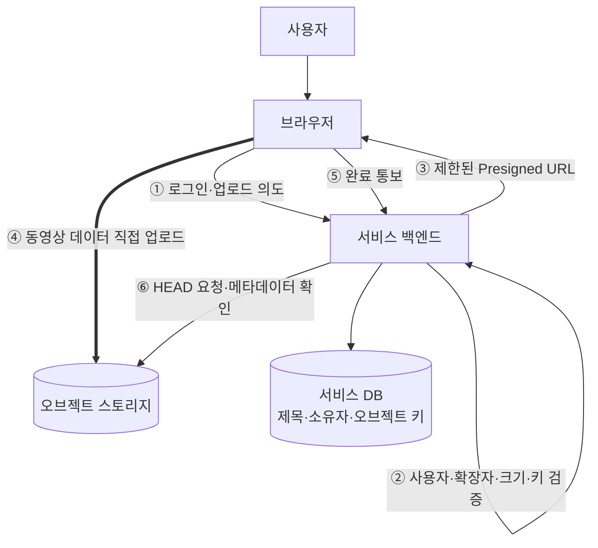
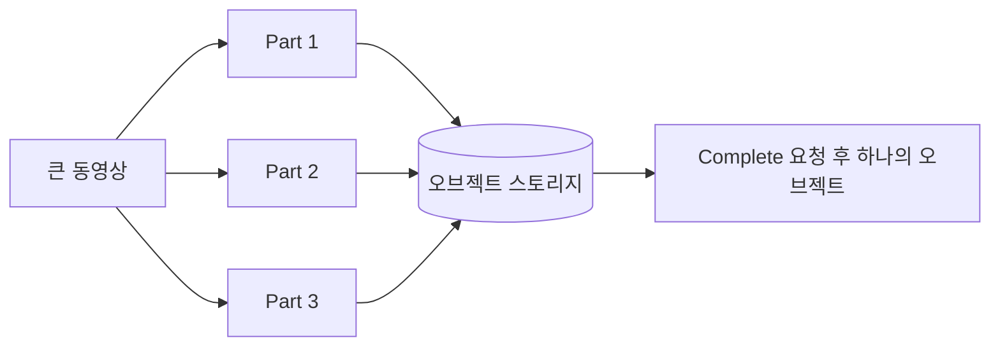

## 목차

- [[#1. 개요|1. 개요]]
- [[#2. 요청 구성 요소|2. 요청 구성 요소]]
- [[#3. 주요 작업|3. 주요 작업]]
- [[#4. Access Key ID와 Secret Access Key|4. Access Key ID와 Secret Access Key]]
- [[#5. 요청 서명의 원리|5. 요청 서명의 원리]]
- [[#6. 자격 증명의 발급과 보관|6. 자격 증명의 발급과 보관]]
- [[#7. Presigned URL|7. Presigned URL]]
- [[#8. 동영상 직접 업로드 구조|8. 동영상 직접 업로드 구조]]
- [[#9. 대용량 파일과 Multipart Upload|9. 대용량 파일과 Multipart Upload]]
- [[#10. 접근 통제의 계층|10. 접근 통제의 계층]]
- [[#11. S3 호환 스토리지|11. S3 호환 스토리지]]
- [[#12. 관련 문서|12. 관련 문서]]
- [[#13. 출처|13. 출처]]

## 1. 개요

S3 API는 오브젝트 스토리지에 데이터를 저장하고 조회하기 위해 널리 사용하는 HTTP 기반 인터페이스이다. 사용자는 디스크를 마운트하여 블록을 쓰는 대신, 엔드포인트에 버킷과 오브젝트 키를 지정하여 요청을 보낸다.

오브젝트 스토리지 내부도 결국 HDD나 SSD를 사용한다. 다만 사용자가 보는 것은 파일시스템이나 블록 장치가 아니라 API이다. 스토리지 소프트웨어가 요청을 해석하여 오브젝트의 위치, 복제, 무결성과 메타데이터를 관리한다.

## 2. 요청 구성 요소

| 요소 | 의미 | 예시 |
|---|---|---|
| Endpoint | API 요청을 받는 주소 | `https://objects.example.com` |
| Bucket | 오브젝트를 묶는 논리 공간 | `user-videos` |
| Key | 버킷 안에서 오브젝트를 식별하는 문자열 | `users/42/video.mp4` |
| Method | 수행할 작업 | `PUT`, `GET`, `HEAD`, `DELETE` |
| Header | 인증·콘텐츠 형식·조건 등 요청 정보 | `Content-Type: video/mp4` |
| Body | 업로드할 실제 데이터 | 동영상 바이트 |

키에 `/`가 들어가도 반드시 실제 디렉터리가 존재하는 것은 아니다. `users/42/`는 키의 접두사(prefix)이며, 관리 화면이 이를 폴더처럼 보여 줄 수 있다.

## 3. 주요 작업

| 작업 | 의미 |
|---|---|
| `PUT Object` | 오브젝트 저장 또는 같은 키의 오브젝트 교체 |
| `GET Object` | 오브젝트 내용 조회 |
| `HEAD Object` | 본문을 받지 않고 크기·형식·메타데이터 확인 |
| `DELETE Object` | 오브젝트 삭제 요청 |
| `ListObjectsV2` | 버킷의 키 목록 조회 |
| Multipart Upload | 큰 오브젝트를 여러 조각으로 나누어 업로드 |

일반적인 오브젝트 API는 파일의 중간 일부를 현장에서 직접 고치는 방식보다, 새 오브젝트를 쓰거나 같은 키로 교체하는 방식에 가깝다. 버전 관리가 활성화되어 있으면 이전 버전이 보존될 수 있다.

## 4. Access Key ID와 Secret Access Key

S3 API의 장기 자격 증명은 흔히 다음 두 값을 한 쌍으로 사용한다.

- **Access Key ID**: 어떤 자격 증명으로 요청했는지 스토리지에 알려 주는 식별자
- **Secret Access Key**: 요청 서명을 계산하는 데 사용하는 비밀값

Access Key ID는 공개키가 아니며 Secret Access Key는 개인키가 아니다. 두 값은 공개키 암호의 키 쌍이 아니라, 계정 이름과 매우 강한 비밀번호에 가까운 **식별자와 공유 비밀값**이다.

TLS 인증서에서 사용하는 공개키·개인키와 다른 체계라는 점이 중요하다. S3 Signature Version 4는 Secret Access Key에서 파생한 키와 HMAC을 사용하여 요청 서명을 만든다.[^1]

## 5. 요청 서명의 원리

클라이언트는 Secret Access Key 자체를 매 요청마다 서버에 보내지 않는다. 요청의 메서드, 경로, 헤더, 본문 해시와 시각 등을 정해진 형식으로 묶고, 비밀값을 이용해 서명을 계산한다.

서버는 같은 규칙과 비밀값으로 서명을 다시 계산한다. 결과가 일치하면 비밀값을 아는 주체가 요청을 만들었고, 서명 후 요청 내용이 바뀌지 않았음을 확인할 수 있다. 그다음 별도의 권한 정책을 확인한다.

> [!note] 대칭키와의 관계
> 양쪽이 같은 비밀값을 바탕으로 HMAC을 계산하므로 넓게 보면 공유 비밀 방식이다. 그러나 이 비밀값으로 동영상 본문을 암호화하는 것은 아니다. 전송 중 데이터 보호는 일반적으로 [[TLS]]가 담당한다.

## 6. 자격 증명의 발급과 보관

Secret Access Key는 자격 증명을 생성할 때 안전한 관리 화면이나 API를 통해 발급된다. 서비스가 매 요청마다 비밀값을 다시 보내 주는 구조가 아니다. 제품에 따라 생성 직후에만 전체 값을 확인할 수 있으므로 안전한 비밀 저장소에 보관해야 한다.

다음 위치에는 장기 Secret Access Key를 두지 않는 것이 원칙이다.

- 브라우저 JavaScript와 모바일 앱 배포 파일
- 공개 저장소와 일반 설정 파일
- 로그, 메신저와 문서 화면
- 컨테이너 이미지에 직접 포함한 환경 파일

클라우드 환경에서는 가능하면 역할 기반의 단기 자격 증명이나 워크로드 신원을 사용한다. 불가피하게 장기 키를 쓰면 최소 권한, 주기적인 교체, 사용 기록 확인과 즉시 폐기 절차가 필요하다.

## 7. Presigned URL

Presigned URL은 비밀키를 가진 백엔드가 특정 S3 요청에 미리 서명하여 만든 **기간 제한 위임 URL**이다. 브라우저는 Secret Access Key를 받지 않고도 정해진 오브젝트와 작업을 제한된 시간 동안 수행할 수 있다.[^2]

Presigned URL에는 일반적으로 작업, 버킷, 키, 만료 시각과 서명이 반영된다. URL을 받은 사람은 만료 전까지 허용된 작업을 수행할 수 있으므로 주소 자체를 민감하게 다루어야 한다.

로그인 세션의 유효 시간과 Presigned URL의 만료 시간은 별개이다. 백엔드는 사용자를 인증한 뒤 짧은 만료 시간과 제한된 대상의 URL을 발급해야 한다.

## 8. 동영상 직접 업로드 구조

동영상 공유 서비스에서 모든 파일을 웹 서버가 받아 다시 스토리지로 보내면 웹 서버의 네트워크와 처리 자원이 이중으로 사용된다. Presigned URL을 사용하면 제어 요청은 백엔드가 처리하고, 실제 데이터는 브라우저가 오브젝트 스토리지로 직접 보낼 수 있다.

사용자는 웹사이트를 통해 업로드하지만 Secret Access Key를 소유하지 않는다. 사용자가 받는 것은 한정된 권한을 담은 서명 URL이다. 백엔드는 파일의 실제 바이트를 중계하지 않아도 누가 어떤 키에 업로드할지 통제할 수 있다.

브라우저 직접 업로드에서는 오브젝트 스토리지의 CORS 설정도 필요할 수 있다. 업로드 완료 통보만 신뢰하지 말고, 백엔드가 `HEAD Object`나 이벤트를 통해 실제 객체와 크기를 확인하는 편이 안전하다.

## 9. 대용량 파일과 Multipart Upload

Multipart Upload는 큰 오브젝트를 여러 부분으로 나누어 병렬 또는 재시도 가능한 형태로 전송하는 방식이다.[^3]

일부 조각 전송에 실패해도 전체 파일을 처음부터 다시 보낼 필요가 없다는 장점이 있다. 백엔드는 업로드를 시작하고 각 Part에 서명된 요청을 발급한 뒤, 모든 Part가 전송되면 완료 요청을 수행하도록 설계할 수 있다. 중단된 Multipart Upload는 저장 공간을 계속 사용할 수 있으므로 수명 주기 정책이나 정리 작업도 필요하다.

## 10. 접근 통제의 계층

S3 접근은 한 가지 설정만으로 결정되지 않는다.

1. **네트워크 접근성**: 엔드포인트에 도달할 수 있는가
2. **전송 보호**: HTTPS로 통신하는가
3. **신원 확인**: 어떤 자격 증명으로 요청했는가
4. **권한 정책**: 해당 주체가 버킷과 키에 그 작업을 할 수 있는가
5. **데이터 보호**: 암호화, 버전 관리, Object Lock과 복제 정책이 있는가

[[Security Group]] 같은 네트워크 정책은 엔드포인트 접근을 제한할 수 있지만, S3 사용자와 오브젝트 권한을 대신하지는 않는다.

## 11. S3 호환 스토리지

S3 API는 AWS 밖의 여러 오브젝트 스토리지에서도 호환 인터페이스로 제공된다.

- **Zadara NGOS·ZIOS**: S3 호환 API를 제공하는 Zadara의 오브젝트 스토리지 계열이다.[^4]
- **NetApp StorageGRID**: 분산 오브젝트 스토리지 제품으로 S3 API를 제공한다.[^5]
- **NetApp ONTAP S3**: ONTAP에서 S3 오브젝트 접근을 제공하는 기능이다.[^6]

NetApp은 회사 이름이며 모든 NetApp 제품이 오브젝트 스토리지인 것은 아니다. 또한 “S3 호환”은 핵심 API와 도구를 사용할 수 있다는 뜻이지 AWS S3의 모든 기능과 동작이 완전히 같다는 보장은 아니다. 사용하려는 서명 방식, 버전 관리, 수명 주기, Object Lock과 SDK 기능을 제품 문서에서 확인해야 한다.

## 12. 관련 문서

- [[Object Storage|오브젝트 스토리지]]
- [[NGOS]]
- [[ZIOS]]
- [[TLS]]
- [[Digital Signature and Certificate|전자서명과 인증서]]

## 13. 출처

[^1]: AWS, [Authenticating Requests (AWS Signature Version 4)](https://docs.aws.amazon.com/AmazonS3/latest/developerguide/sig-v4-authenticating-requests.html)
[^2]: AWS, [Download and upload objects with presigned URLs](https://docs.aws.amazon.com/AmazonS3/latest/userguide/using-presigned-url.html)
[^3]: AWS, [Uploading and copying objects using multipart upload](https://docs.aws.amazon.com/AmazonS3/latest/userguide/mpuoverview.html)
[^4]: Zadara, [NextGen Object Storage User Guide](https://guides.zadarastorage.com/ngos-guide/latest/)
[^5]: NetApp, [StorageGRID documentation — Primer](https://docs.netapp.com/us-en/storagegrid-119/primer/)
[^6]: NetApp, [ONTAP version support for S3 object storage](https://docs.netapp.com/us-en/ontap/s3-config/ontap-version-support-s3-concept.html)

## 둘러보기

[[Storage 분류|← Storage 분류]] · [[Knowledge Base/index|Knowledge Base]]

