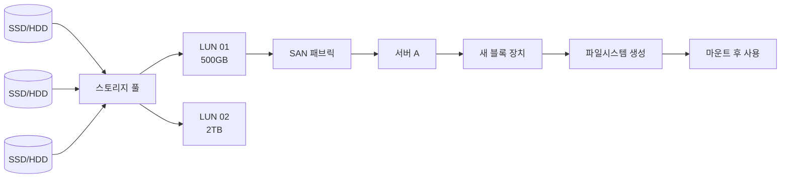
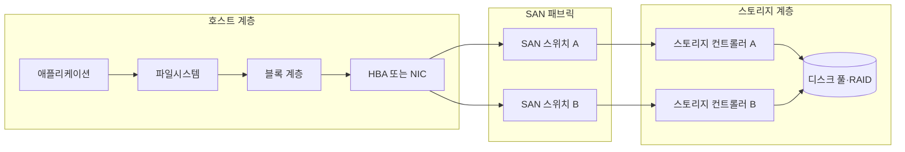
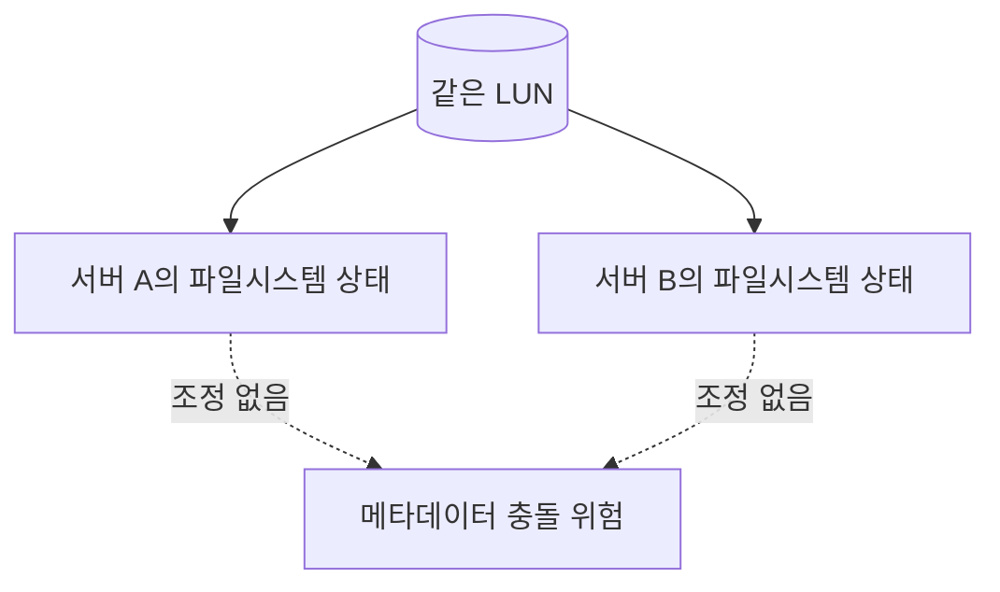

## 목차

- [[#1. 개요|1. 개요]]
- [[#2. 저장 공간의 제공 과정|2. 저장 공간의 제공 과정]]
- [[#3. SAN을 구성하는 계층|3. SAN을 구성하는 계층]]
- [[#4. LUN의 의미|4. LUN의 의미]]
- [[#5. Fibre Channel과 iSCSI|5. Fibre Channel과 iSCSI]]
- [[#6. 여러 서버의 동시 접근|6. 여러 서버의 동시 접근]]
- [[#7. SAN과 NAS의 차이|7. SAN과 NAS의 차이]]
- [[#8. 관련 문서|8. 관련 문서]]
- [[#9. 출처|9. 출처]]

## 1. 개요

SAN(Storage Area Network)은 서버와 스토리지 사이에서 **블록 저장 공간을 전달하도록 구성한 전용 네트워크와 운영 체계**이다. 단일 장비의 이름이 아니라 스토리지 배열, 스위치, 호스트 연결 장치, 경로와 접근 정책을 함께 가리키는 말에 가깝다.[^1]

서버는 SAN에서 받은 공간을 공유 폴더가 아니라 새 디스크와 같은 블록 장치로 인식한다. 이후 파티션과 파일시스템을 만들고 마운트하는 일은 일반적으로 서버 운영체제가 맡는다.

위 사진은 2006년에 촬영된 스토리지 배열의 한 사례이다. 전면의 여러 디스크 베이는 볼 수 있지만 SAN 전체를 찍은 사진은 아니다. 실제 SAN에는 이 장비와 서버를 잇는 스위치·HBA·케이블과 관리 구성이 더해진다. 사진: Dylan, [Wikimedia Commons 원본](https://commons.wikimedia.org/wiki/File:EqualLogic_PS100E_PeerStorage_Array_(157832701).jpg), [CC BY 2.0](https://creativecommons.org/licenses/by/2.0/). Commons의 편집된 판본을 추가 편집 없이 사용했다.

> [!tip] 쉽게 설명하면
> NAS가 “정리된 서류함을 네트워크로 빌려주는 방식”이라면, SAN은 “아직 서류철을 만들지 않은 빈 디스크를 네트워크로 빌려주는 방식”에 가깝다.

## 2. 저장 공간의 제공 과정

스토리지 관리자는 여러 물리 디스크를 풀로 묶고, 그 안에서 서버에 제공할 논리 공간을 만든다. 서버는 이 공간의 실제 디스크 위치를 알 필요가 없다.

이 과정에서 용량 제공, 경로 연결, 호스트 허용은 스토리지와 SAN에서 수행한다. 파일 이름과 디렉터리를 관리하는 파일시스템은 호스트 쪽에 놓이는 경우가 일반적이다.

## 3. SAN을 구성하는 계층

- **호스트 계층**은 블록 요청을 만들고 파일시스템을 관리한다.
- **패브릭 계층**은 서버와 스토리지 사이의 여러 경로를 연결한다.
- **스토리지 계층**은 논리 볼륨, RAID, 캐시와 실제 디스크를 관리한다.

Fibre Channel SAN에서는 서버의 HBA(Host Bus Adapter)와 전용 스위치를 자주 사용한다. IP SAN에서는 일반 이더넷 NIC와 스위치를 통해 [[iSCSI]] 같은 프로토콜을 사용할 수 있다.

## 4. LUN의 의미

LUN은 본래 SCSI의 **Logical Unit Number**, 즉 논리 장치를 식별하는 번호이다. 다만 운영 현장에서는 서버에 제공한 논리 디스크 자체를 “LUN”이라고 부르는 경우가 많다.[^2]

스토리지에서 500GB LUN을 서버 A에 연결하면, 서버 A는 대체로 이를 새로운 블록 장치로 본다. LUN 안의 파일 이름까지 스토리지가 정해 주는 것은 아니다. 서버가 파일시스템을 구성하면 그때부터 파일과 디렉터리가 생긴다.

접근 제어에는 보통 다음 두 범주가 사용된다.

- **Zoning**: SAN 패브릭에서 어떤 포트와 장치가 서로 통신할 수 있는지 제한
- **LUN Masking**: 스토리지에서 어떤 호스트가 특정 LUN을 볼 수 있는지 제한

## 5. Fibre Channel과 iSCSI

| 구분 | Fibre Channel SAN | IP SAN·iSCSI |
|---|---|---|
| 운반망 | Fibre Channel 패브릭 | Ethernet과 IP 네트워크 |
| 호스트 연결 | 주로 FC HBA | NIC 또는 iSCSI 전용 어댑터 |
| 전달 내용 | SCSI 계열 블록 명령 | TCP/IP에 실은 SCSI 명령 |
| 특징 | 전용성과 예측 가능한 운영 | 익숙한 IP 기술 활용 |

둘은 운반 방식이 다르지만, 호스트가 원격 공간을 블록 장치로 다룬다는 점은 같다. [[iSCSI]]는 SAN을 구현하는 여러 방법 가운데 하나이다.

## 6. 여러 서버의 동시 접근

하나의 LUN을 여러 서버에 연결할 수 있다는 사실과, 여러 서버가 그 안의 일반 파일시스템을 안전하게 동시에 쓸 수 있다는 말은 다르다.

각 서버가 ext4·XFS·NTFS 같은 일반 파일시스템을 독립적으로 관리하면 서로의 캐시와 변경 상태를 알지 못해 데이터가 손상될 수 있다. 다중 호스트 쓰기가 필요하면 클러스터 파일시스템, 분산 잠금 또는 애플리케이션 수준의 조정이 필요하다.

## 7. SAN과 NAS의 차이

| 질문 | SAN | NAS |
|---|---|---|
| 서버에 무엇이 보이는가 | 디스크와 같은 블록 장치 | 공유 폴더와 파일 |
| 파일시스템의 주 관리 위치 | 호스트 | NAS 서버 |
| 대표 기술 | Fibre Channel, iSCSI | NFS, SMB |
| 여러 사용자의 파일 공유 | 별도 조정 필요 | 본래 목적에 포함 |

SAN은 “스토리지 전용 네트워크”, NAS는 “파일 서비스를 제공하는 장비 또는 시스템”이라는 차이도 중요하다. 하나의 제품이 블록과 파일 서비스를 모두 제공할 수 있으므로 제품 이름보다 **호스트에 어떤 인터페이스를 제공하는지**를 기준으로 판단해야 한다.[^3]

## 8. 관련 문서

- [[Block Storage|블록 스토리지]]
- [[iSCSI]]
- [[NAS]]
- [[RAID]]
- [[Linux Block Layer]]

## 9. 출처

[^1]: IBM, [What is a storage area network (SAN)?](https://www.ibm.com/think/topics/storage-area-network)
[^2]: SNIA, [Storage Networking Industry Dictionary — LUN](https://www.snia.org/education/online-dictionary/term/lun)
[^3]: IBM, [SAN vs. NAS](https://www.ibm.com/think/topics/san-vs-nas)

## 둘러보기

[[Storage 분류|← Storage 분류]] · [[Knowledge Base/index|Knowledge Base]]

