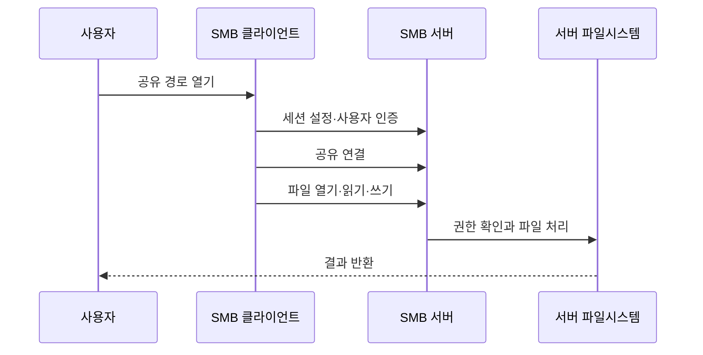

## 목차

- [[#1. 개요|1. 개요]]
- [[#2. 공유 폴더 접근 과정|2. 공유 폴더 접근 과정]]
- [[#3. 사용자와 권한|3. 사용자와 권한]]
- [[#4. 파일 서비스 기능|4. 파일 서비스 기능]]
- [[#5. NFS와의 비교|5. NFS와의 비교]]
- [[#6. 관련 문서|6. 관련 문서]]
- [[#7. 출처|7. 출처]]

## 1. 개요

SMB(Server Message Block)는 네트워크에서 파일, 디렉터리와 프린터 같은 자원을 공유하기 위한 프로토콜이다. Windows의 공유 폴더와 네트워크 드라이브에서 널리 사용되며, Linux도 Samba나 커널 클라이언트를 통해 SMB를 사용할 수 있다.[^1]

`\\fileserver\project`와 같은 UNC 경로는 SMB 공유의 대표적인 표현이다. 이를 드라이브 문자에 연결할 수 있지만, 실제 데이터는 원격 파일 서버에 있다.

## 2. 공유 폴더 접근 과정

클라이언트는 먼저 서버와 세션을 만들고 사용자를 인증한다. 이후 특정 공유에 연결하여 파일 작업을 요청한다. 블록 번호와 파일시스템 구조는 서버가 관리한다.

## 3. 사용자와 권한

SMB는 Windows 계정 체계와 자연스럽게 결합한다. Active Directory 환경에서는 사용자와 그룹의 SID, 공유 권한과 파일시스템 ACL을 함께 사용한다.

공유 권한과 파일 권한을 모두 적용하면 실제 허용 범위는 두 정책의 결합으로 결정된다. 따라서 “공유에는 접근되지만 파일은 열리지 않는” 상황도 생길 수 있다.

### 공유 폴더를 읽는 웹 서비스의 권한

Linux 웹 서버는 SMB 공유를 읽기 전용으로 마운트하고 그 경로의 파일을 HTTP로 제공할 수 있다. Windows 서버의 공유 권한과 NTFS 권한을 통과해 마운트에 성공한 뒤에도, Linux에서는 프로세스의 파일 접근 권한과 SELinux 정책이 적용된다.

RHEL 계열에서 CIFS 마운트에 cifs_t 타입이 지정되고 웹 서버 정책이 httpd 도메인 계열을 사용한다면, httpd_use_cifs Boolean을 확인할 수 있다. 셸에서 파일을 읽었어도 서비스 프로세스에는 별도의 보안 컨텍스트가 적용될 수 있으므로, HTTP 오류를 조사할 때는 웹 서버 로그의 실제 경로와 Permission denied 여부를 함께 확인한다. [Red Hat Enterprise Linux 9 SELinux 가이드](https://docs.redhat.com/documentation/red_hat_enterprise_linux/9/pdf/using_selinux/red_hat_enterprise_linux-9-using_selinux-en-us.pdf)

## 4. 파일 서비스 기능

SMB2·SMB3 계열은 단순한 파일 복사를 넘어 파일 잠금, 장애 후 세션 복구, 여러 연결 활용과 암호화 같은 기능을 제공한다. 실제 사용 가능 기능은 서버·클라이언트 버전과 구성에 따라 달라진다.[^1]

이 기능들은 여러 사용자가 같은 파일 서버를 안정적으로 사용하도록 돕는다. 다만 애플리케이션 자체의 동시 편집 충돌까지 모두 대신 해결하는 것은 아니다.

## 5. NFS와의 비교

| 구분 | SMB | NFS |
|---|---|---|
| 대표 환경 | Windows 파일 공유 | Unix·Linux 파일 공유 |
| 대표 권한 체계 | SID·Windows ACL·AD | UID·GID·POSIX 권한 |
| 경로 예시 | `\\server\share` | 서버의 export를 로컬 경로에 마운트 |
| 교차 운영체제 사용 | 가능 | 가능 |

“Windows는 SMB, Linux는 NFS”라는 말은 흔한 경향을 설명할 뿐 절대 규칙은 아니다. 선택할 때는 운영체제뿐 아니라 계정 체계, 애플리케이션 지원, 잠금과 성능 요구를 함께 살펴보아야 한다.

## 6. 관련 문서

- [[NAS]]
- [[File Storage|파일 스토리지]]
- [[NFS]]
- [[Filesystem|파일시스템]]

## 7. 출처

[^1]: Microsoft, [MS-SMB2: Server Message Block Protocol Versions 2 and 3](https://learn.microsoft.com/en-us/openspecs/windows_protocols/ms-smb2/5606ad47-5ee0-437a-817e-70c366052962)

## 둘러보기

[[Storage 분류|← Storage 분류]] · [[Knowledge Base/index|Knowledge Base]]

