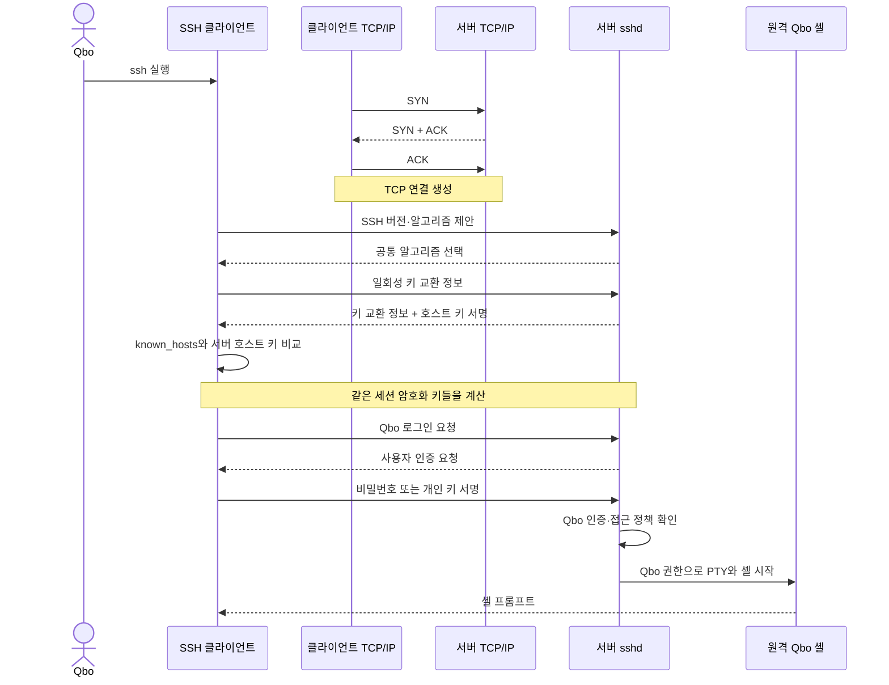

## 목차

- [[#1. 개요|1. 개요]]
- [[#2. 접속 명령의 해석|2. 접속 명령의 해석]]
- [[#3. TCP 연결과 원격 셸 생성 과정|3. TCP 연결과 원격 셸 생성 과정]]
- [[#4. 서버 호스트 인증과 사용자 인증|4. 서버 호스트 인증과 사용자 인증]]
- [[#5. 인감도장에 빗댄 공개 키 인증|5. 인감도장에 빗댄 공개 키 인증]]
- [[#6. 비밀번호 인증|6. 비밀번호 인증]]
- [[#7. 연결 유지와 SSH 채널|7. 연결 유지와 SSH 채널]]
- [[#8. 원격 셸·PTY와 명령 실행|8. 원격 셸·PTY와 명령 실행]]
- [[#9. SSH 관련 파일과 위치|9. SSH 관련 파일과 위치]]
- [[#10. 반복 접속을 위한 클라이언트 설정|10. 반복 접속을 위한 클라이언트 설정]]
- [[#11. 파일 전송과 포트 포워딩|11. 파일 전송과 포트 포워딩]]
- [[#12. Bastion을 통한 접속|12. Bastion을 통한 접속]]
- [[#13. 기본 보안 원칙|13. 기본 보안 원칙]]
- [[#14. 접속 실패를 계층별로 확인|14. 접속 실패를 계층별로 확인]]
- [[#15. 관련 문서|15. 관련 문서]]
- [[#16. 출처|16. 출처]]

## 1. 개요

SSH(Secure Shell)는 신뢰하기 어려운 네트워크를 통해 원격 컴퓨터의 신원을 확인하고 사용자를 인증한 뒤, 암호화된 연결로 셸·명령 실행·파일 전송·포트 포워딩을 제공하는 프로토콜과 도구 모음이다.

Linux 서버에서는 일반적으로 클라이언트의 `ssh` 프로그램이 연결을 시작하고 서버의 `sshd` 데몬이 요청을 받는다. 인증에 성공하면 `sshd`는 원격 계정의 UID·GID와 권한으로 셸이나 요청한 프로그램을 실행한다.[^ssh]


내 PC의 화면과 키보드를 사용하더라도 접속 후 실행한 Bash·`ls`·`grep`과 파일 접근은 원격 서버에서 이루어진다.

## 2. 접속 명령의 해석

```bash
ssh -i ~/.ssh/qbo-company -p 2222 Qbo@server.example.com
```

| 부분 | 의미 |
|---|---|
| `ssh` | 로컬 PC에서 실행하는 OpenSSH 클라이언트 |
| `-i` | 사용자 공개 키 인증에 사용할 identity 파일 지정 |
| `~/.ssh/qbo-company` | 로컬 Qbo 홈에 있는 사용자 개인 키 파일 |
| `-p 2222` | 서버에서 SSH 연결을 받을 TCP 포트 지정 |
| `Qbo` | 원격 서버에서 사용할 계정 이름 |
| `server.example.com` | 접속할 원격 서버의 호스트 이름 |

`-i` 뒤에는 일반적으로 공개 키가 아니라 **로컬 PC의 개인 키**를 지정한다.[^ssh] 이에 대응하는 공개 키가 원격 서버 Qbo 계정의 `authorized_keys`에 등록되어 있어야 한다.

`~`는 로컬 셸이 현재 로컬 사용자의 홈 경로로 확장한다. 접속한 뒤 `pwd`와 `ls`는 원격 서버에서 실행되고, `exit`는 서버 자체를 종료하는 것이 아니라 현재 원격 셸과 SSH 세션을 끝낸다.

포트를 생략하면 일반적으로 22번을 사용하지만 서버 설정에 따라 바꿀 수 있다. 주소와 포트를 알고 있어도 라우팅, 방화벽·보안 그룹, VPN·Bastion·NAT 구성과 서버의 `sshd` 수신 상태가 맞지 않으면 접속할 수 없다.

## 3. TCP 연결과 원격 셸 생성 과정

SSH 접속은 TCP 3-way handshake만으로 완성되지 않는다. TCP 연결 위에서 SSH 알고리즘 협상, 키 교환, 서버 호스트 인증과 사용자 인증이 이어진다.



### TCP 3-way handshake

```text
클라이언트                         서버
SYN                  ────────────▶
                     ◀──────────── SYN + ACK
ACK                  ────────────▶
```

TCP 단계는 양쪽이 데이터를 주고받을 연결 상태를 준비한다. 이 단계만으로 서버의 신원, 사용자 권한과 암호화가 확인되는 것은 아니다.

### SSH 키 교환과 세션 암호화

클라이언트와 서버는 일회성 키 교환 정보를 주고받아 같은 비밀값을 각자 계산하고, 이번 연결에 사용할 대칭 세션 키들을 만든다. 실제 셸 입력과 출력은 효율적인 대칭 암호 방식으로 보호된다. 사용자 개인 키로 모든 데이터를 직접 암호화하는 것이 아니다.

긴 연결에서는 연결을 끊지 않고 새 세션 키로 다시 키 교환(rekey)할 수 있다. 인증 키는 신원을 증명하고, 세션 키는 이번 연결의 데이터를 암호화한다는 역할 차이가 있다.

## 4. 서버 호스트 인증과 사용자 인증

SSH는 서로 다른 두 대상을 확인한다.

| 구분 | 확인 대상 | 개인 키 위치 | 공개 키를 확인·등록하는 위치 |
|---|---|---|---|
| 호스트 키 | 접속한 서버가 의도한 서버인지 | 서버 | 클라이언트의 `known_hosts` |
| 사용자 키 | 접속자가 Qbo 개인 키 보유자인지 | Qbo의 클라이언트 | 서버 Qbo의 `authorized_keys` |

### 서버 호스트 키

서버는 호스트 개인 키로 키 교환 내용을 서명한다. 클라이언트는 호스트 공개 키와 서명을 확인하고 이전에 기록한 키와 비교한다.

```text
서버 호스트 개인 키
        ↓ 서명
클라이언트가 호스트 공개 키로 검증
        ↓
~/.ssh/known_hosts와 비교
```

처음 접속하는 서버는 기존 기록이 없기 때문에 공개 키 지문을 신뢰할지 묻는다. 이상적으로는 서버 관리자나 신뢰할 수 있는 관리 시스템이 알려 준 지문과 대조해야 한다. 기존 서버의 호스트 키가 갑자기 달라지면 서버 재설치·교체일 수도 있지만 중간자 공격 가능성도 있으므로 원인을 확인하지 않고 경고를 무시하면 안 된다.[^hostcheck]

### 사용자 공개 키 인증

사용자 키 쌍은 일반적으로 Qbo가 자신의 PC에서 생성한다.

```bash
ssh-keygen -t ed25519 -C "Qbo@company-laptop"
```

```text
~/.ssh/id_ed25519       개인 키 · Qbo PC에 비밀로 보관
~/.ssh/id_ed25519.pub   공개 키 · 서버에 등록 가능
```

공개 키는 서버 관리자에게 전달하거나 허용된 기존 로그인 방법으로 서버의 다음 파일에 등록한다.

```text
/home/Qbo/.ssh/authorized_keys
```

OpenSSH의 `authorized_keys`는 기본적으로 한 줄에 공개 키 하나를 기록할 수 있어 한 계정에 여러 장치·담당자의 공개 키를 등록할 수 있다.[^sshd]

```text
Qbo 노트북 개인 키 A  ↔  서버에 등록된 공개 키 A
Qbo 데스크톱 개인 키 B ↔  서버에 등록된 공개 키 B
관리자 개인 키 C       ↔  서버에 등록된 공개 키 C
```

개인 키는 서버로 보내지 않는다. 클라이언트가 현재 SSH 연결에 종속된 데이터를 개인 키로 서명하고, 서버가 등록된 공개 키로 검증한다.

```text
서명 = Sign(개인 키, 이번 연결 데이터)
검증 = Verify(공개 키, 이번 연결 데이터, 서명)
```

공개 키에서 대응하는 개인 키를 현실적인 계산량으로 역산하거나 다른 개인 키로 유효한 서명을 만드는 것이 어렵도록 설계된다. 과거 접속 서명은 현재 연결 데이터와 맞지 않기 때문에 그대로 재사용할 수 없다.

## 5. 인감도장에 빗댄 공개 키 인증

```text
개인 키          Qbo만 보관하는 인감도장
공개 키          서버에 등록한 인감 검증 정보
이번 연결 데이터  매번 내용과 번호가 다른 확인 문서
서명             그 문서에 도장을 찍은 결과
authorized_keys  로그인 허용 인감 목록
```

서버는 개인 키인 도장 자체를 전달받지 않는다. 매번 다른 연결 정보에 만들어진 서명을 등록된 공개 키로 검증한다. 현실의 도장은 정교하게 복제될 가능성이 있지만 암호 키는 공개 정보로부터 개인 키나 서명을 위조하는 일이 계산상 불가능하도록 설계된다는 차이가 있다.

공개 키는 비밀일 필요가 없지만 **어떤 공개 키를 Qbo의 것으로 등록할지**는 신뢰할 수 있게 확인해야 한다. 공격자가 전달 과정에서 자신의 공개 키로 바꿔치기하면 서버 관리자가 공격자에게 Qbo 권한을 줄 수 있기 때문이다.

```bash
ssh-keygen -lf ~/.ssh/id_ed25519.pub
```

공개 키 지문을 사내 시스템·전화·검증된 메신저 등 별도 경로로 대조할 수 있다. 장치별로 키 쌍을 분리하면 한 장치를 분실했을 때 해당 공개 키만 `authorized_keys`에서 제거할 수 있다.

## 6. 비밀번호 인증

사용자 공개 키 인증은 필수가 아니다. 서버가 허용하면 원격 Qbo 계정의 비밀번호로도 인증할 수 있다.

```text
TCP 연결
→ SSH 키 교환
→ 호스트 키로 서버 확인
→ 암호화된 통로 생성
→ 그 통로 안에서 Qbo 비밀번호 인증
→ 원격 셸 시작
```

‘키 없이 비밀번호로 SSH에 접속한다’는 표현은 **사용자 키 인증을 사용하지 않는다**는 뜻이다. 서버 호스트 키와 세션 암호화 키는 비밀번호 방식에서도 사용된다.

| 관점 | 비밀번호 인증 | 공개 키 인증 |
|---|---|---|
| 사용자가 증명하는 것 | 원격 계정의 비밀번호를 알고 있음 | 대응하는 개인 키를 보유함 |
| 서버의 검증 정보 | 비밀번호 검증 체계 | `authorized_keys`의 공개 키 |
| 반복 추측 공격 | 약한 비밀번호·재사용 시 위험 | 개인 키 자체를 추측하기는 매우 어려움 |
| 폐기 | 비밀번호 변경 | 공개 키 한 줄 제거 |
| 자동화 | 비밀번호 보관 문제 | 전용 키와 제한 옵션 사용 가능 |

비밀번호 인증을 사용하더라도 호스트 키 경고를 무시하면 잘못된 서버에 비밀번호를 입력할 위험이 있다. 공개 키 인증도 개인 키가 유출되면 위험하므로 키 암호 설정, 장치별 분리, 사용하지 않는 키 폐기가 필요하다.

## 7. 연결 유지와 SSH 채널

대화형 SSH 접속은 일반적으로 하나의 TCP 연결을 만들고 `exit`, 서버 정책, 네트워크 단절이나 장애로 종료될 때까지 유지한다. 명령을 입력할 때마다 3-way handshake와 사용자 인증을 반복하지 않는다.

```text
TCP 연결·SSH 인증
   ↓
명령 1
명령 2
명령 3
   ↓
exit
   ↓
SSH와 TCP 연결 종료
```

입력이 없는 유휴 상태에서도 연결이 유지될 수 있지만 NAT·방화벽의 세션 만료, 절전·네트워크 변경, 서버의 유휴 종료 정책과 keepalive 실패 등으로 끊길 수 있다.

하나의 SSH 연결 안에는 여러 논리 채널을 만들 수 있다.

```text
하나의 암호화된 SSH 연결
├─ 대화형 셸과 PTY
├─ 단일 명령 실행
├─ SFTP 서브시스템
├─ 로컬 포트 포워딩
└─ 원격 포트 포워딩
```

클라이언트 설정에 따라 기존 연결을 다중화하여 재사용할 수 있지만 모든 SSH 실행이 자동으로 같은 TCP 연결을 쓰는 것은 아니다.

## 8. 원격 셸·PTY와 명령 실행

대화형 로그인에서는 `sshd`가 의사 터미널(PTY)을 할당하고 Qbo 권한으로 로그인 셸을 실행한다.

```text
로컬 키보드
  ↓
MobaXterm 터미널 에뮬레이터
  ↓ SSH
서버 sshd
  ↓
서버의 PTY
  ↓
서버의 Qbo Bash
  ↓
서버의 ls · grep · 프로그램
```

PTY는 물리 터미널과 비슷한 문자 입출력 동작을 커널이 소프트웨어로 제공하는 장치이다. MobaXterm은 터미널 에뮬레이터와 SSH 클라이언트를 모두 포함하고, 원격 Bash는 서버의 CPU·메모리·파일과 Qbo 계정 권한을 사용한다.

원격에서 단일 명령만 실행할 수도 있다.

```bash
ssh Qbo@server.example.com 'hostname'
```

이 명령의 따옴표와 로컬·원격 셸의 해석 범위를 구분해야 한다. 복잡한 명령은 로컬에서 변수나 와일드카드가 먼저 확장되지 않도록 따옴표를 신중하게 사용한다.

## 9. SSH 관련 파일과 위치

### 클라이언트

| 경로 | 역할 |
|---|---|
| `~/.ssh/config` | 사용자별 접속 설정 |
| `~/.ssh/id_ed25519` | 사용자 개인 키의 일반적인 기본 이름 |
| `~/.ssh/id_ed25519.pub` | 대응하는 사용자 공개 키 |
| `~/.ssh/known_hosts` | 확인한 서버 호스트 공개 키 기록 |

### 서버

| 경로 | 역할 |
|---|---|
| `/etc/ssh/sshd_config` | OpenSSH 서버 설정의 대표 경로 |
| `/etc/ssh/sshd_config.d/` | 배포판이 포함 설정을 사용하는 경우의 조각 파일 경로 |
| `/etc/ssh/ssh_host_*_key` | 서버 호스트 개인 키 |
| `~Qbo/.ssh/authorized_keys` | Qbo 로그인을 허용할 사용자 공개 키 목록 |

경로와 포함 설정의 동작은 배포판과 OpenSSH 빌드에 따라 달라질 수 있다. `sshd -T`는 서버가 해석한 유효 설정 확인에 사용할 수 있지만 관리자 권한과 서버 환경을 고려해야 한다.

OpenSSH는 개인 키와 `authorized_keys`의 소유권·권한이 지나치게 넓으면 안전하지 않다고 판단해 사용을 거부할 수 있다. 일반적인 사용자 홈 구성 사례는 다음과 같다.

```bash
chmod 700 ~/.ssh
chmod 600 ~/.ssh/authorized_keys
chmod 600 ~/.ssh/id_ed25519
```

실제 소유자와 상위 홈 디렉터리 권한도 함께 확인해야 하며 Windows에서는 파일 권한 표현 방식이 다를 수 있다.

## 10. 반복 접속을 위한 클라이언트 설정

매번 사용자·포트·키 경로를 입력하는 대신 `~/.ssh/config`에 별칭을 만들 수 있다.

```sshconfig
Host company-server
    HostName server.example.com
    User Qbo
    Port 2222
    IdentityFile ~/.ssh/qbo-company
    IdentitiesOnly yes
```

이후 다음처럼 접속한다.

```bash
ssh company-server
```

`Host`는 로컬에서 사용할 별칭이고 `HostName`은 실제 접속 대상이다. `IdentityFile`은 사용자 인증 개인 키 경로이며 `IdentitiesOnly yes`는 지정한 키·인증서 중심으로 시도하도록 제한하는 데 사용할 수 있다. 설정 파일에 개인 키 내용을 직접 넣는 것이 아니다.

## 11. 파일 전송과 포트 포워딩

SSH의 보안 연결은 원격 셸 외의 기능에도 사용된다.

```bash
scp report.txt Qbo@server.example.com:/home/Qbo/
sftp Qbo@server.example.com
```

- `scp`는 SSH 연결을 이용해 파일을 복사하는 명령이다.
- `sftp`는 SSH 위에서 동작하는 파일 전송 서브시스템이다. 이름이 비슷한 FTP와 별개의 프로토콜이다.

포트 포워딩은 SSH 연결 안에 다른 TCP 연결을 운반한다.

```bash
ssh -L 8080:internal-web.example.com:80 Qbo@bastion.example.com
```

이 예시는 로컬 8080번 포트에 들어온 연결을 SSH 서버를 거쳐 내부 웹 서버 80번 포트로 전달한다. 포트 포워딩은 네트워크 접근 경로를 만들 뿐 대상 애플리케이션의 인증·권한을 자동으로 대신하지 않는다.

## 12. Bastion을 통한 접속

대상 서버가 인터넷에서 직접 접근되지 않는 사설망에 있으면 외부 접점인 Bastion을 거쳐 접속할 수 있다.

```text
Qbo PC
  ↓ SSH
Bastion
  ↓ SSH 전달
사설망 대상 서버
```

OpenSSH의 `-J` 또는 `ProxyJump`를 사용할 수 있다.

```bash
ssh -J Qbo@bastion.example.com Qbo@internal.example.com
```

개인 키를 Bastion 서버에 복사해 두는 방식은 키 유출 범위를 넓힐 수 있다. ProxyJump처럼 클라이언트가 대상 서버까지 인증을 유지하는 방식과 조직의 접근 정책을 우선 검토한다.

## 13. 기본 보안 원칙

- 처음 접속하는 서버의 호스트 키 지문을 신뢰할 수 있는 경로로 확인한다.
- 호스트 키 변경 경고를 원인 확인 없이 우회하지 않는다.
- 개인 키를 서버·메신저·문서에 복사하지 않고 키 암호와 안전한 저장소로 보호한다.
- 장치·자동화·용도별로 키를 분리하고 분실·퇴사·용도 종료 시 공개 키를 제거한다.
- 원격 계정에는 필요한 최소 권한만 부여하고 root 직접 로그인과 비밀번호 정책을 검토한다.
- 공개 키 인증을 충분히 시험하기 전에 유일한 접속 수단을 비활성화하지 않는다.
- 방화벽·VPN·Bastion 등으로 SSH 접근 경로를 필요한 범위로 제한하고 인증 실패·접속 기록을 확인한다.
- 자동화 키에는 가능하면 명령·출발지·포워딩 제한과 별도 계정을 적용한다.

포트 번호를 22에서 바꾸면 자동 스캔 로그를 줄일 수는 있지만 인증·접근 제어를 대신하는 보안 경계는 아니다.

## 14. 접속 실패를 계층별로 확인

```text
1. 이름 해석        호스트 이름이 올바른 주소로 해석되는가?
2. 네트워크 경로    라우팅·VPN·Bastion 경로가 있는가?
3. TCP 포트         방화벽을 통과하고 sshd가 수신 중인가?
4. 호스트 확인      known_hosts와 서버 호스트 키가 맞는가?
5. 사용자 인증      계정·비밀번호·authorized_keys·개인 키가 맞는가?
6. 세션 시작        로그인 셸·홈·PTY·정책이 허용되는가?
```

```bash
ssh -v Qbo@server.example.com
```

`-v`는 접속이 이름 해석·TCP·키 교환·호스트 확인·사용자 인증 중 어느 단계까지 진행되었는지 확인하는 데 도움이 된다. 더 상세한 출력을 위해 `-vv`, `-vvv`를 사용할 수 있지만 로그에 사용자 이름·호스트·경로 등 환경 정보가 포함될 수 있으므로 외부 공유 전에 검토한다.

## 15. 관련 문서

- [[Linux]], [[Linux Structure|리눅스 구조]], [[Linux Accounts and Permissions|리눅스 계정과 권한]]
- [[CLI]], [[Shell|셸]], [[Terminal|터미널]], [[Linux Basic Commands|리눅스 기본 명령어]]
- [[Networking]], [[GRE]], Bastion
- [[Security 분류|Security]], [[Networking 분류|Networking]]

## 16. 출처

[^ssh]: [OpenBSD Manual Pages — `ssh(1)`](https://man.openbsd.org/ssh.1), [`sshd(8)`](https://man.openbsd.org/sshd.8)
[^hostcheck]: [OpenBSD Manual Pages — `ssh_config(5)`, `StrictHostKeyChecking` and `UserKnownHostsFile`](https://man.openbsd.org/ssh_config)
[^sshd]: [OpenBSD Manual Pages — `sshd(8)`, Authorized Keys File Format](https://man.openbsd.org/sshd.8#AUTHORIZED_KEYS_FILE_FORMAT)

- [OpenBSD Manual Pages — `sshd_config(5)`](https://man.openbsd.org/sshd_config)
- [OpenBSD Manual Pages — `ssh-keygen(1)`](https://man.openbsd.org/ssh-keygen.1)

## 둘러보기

[[Knowledge Base/index|전체 개념 목록]] · [[Security 분류|Security]] · [[Networking 분류|Networking]]
