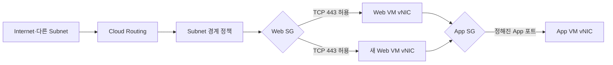
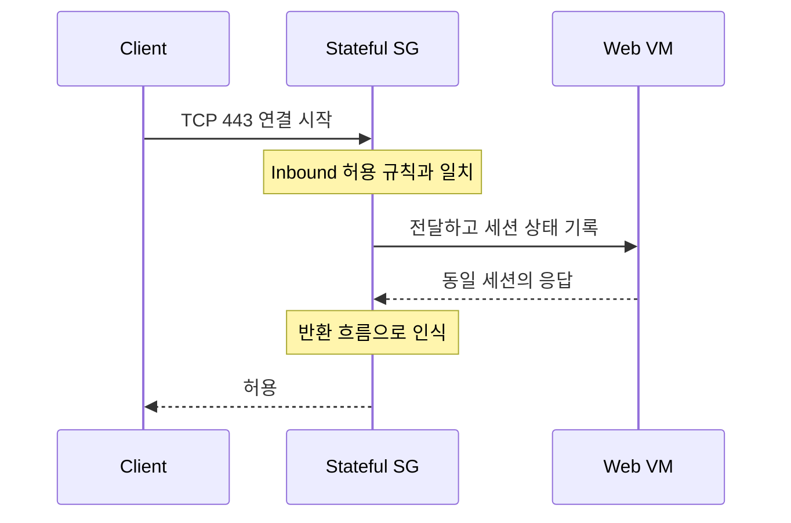

## 목차

- [[#1. 개요|1. 개요]]
- [[#2. 물리 방화벽과 다른 적용 위치|2. 물리 방화벽과 다른 적용 위치]]
- [[#3. 규칙의 구성|3. 규칙의 구성]]
- [[#4. 상태 기반 반환 통신|4. 상태 기반 반환 통신]]
- [[#5. Security Group 참조|5. Security Group 참조]]
- [[#6. AWS Security Group과 Network ACL|6. AWS Security Group과 Network ACL]]
- [[#7. Zadara zCompute Security Group|7. Zadara zCompute Security Group]]
- [[#8. 흔한 오해와 설계 기준|8. 흔한 오해와 설계 기준]]
- [[#9. 관련 문서|9. 관련 문서]]
- [[#10. 출처|10. 출처]]

## 1. 개요

Security Group은 클라우드 가상 네트워크의 리소스 또는 가상 네트워크 인터페이스에 연결하여 인바운드·아웃바운드 흐름을 통제하는 논리적 방화벽 정책 집합이다. 이름이 같아도 적용 대상, 허용·거부 규칙, 상태 추적과 참조 기능은 제품마다 다르므로 해당 플랫폼 문서를 확인해야 한다.

AWS와 Zadara zCompute의 Security Group은 모두 상태 기반 허용 목록으로 공개되어 있지만, 모든 클라우드 제품의 `Security Group`이 반드시 동일하다고 일반화해서는 안 된다.[^aws-sg][^zadara-sg]

## 2. 물리 방화벽과 다른 적용 위치

Security Group은 일반적으로 랙 경계에 놓인 물리 장비 한 대가 아니다. 클라우드 제어 계층에서 정의한 정책을 가상 스위치·하이퍼바이저·분산 네트워크 계층 등이 각 가상 NIC 가까이에서 집행한다. 정확한 내부 구현은 제품에 따라 다르다.



같은 정책을 여러 VM의 인터페이스에 연결할 수 있어 인스턴스가 교체되거나 확장될 때도 동일한 역할의 정책을 다시 사용할 수 있다.

## 3. 규칙의 구성

일반적인 규칙은 다음 요소를 조합한다.

```text
방향: Inbound 또는 Outbound
프로토콜: TCP · UDP · ICMP 등
포트 또는 포트 범위
출발지 또는 목적지: CIDR · IP · 다른 Security Group 등
```

예시 정책은 다음과 같다.

| 대상 | 방향 | 프로토콜·포트 | 상대 | 의미 |
|---|---|---|---|---|
| Web SG | Inbound | TCP 443 | `0.0.0.0/0` | 모든 IPv4 위치에서 HTTPS 진입 허용 |
| App SG | Inbound | TCP 8080 | Web SG | Web 역할의 인터페이스에서 시작한 통신 허용 |
| DB SG | Inbound | TCP 5432 | App SG | App 역할에서 DB 접속 허용 |

`0.0.0.0/0`은 모든 IPv4 주소를 뜻하므로 관리 포트에 무심코 적용하면 노출 범위가 지나치게 넓어진다.

## 4. 상태 기반 반환 통신

상태 기반 Security Group은 허용된 방향에서 시작한 세션의 반환 트래픽을 연결 상태로 인식한다.



이는 반대 방향의 모든 신규 연결을 허용한다는 뜻이 아니다. 기존 허용 세션에 해당하는 반환 트래픽만 상태에 따라 허용한다.

## 5. Security Group 참조

IP 주소 대신 다른 Security Group을 출발지나 대상으로 참조하면 인스턴스 교체·Auto Scaling으로 IP가 바뀌어도 역할 기반 정책을 유지하기 쉽다. 예를 들어 App SG의 인바운드 규칙이 Web SG를 참조하면 Web SG가 연결된 인터페이스의 트래픽을 대상으로 평가할 수 있다.[^aws-rules]

다만 SG 참조는 사용자나 애플리케이션의 신원을 암호학적으로 인증하는 기능이 아니다. 참조된 SG가 연결된 네트워크 인터페이스라는 조건을 정책에 사용하는 것이므로, 잘못된 리소스에 SG를 연결할 권한과 운영 변경도 통제해야 한다.

## 6. AWS Security Group과 Network ACL

AWS에서는 Security Group이 리소스의 네트워크 인터페이스 수준에 적용되고 상태 기반 허용 규칙을 사용한다. Network ACL은 Subnet 수준에 적용되며 허용과 거부 규칙을 순서대로 평가하고 반환 트래픽도 별도 규칙이 필요한 무상태 방식이다.[^aws-compare]

| AWS 기준 | Security Group | Network ACL |
|---|---|---|
| 적용 범위 | 연결된 리소스·네트워크 인터페이스 | Subnet 전체 |
| 규칙 종류 | 허용 | 허용·거부 |
| 상태 | Stateful | Stateless |
| 평가 | 모든 규칙을 종합 | 번호 순서로 첫 일치 규칙 적용 |
| 반환 트래픽 | 허용 세션이면 자동 인식 | 반대 방향 규칙도 필요 |

이 비교는 AWS의 구현에 관한 설명이며, 모든 클라우드의 ACL과 Security Group에 그대로 적용되는 보편 법칙은 아니다.

## 7. Zadara zCompute Security Group

Zadara의 공개 zCompute 가이드는 Security Group을 가상 네트워크 인터페이스에 적용하는 인바운드·아웃바운드 허용 목록으로 설명한다. 규칙과 일치하지 않는 트래픽은 폐기하고, 세션을 시작하는 방향의 규칙만 지정하면 반환 방향은 상태 추적으로 처리한다.[^zadara-sg]

따라서 zCompute Security Group을 이해할 때도 다음 세 가지를 구분해야 한다.

- VPC 라우팅이 목적지까지 경로를 제공하는가
- Security Group이 해당 흐름을 허용하는가
- VM 운영체제의 호스트 방화벽과 서비스가 해당 포트에서 요청을 받는가

Security Group이 허용되어도 경로가 없거나 프로세스가 대기하지 않으면 서비스는 연결되지 않는다.

## 8. 흔한 오해와 설계 기준

- Security Group은 VM 안에 설치하는 일반 프로그램과 동일하지 않다. 클라우드 가상 네트워크 계층의 정책이다.
- IP 대신 SG를 참조하면 Auto Scaling에 유리하지만 애플리케이션 인증을 대체하지 않는다.
- Stateful은 모든 반환 트래픽 허용이 아니라 허용된 기존 세션의 반환 흐름 인식이다.
- SG 허용, Subnet ACL, 라우팅, NAT, 호스트 방화벽과 서비스 수신 상태는 서로 다른 조건이다.
- 제품별 기본 규칙, 지원 대상과 참조 범위를 확인해야 한다.

## 9. 관련 문서

- [[Firewall]] · [[Public and Private IP|공인 IP와 사설 IP]]
- [[NAT]] · [[Router|라우터]] · [[Virtual Machine|가상 머신]]
- [[SSH]] · [[HTTP and HTTPS|HTTP와 HTTPS]]

## 10. 출처

[^aws-sg]: AWS, [Control traffic to your AWS resources using security groups](https://docs.aws.amazon.com/vpc/latest/userguide/vpc-security-groups.html). VPC Security Group의 상태 기반 동작과 네트워크 인터페이스 연결.
[^aws-rules]: AWS, [Security group rules](https://docs.aws.amazon.com/vpc/latest/userguide/security-group-rules.html). CIDR·다른 Security Group을 사용하는 규칙과 참조 동작.
[^aws-compare]: AWS, [Infrastructure security in Amazon VPC](https://docs.aws.amazon.com/vpc/latest/userguide/infrastructure-security.html). Security Group과 Network ACL의 적용 범위, 규칙과 상태 처리 비교.
[^zadara-sg]: Zadara, [zCompute User Guide — Security Groups](https://guides.zadarastorage.com/cs-compute-guide/latest/security-groups.html). 가상 NIC에 적용하는 허용 목록, 인바운드·아웃바운드 제어와 상태 기반 세션 추적.

## 둘러보기

[[Knowledge Base/index|전체 개념 목록]] · [[Security 분류|Security]] · [[Networking 분류|Networking]]
