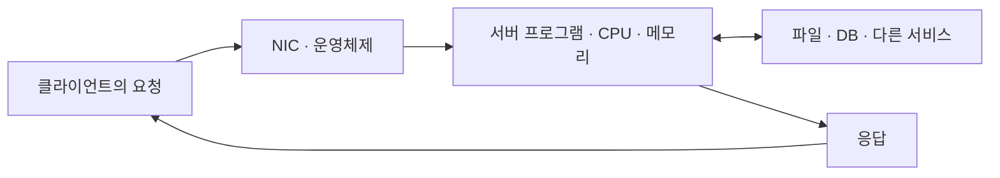

## 1. 개요

Server(서버)는 클라이언트의 요청을 받아 데이터나 기능을 제공하는 컴퓨터 시스템 또는 소프트웨어이다.

웹사이트를 열면 브라우저는 페이지를 요청하고 웹 서버는 그 내용을 보내 준다. 회사 공유 폴더를 열면 파일 서버가 파일을 제공한다. 이처럼 서버를 구분하는 핵심은 컴퓨터의 크기나 모양이 아니라 다른 프로그램에 서비스를 제공하는 역할이다. 일반 PC에서도 서버 프로그램을 실행할 수 있고, 데이터센터의 고성능 장비에서도 같은 역할을 수행할 수 있다.

## 2. 클라이언트와 서버의 관계

클라이언트는 기능을 요청하는 쪽이고 서버는 요청을 받아 처리하는 쪽이다. 웹에서는 브라우저와 웹 서버가 HTTP라는 약속에 따라 요청과 응답을 주고받는다. HTTP 표준도 클라이언트와 서버를 통신에서 수행하는 역할로 정의한다.[^request]

이 역할은 기기에 영구적으로 붙는 이름이 아니다. 쇼핑몰의 WAS는 브라우저 요청을 처리할 때는 서버이고, 주문 정보를 얻으려고 DBMS에 질의할 때는 DB 클라이언트이다. 한 컴퓨터에서 클라이언트와 서버 프로그램을 함께 실행할 수도 있다.

예를 들어 주문 내역 화면을 여는 경우에는 브라우저 → 웹·애플리케이션 서버 → DB 서버로 요청이 이어지고, 조회한 결과가 반대 방향으로 돌아온다. 사용자는 하나의 서비스를 이용하지만 내부에서는 여러 서버가 역할을 나누어 수행할 수 있다.

## 3. 서버의 종류와 대표 예시

| 종류 | 제공하는 기능 | 대표 예시 |
|---|---|---|
| [[Web Server\|웹 서버]] | 웹 문서·이미지 등을 제공하거나 애플리케이션에 요청 전달 | NGINX, Apache HTTP Server |
| [[Web Application Server\|애플리케이션 서버]] | 로그인·주문·결제 등 업무 코드 실행 | Tomcat 기반 Java 애플리케이션 |
| [[Database\|데이터베이스 서버]] | 데이터 저장·조회·변경과 동시 접근 관리 | PostgreSQL, MySQL |
| [[File Storage\|파일 서버]] | 여러 사용자나 컴퓨터에 파일 공유 제공 | NFS·SMB 파일 서비스 |
| DNS 서버 | 도메인 이름에 대한 IP 주소 등 레코드 제공 | 웹 접속에 사용하는 DNS 서비스 |

이 분류는 서비스의 기능을 기준으로 한다. 한 장비가 웹과 DB 역할을 함께 맡을 수도 있고, 이용자가 많은 서비스는 같은 역할의 서버를 여러 대 운영할 수도 있다. 서버 종류와 장비 수는 서로 다른 개념이다.

## 4. 요청을 처리하는 원리

서버 프로그램은 운영체제 위에서 실행되며, 네트워크 요청을 받을 주소와 포트 등을 사용한다. 일반적인 웹 접속에서는 다음과 같은 처리가 이루어진다.

1. 클라이언트가 서버의 주소를 알아내고 연결을 준비한다.
2. 요청 데이터가 네트워크를 지나 서버의 NIC에 도착한다.
3. 운영체제가 데이터를 해당 서버 프로세스에 전달한다.
4. CPU가 프로그램 코드를 실행하고, 메모리의 데이터나 필요한 파일·DB를 사용한다.
5. 처리한 결과를 응답으로 만들어 클라이언트에 돌려준다.

파일을 그대로 보내는 서버와 사용자별로 계산한 결과를 보내는 서버는 처리 내용이 다르다. 또한 서버가 매 요청마다 새 프로세스를 만드는 것은 아니다. 프로세스·스레드·이벤트 처리 방식에 따라 여러 요청을 나누어 처리한다. 웹 요청의 구체적인 흐름은 [[Web Server]]와 [[Web Application Server]]에서 설명한다.

서버가 계속 서비스를 제공하는 것은 프로그램이 요청을 기다리고 처리하는 동작을 반복하기 때문이다. 서버용 장비는 이 프로그램이 오랫동안 안정적으로 실행되도록 설계되며, 전원·냉각·부품 관리 기능을 강화한 제품도 있다. 다만 모든 서버가 24시간 켜져 있어야만 서버인 것은 아니다.

## 5. 서버를 이루는 하드웨어와 소프트웨어

| 구성 | 서버에서의 역할 |
|---|---|
| [[CPU]] | 요청을 처리하는 프로그램의 명령 실행 |
| [[Memory\|메모리]] | 실행 중인 코드·데이터·캐시 보관 |
| [[Disk\|디스크]]와 [[Storage\|스토리지]] | 운영체제·파일·DB 등 지속 보관할 데이터 저장 |
| [[NIC]]와 [[Networking\|네트워크]] | 다른 장치와 요청·응답 송수신 |
| 운영체제 | CPU·메모리·장치와 프로세스의 사용 관리 |
| 서버 프로그램 | 웹·파일·DB 등 실제 서비스 기능 제공 |

물리 서버는 이 부품을 갖춘 실제 컴퓨터이고, 서버 프로그램은 그 위에서 동작하는 소프트웨어이다. 예를 들어 “서버를 구매한다”는 말은 장비를, “웹 서버를 설치한다”는 말은 소프트웨어를 뜻할 수 있다. 랙에 설치하는 형태와 부품 배치는 [[Physical Server Configuration|물리 서버 구성]]에서 다룬다.[^hardware]

## 6. 서버의 등장 배경과 발전 과정

서버의 배경에는 여러 사람이 컴퓨터의 연산 자원과 데이터를 함께 사용하려는 요구가 있다. 인터넷 이전에도 중앙 컴퓨터에 여러 사용자가 접속하는 방식이 있었고, 이후에는 네트워크로 연결한 컴퓨터가 서로 기능을 요청하고 제공하는 방식이 발전했다. 이 흐름 전체를 특정 장비 한 대가 발명된 사건으로 설명하기는 어렵다.[^network-history]

웹 서버는 그중 하나의 구체적인 발전 사례이다. 1990년 말 CERN에서는 Tim Berners-Lee가 만든 최초의 웹 서버와 브라우저가 동작했다. 서버는 NeXT 컴퓨터에서 웹 문서를 제공했다. 이는 서버 전체의 시작이 아니라 웹 서비스의 초기 사례이다.[^web-history]

[[Virtualization|서버 가상화]]는 물리 장비 한 대의 자원을 여러 [[Virtual Machine|VM]]에 나누어 각자의 운영체제를 실행하게 했다. 한 서비스마다 장비 한 대를 준비하는 대신, [[Hypervisor|하이퍼바이저]]가 여러 실행 환경의 자원 접근을 중재하도록 구성한 것이다. 가상화는 클라우드보다 먼저 발전한 기술이며, 이후 클라우드의 자원 제공 방식에도 중요한 기반이 되었다.[^virt][^virt-history]

## 7. 현대의 서버와 클라우드

| 형태 | 사용자가 접하는 서버의 모습 |
|---|---|
| [[Bare Metal\|물리 서버·베어메탈]] | 실제 장비에 OS와 서버 프로그램을 설치해 사용 |
| [[Virtual Machine\|가상 서버(VM)]] | 물리 호스트의 일부 자원을 가상 컴퓨터로 할당받아 사용 |
| 컨테이너 | 일반적으로 호스트 커널을 공유하는 격리된 환경에서 프로그램 실행 |
| 서버리스 | 서버의 배치·용량 관리 등을 제공자에게 맡기고 코드·서비스 기능을 사용 |

VM은 독립된 운영체제를 실행하고, 컨테이너는 일반적으로 호스트 커널을 공유한다. 두 방식은 실행 환경을 나누는 방법이 다르지만 실제 CPU·메모리·네트워크·저장장치를 사용한다.[^virt][^container]

클라우드에서는 장비를 구매하지 않고도 화면이나 API로 가상 서버를 생성하고 자원을 조절할 수 있다. 서버리스도 실제 서버가 사라진다는 뜻은 아니다. 사용자가 관리하는 대상이 장비·OS에서 코드와 서비스 설정 중심으로 바뀌는 것이다.[^serverless]

따라서 현대의 서버는 하나의 물리 장비, 가상 컴퓨터, 여러 인스턴스로 이루어진 서비스 등 다양한 모습으로 제공된다. 제공 형태가 바뀌어도 요청을 받아 필요한 기능과 데이터를 제공한다는 역할은 이어진다.

## 8. 관련 문서

- [[Virtualization]], [[Hypervisor]], [[Virtual Machine]], [[Bare Metal]]
- [[Networking]], [[Storage]]: 서버가 사용하는 연결·저장 기반
- [[3-Tier Architecture]], [[Web Server]], [[Web Application Server]], [[Database]]
- [[Shell Script]], [[SNMP]], [[Unified Cloud Management Portal]]

## 9. 출처

[^request]: [IETF — RFC 9110, §3.3 Connections, Clients, and Servers](https://www.rfc-editor.org/rfc/rfc9110.html#section-3.3)
[^network-history]: [Internet Society — A Brief History of the Internet](https://www.internetsociety.org/internet/history-internet/brief-history-internet/). 인터넷 개발 참여자들이 정리한 네트워크·자원 공유의 발전 과정.
[^web-history]: [CERN — A short history of the Web](https://home.cern/science/computing/the-birth-of-the-web/short-history-web/)
[^virt-history]: [IBM — What is virtualization?](https://www.ibm.com/think/topics/virtualization). 가상화의 발전 과정과 VM·물리 호스트의 관계.
[^serverless]: [AWS — Serverless on AWS](https://aws.amazon.com/serverless/)

[^hardware]: [Dell — PowerEdge R650: volatile and non-volatile components](https://dl.dell.com/manuals/all-products/esuprt_server_int/esuprt_server_int_poweredge/poweredge-r650_Reference-Guide_en-us.pdf). 구성 요소를 확인하는 특정 모델 사례이다.

[^virt]: [Red Hat — Server virtualization](https://www.redhat.com/en/topics/virtualization/what-server-virtualization)
[^container]: [Docker — What is a container?](https://docs.docker.com/get-started/docker-concepts/the-basics/what-is-a-container/)

## 둘러보기

[[Knowledge Base/index|전체 개념 목록]] · [[Compute 분류|Compute]]
