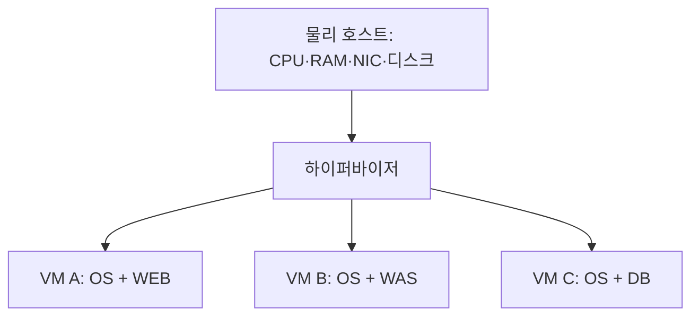

## 1. 개요

Server(서버)는 클라이언트의 요청을 받아 연산·데이터·기능을 제공하는 컴퓨터 시스템 또는 소프트웨어이다.

이 문서는 네트워크 서비스를 제공하는 서버를 중심으로 설명한다. 랙에 꽂힌 물리 장비, 클라우드에서 생성한 VM, HTTP 요청을 처리하는 프로그램을 모두 서버라고 부를 수 있지만 서로 다른 계층이다. “서버가 죽었다”는 말도 전원 장애인지, 운영체제 정지인지, 프로그램 종료인지 구별해야 의미가 분명해진다.

[[Networking]]은 요청과 응답의 이동을, [[Storage]]는 데이터의 기록과 보관을 담당한다. 서버는 이 자원을 사용해 실제 프로그램을 실행한다. [[3-Tier Architecture]]의 WEB·WAS·DB는 이러한 서버 자원을 서로 다른 책임으로 사용하는 대표 사례이다.

## 2. 물리 서버 안에는 무엇이 있는가

데이터센터에서는 CPU·메모리·디스크·NIC를 갖춘 컴퓨터를 랙에 설치하고 전원·냉각·네트워크를 연결한다. 랙마운트는 설치 형태이며 서버 소프트웨어의 종류를 뜻하지 않는다. 일반 PC도 서버 프로그램을 실행할 수 있다. 엔터프라이즈 장비는 원격 관리, 오류 감지, 부품 이중화 같은 운영 기능을 제공할 수 있지만 지원 범위는 모델과 구성에 따라 다르다.[^hardware]

| 구성 요소 | 실제 역할 | 업무에서 연결되는 질문 |
|---|---|---|
| CPU | 프로그램의 명령을 실행 | 작업이 계산을 많이 하는가, 대기하고 있는가? |
| RAM | 실행 중인 프로그램·데이터와 캐시 보관 | 메모리가 부족한가, 회수 가능한 캐시가 많은가? |
| SSD·HDD와 저장 컨트롤러 | OS·파일·DB 등의 데이터 기록 | 용량·응답 지연·보호 상태가 적절한가? |
| NIC | 네트워크 신호와 데이터 송수신 | 링크 속도·오류·드롭·경로가 정상인가? |
| 메인보드·PCIe | CPU·메모리·주변 장치 연결 | 장치가 실제로 인식되며 연결 대역폭은 충분한가? |
| 전원·팬·냉각 | 장비가 안정적으로 동작할 환경 유지 | 전원 이중화·온도·팬 오류가 있는가? |
| BMC 계열 관리 장치 | 호스트 OS와 구별되는 원격 관리 경로 | OS가 응답하지 않을 때 장비 상태를 볼 수 있는가? |

BMC는 운영체제 안에서 실행하는 SSH 서버와 다르다. 예를 들어 Dell iDRAC은 호스트의 대기 전원이 유지되는 조건에서 관리 기능을 제공할 수 있다. 전원 공급 자체가 사라진 상황까지 원격 관리가 항상 된다는 뜻은 아니다.[^bmc]

CPU 코어와 OS에 보이는 논리 CPU는 같은 수가 아닐 수 있다. SMT를 지원하는 코어는 여러 하드웨어 스레드를 제공할 수 있고, 프로그램의 소프트웨어 스레드는 그 실행 자원에 스케줄링된다. 따라서 논리 CPU 16개를 물리 코어 16개와 동일시하면 안 된다. Linux는 package·core·thread 형제 관계를 topology 정보로 제공한다.[^topology]

CPU 캐시는 CPU 가까이에 데이터를 두는 작은 고속 계층이고 RAM은 프로그램의 더 큰 실행 공간이다. OS의 파일 page cache는 RAM을 파일 데이터에 사용하는 별도 개념이다. swap은 메모리 페이지 일부를 저장 장치에 두는 수단이며, 디스크 공간을 추가했다고 RAM과 같은 속도의 실행 자원이 늘어나는 것은 아니다. 회수·swap·메모리 제한은 지연과 OOM 해석에 연결된다.[^memory]

Tower·rack·blade는 설치와 수용 형태의 차이이다. 랙 서버는 랙에 설치하고 blade는 섀시의 전원·냉각·연결 일부를 공유할 수 있다. 형태만으로 성능·가용성 순위를 정하지 않으며 어떤 부품·섀시·전원을 공유하는지를 확인한다.

## 3. 전원을 켜서 서비스가 실행될 때까지

일반적인 Linux 서버에서는 펌웨어가 장치를 초기화하고 부트 로더 또는 펌웨어가 커널을 메모리에 올린다. 커널이 루트 파일시스템을 사용할 수 있게 만든 뒤 서비스 관리자가 필요한 프로그램을 시작한다. systemd를 쓰는 환경에서는 서비스 간 의존성과 시작 상태를 unit으로 관리한다. 네트워크 부팅이나 펌웨어의 직접 커널 로딩 등 구성에 따른 변형도 있다.[^boot]

이 그림은 의존 관계를 단순화한 것이다. OS가 부팅되었다고 모든 서비스가 준비된 것은 아니다. DB가 먼저 준비되어야 하는 애플리케이션, 인증서나 원격 볼륨이 필요한 서비스도 있다. 부팅 성공·프로세스 실행·포트 수신·업무 응답 성공은 서로 다른 확인 단계이다.

## 4. 요청 하나가 물리 자원을 사용하는 방식

웹 요청의 개념적 경로는 NIC로 들어온 데이터가 OS 네트워크 스택과 소켓을 거쳐 서버 프로세스에 전달되는 흐름이다. 프로세스의 코드를 CPU가 실행하고, 실행 상태와 필요한 데이터는 메모리에 놓인다. 파일이나 DB가 필요하면 로컬 또는 원격 저장소에 접근하고 결과를 다시 네트워크로 보낸다. 실제 구현에는 인터럽트 조절·오프로딩·캐시 등이 있어 모든 바이트를 CPU가 똑같이 처리하는 것은 아니다.

따라서 응답이 느리다고 곧바로 CPU를 증설하면 원인이 해결되지 않을 수 있다. DB 잠금 대기, 디스크 동기 쓰기, 외부 API 응답 대기도 전체 지연에 포함된다. 운영에서는 “요청을 받기 전”, “받고 처리 중”, “하위 시스템을 기다리는 중”, “응답을 보내는 중”으로 구간을 나눠 관측하면 서버 자원과 업무 증상을 연결하기 쉽다.

## 5. 물리 서버·VM·컨테이너의 관계

서버 가상화는 하이퍼바이저를 통해 하나의 물리 호스트 자원을 여러 VM에 나눠 제공한다. 게스트는 가상 CPU·메모리·디스크·NIC를 보며 각자의 OS를 실행한다. VM을 만든다고 별도 물리 CPU와 디스크가 자동으로 한 세트씩 생기는 것은 아니다.[^virt]

가상 CPU 수는 애플리케이션이 사용할 수 있는 논리적 실행 자원을 표현한다. 물리 코어와의 일대일 전용 할당 여부는 가상화 설정에 따른다. VM 세 대가 같은 호스트에 있으면 호스트 장애를 함께 겪을 수 있다. 애플리케이션 인스턴스를 늘리는 것과 물리 장애 영역을 나누는 것을 별도로 설계해야 한다.

컨테이너는 일반적으로 호스트 커널을 공유하면서 프로세스와 자원 사용 범위를 격리한다. VM처럼 각 컨테이너가 별도 게스트 커널을 부팅하는 모델과 구별된다. 배치 방식이 달라도 최종적으로는 실제 호스트의 연산·메모리·네트워크·스토리지를 사용한다.[^container]

VM의 게스트 OS도 가상 펌웨어·가상 부팅 장치·가상 NIC를 통해 별도로 부팅한다. 물리 호스트가 정상이어도 게스트의 부트 설정·파일시스템·서비스 설정 때문에 그 VM만 시작하지 못할 수 있다. 게스트에서 보이는 디스크 오류 역시 물리 장치 고장인지 가상 장치·원격 볼륨 경로 문제인지 추가 관측이 필요하다.

## 6. 운영 지표를 읽는 관점

| 관측 내용 | 해석할 수 있는 것 | 함께 볼 정보 |
|---|---|---|
| CPU 사용률·실행 대기 | 계산 부하와 실행 자원 경쟁 | 프로세스별 사용량, 응답 시간, VM 자원 경합 |
| 메모리 사용·회수·swap | 앱 메모리와 캐시, 메모리 압박 | available, major fault, OOM 기록 |
| 디스크 지연·큐·처리량 | I/O 요청과 완료 사이 대기 | I/O 크기, 읽기/쓰기, 파일시스템·원격 저장소 |
| NIC 트래픽·오류·드롭 | 전송량과 인터페이스 이상 | 링크·스위치 포트·TCP 재전송·경로 |
| 서비스 지연·오류율 | 사용자가 겪는 결과 | 같은 시간대의 자원 지표와 요청 로그 |

Linux는 여유 메모리를 파일 캐시 등으로 활용한다. 사용 중인 메모리 총량이 크다는 사실만으로 메모리 누수라고 판단할 수 없다. 반대로 자원 부족이나 제한 때문에 OOM으로 프로세스가 종료될 수 있으므로 종료 기록과 메모리 압박을 함께 봐야 한다.[^memory]

장비 장애도 계층으로 구별한다. 관리 콘솔에는 접속되지만 OS가 부팅되지 않는다면 하드웨어 전원과 OS 부팅 상태가 다른 상황이다. OS에 접속되는데 서비스 포트가 닫혀 있다면 프로세스·수신 주소·방화벽을 조사한다. 이 구별은 원인을 확정하는 공식이 아니라 불필요한 재부팅 대신 확인 범위를 정하는 방법이다.

전원 장치 두 개, NIC 이중화, RAID는 각 부품·경로의 일부 장애에 대응하는 수단이다. 메인보드·공통 전원·섀시·호스트 전체의 장애를 모두 제거하지는 않는다. 서비스 고가용성에는 독립된 호스트와 장애 전환·상태 관리가, 과거 데이터 복구에는 보존된 백업이 필요할 수 있다. 부품 이중화·서비스 계속성·데이터 복구는 목적이 서로 다르다.

## 7. 서버 가상화가 필요한 배경과 역할

서비스별로 물리 서버를 한 대씩 배치하면 자원이 남더라도 다른 업무가 쓰기 어렵고 장비 수와 운영 부담이 늘어날 수 있다. 가상화는 여러 독립 OS 환경을 공통 호스트에서 운영하고 배포·이동·자원 할당을 소프트웨어로 관리하도록 돕는다. 다만 통합이 진행될수록 한 호스트의 장애 영향과 자원 경합을 함께 관리해야 한다.[^virt]

클라우드 엔지니어는 VM 생성 결과뿐 아니라 그 VM이 어떤 자원과 네트워크·볼륨에 의존하는지 설명할 수 있어야 한다. “인스턴스 정상”은 인프라 상태이고 “사용자 주문 성공”은 여러 서버와 데이터 경로가 함께 동작한 결과이다.

## 8. 관련 문서

- [[Networking]], [[Storage]]: 서버가 사용하는 연결·저장 기반
- [[3-Tier Architecture]], [[Web Server]], [[Web Application Server]], [[Database]]
- [[Shell Script]], [[SNMP]], [[Unified Cloud Management Portal]]

## 9. 출처

[^hardware]: [Dell — PowerEdge R650: volatile and non-volatile components](https://dl.dell.com/manuals/all-products/esuprt_server_int/esuprt_server_int_poweredge/poweredge-r650_Reference-Guide_en-us.pdf). 구성 요소를 확인하는 특정 모델 사례이다.
[^bmc]: [Dell — No Power, No POST, No Boot, No Video 구분과 iDRAC 대기 전원](https://www.dell.com/support/kbdoc/en-ca/000152161/dell-poweredge-troubleshooting-a-server-that-does-not-start-no-power-no-post-no-boot-and-no-video)
[^boot]: [systemd — System bootup process](https://www.freedesktop.org/software/systemd/man/latest/bootup.html)
[^virt]: [Red Hat — Server virtualization](https://www.redhat.com/en/topics/virtualization/what-server-virtualization)
[^container]: [Docker — What is a container?](https://docs.docker.com/get-started/docker-concepts/the-basics/what-is-a-container/)
[^memory]: [Linux Kernel — Memory management concepts](https://docs.kernel.org/admin-guide/mm/concepts.html)

[^topology]: [Linux Kernel — CPU topology](https://docs.kernel.org/admin-guide/cputopology.html)

## 둘러보기

[[Knowledge Base/index|전체 개념 목록]] · [[Compute 분류|Compute]]
