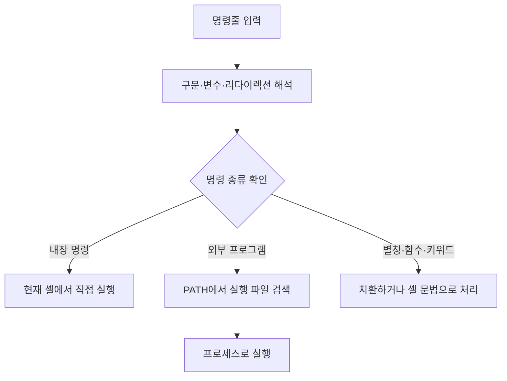

## 목차

- [[#1. 개요|1. 개요]]
- [[#2. 명령을 처리하는 흐름|2. 명령을 처리하는 흐름]]
- [[#3. 별칭과 실제 프로그램 확인|3. 별칭과 실제 프로그램 확인]]
- [[#4. 관련 문서와 출처|4. 관련 문서와 출처]]

## 1. 개요

Shell(셸)은 사용자가 입력한 명령을 해석하여 자체 기능을 수행하거나 외부 프로그램을 실행하고, 입력·출력과 실행 환경을 연결하는 명령 해석기이자 프로그래밍 환경이다.

Bash, Zsh, Fish는 명령줄 셸의 예이다. 셸은 [[Terminal|터미널]] 안에서 실행되는 경우가 많지만 터미널 없이 스크립트 파일의 명령을 비대화식으로 실행할 수도 있다.[^bash]

## 2. 명령을 처리하는 흐름



### 셸 내장 명령

`cd`, `export`, `alias`, `read`, `jobs`, `exit`처럼 셸 자체에 구현된 기능이다. 특히 `cd`는 현재 셸의 작업 디렉터리를, `export`는 현재 셸과 이후 자식 프로세스에 전달할 환경을 바꿔야 하므로 별도 프로그램으로 처리하기 어렵다.

### 외부 프로그램

`ls`, `cat`, `grep`처럼 파일시스템에 별도 실행 파일로 존재한다. 셸은 `PATH`를 검색해 `/usr/bin/ls` 같은 파일을 찾고 프로세스로 실행한다. 프로그램은 시스템 호출로 [[Kernel|커널]]의 파일·메모리·네트워크 기능을 사용한다.

## 3. 별칭과 실제 프로그램 확인

```bash
type cd
type -a ls
```

```text
cd is a shell builtin
ls is aliased to 'ls --color=auto'
ls is /usr/bin/ls
```

첫 줄은 `cd`가 셸 내부 기능이라는 뜻이다. 두 번째 줄은 입력한 `ls`가 먼저 `ls --color=auto`로 치환된다는 뜻이고, 세 번째 줄은 최종적으로 찾을 수 있는 외부 프로그램 경로를 나타낸다. 명령은 내장 명령과 외부 프로그램으로 크게 이해할 수 있지만, 정확히는 별칭·셸 함수·`if`와 `for` 같은 키워드도 포함한다.

## 4. 관련 문서와 출처

- [[Terminal|터미널]], [[Program and Process|프로그램과 프로세스]], [[Shell Script|셸 스크립트]], [[Linux]]

[^bash]: [GNU Project — Bash Reference Manual](https://www.gnu.org/software/bash/manual/bash.html)

## 둘러보기

[[Knowledge Base/index|전체 개념 목록]] · [[Compute 분류|Compute]]
