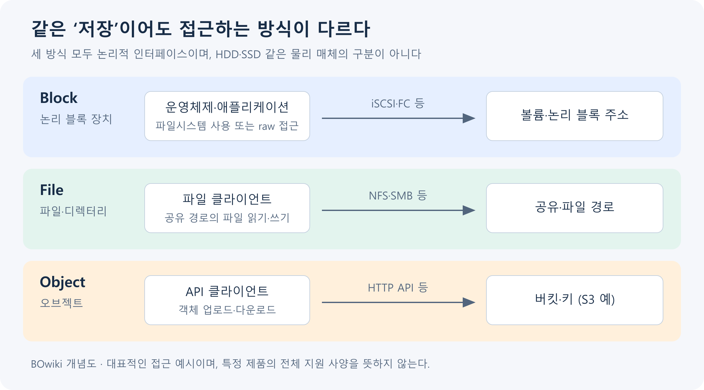

## 목차

- [[#분야 소개|분야 소개]]
- [[#저장 계층의 기초|저장 계층의 기초]]
- [[#블록·파일·오브젝트 접근|블록·파일·오브젝트 접근]]
- [[#네트워크 스토리지|네트워크 스토리지]]
- [[#제품과 확장 주제|제품과 확장 주제]]

## 분야 소개

데이터를 저장하는 매체와 시스템, 블록·파일·오브젝트 접근 방식, 주요 스토리지 제품의 개념을 정리합니다.

## 저장 계층의 기초

- [[Storage|스토리지]]: 저장 매체·접근 방식·I/O·성능·데이터 보호
- [[Disk|디스크]]: HDD·SSD의 구조와 데이터 기록 원리
- [[Partition|파티션]]: 디스크의 논리 블록 주소 범위와 MBR·GPT
- [[Filesystem|파일시스템]]: 블록 공간의 파일·디렉터리·메타데이터 관리
- [[Inode|inode]]: 파일 이름·메타데이터·데이터 블록의 연결
- [[Mount|마운트]]: 파일시스템을 Linux 디렉터리 트리에 연결
- [[Fstab|fstab]]: 파일시스템의 영구 마운트 설정
- [[Disk Capacity Check|디스크 용량 확인]]: `lsblk`·`df`·`du`·inode 사용량 해석
- [[VFS]]: 여러 파일시스템을 하나의 파일 인터페이스로 연결하는 커널 계층
- [[Linux Block Layer]]: 파일시스템과 블록 장치 드라이버 사이의 I/O 계층
- [[RAID]]: 여러 디스크를 성능·가용성 목적에 맞게 구성하는 방식

## 블록·파일·오브젝트 접근

- [[Block Storage|블록 스토리지]]: 블록 장치 단위의 저장과 접근
- [[File Storage|파일 스토리지]]: 파일·디렉터리 단위의 저장과 공유
- [[Object Storage|오브젝트 스토리지]]: API 기반 오브젝트 저장과 접근
- [[S3 API]]: 버킷·키·요청 서명·Presigned URL 기반의 오브젝트 접근

## 네트워크 스토리지

- [[SAN]]: 원격 블록 장치를 제공하는 전용 네트워크와 운영 체계
- [[NAS]]: 원격 파일시스템을 제공하는 스토리지 시스템
- [[iSCSI]]: TCP/IP 네트워크를 통한 SCSI 블록 접근
- [[NFS]]: Unix·Linux 환경에서 널리 사용하는 파일 공유 프로토콜
- [[SMB]]: Windows 환경에서 널리 사용하는 파일 공유 프로토콜

## 제품과 확장 주제

- [[Hammerspace]]: 글로벌 네임스페이스와 데이터 오케스트레이션

- [[VPSA]]: Zadara의 블록·파일 스토리지
- [[ZIOS]]: VPSA Object Storage
- [[NGOS]]: NextGen Object Storage

- [[EMC]]: Dell EMC 스토리지의 의미와 제품군 구분

