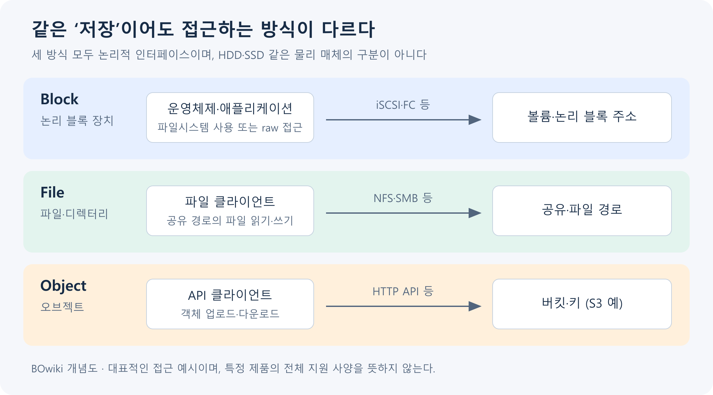

## 목차

- [[#1. 개요|1. 개요]]
- [[#2. RAM·저장 매체·장치·서비스의 구분|2. RAM·저장 매체·장치·서비스의 구분]]
- [[#3. 블록·파일·오브젝트 접근 방식|3. 블록·파일·오브젝트 접근 방식]]
- [[#4. 로컬 디스크와 원격 스토리지의 경로|4. 로컬 디스크와 원격 스토리지의 경로]]
- [[#5. 디스크부터 애플리케이션까지의 저장 계층|5. 디스크부터 애플리케이션까지의 저장 계층]]
- [[#6. 용량·성능 지표의 해석|6. 용량·성능 지표의 해석]]
- [[#7. 가용성과 데이터 보호의 차이|7. 가용성과 데이터 보호의 차이]]
- [[#8. 저장장치에서 스토리지 서비스로의 발전|8. 저장장치에서 스토리지 서비스로의 발전]]
- [[#9. 관련 문서|9. 관련 문서]]
- [[#10. 출처|10. 출처]]

## 1. 개요

Storage(스토리지)는 데이터를 저장 매체에 기록하고 다시 읽을 수 있도록 장치·접근 방식·관리 기능을 제공하는 시스템이다.

클라우드 화면의 볼륨이나 버킷은 관리·접근 단위이고, 실제 데이터는 SSD·HDD 등 저장 매체와 컨트롤러·네트워크·소프트웨어를 통해 처리된다. 저장 용량이 있다는 사실과 서버가 정상적으로 접근할 수 있다는 사실, 장애 후 데이터를 복구할 수 있다는 사실은 서로 다르다.

[[Server]]는 프로그램을 실행하며 데이터를 읽고 쓰고, [[Networking]]은 원격 저장소까지 요청을 전달한다. [[Database]]의 영속성과 복구도 이 저장 경로가 필요한 조건을 충족해야 성립한다.

## 2. RAM·저장 매체·장치·서비스의 구분

| 구분 | 물리적·논리적 의미 | 대표적인 용도 |
|---|---|---|
| RAM | 실행 중인 작업과 캐시에 사용하는 메모리 | 코드·DB 버퍼·파일 캐시 |
| HDD | 회전 매체에 데이터를 기록하는 장치 | 용량 중심 보관·순차 접근 |
| SSD | 플래시 메모리와 컨트롤러를 사용하는 장치 | 낮은 지연이 필요한 I/O |
| 컨트롤러·스토리지 서버 | 매체 접근·보호·프로토콜 처리 | RAID·풀·볼륨·공유 관리 |
| 볼륨·공유·버킷 | 사용자에게 제공하는 접근·관리 단위 | 블록·파일·오브젝트 서비스 |

RAM은 일반적으로 전원이 끊기면 내용이 사라지는 실행 자원이고 SSD·HDD는 전원 없이도 데이터를 보관하는 매체이다. 다만 캐시·전원 보호·동기화 조건에 따라 애플리케이션이 “쓰기 완료”를 받는 시점과 안정적인 매체에 반영되는 시점이 다를 수 있다. 커널과 장치의 쓰기 완료 의미를 이해해야 DB의 영속성과 연결할 수 있다.[^cache][^wal]

SSD·HDD는 매체·장치의 종류이며 SATA·SAS·NVMe 같은 연결·명령 체계와 구별된다. 또한 “SSD이므로 언제나 서비스가 빠르다”는 결론은 맞지 않는다. 서버의 I/O 경로와 처리 한도, 요청 크기·동시성·캐시가 실제 성능에 영향을 준다.[^performance]

HDD는 회전하는 플래터와 헤드로 기록 위치에 접근하므로 탐색·회전 대기가 랜덤 I/O 특성에 영향을 준다. 일반적인 NAND SSD는 컨트롤러가 논리 주소를 실제 플래시 위치에 매핑하고, 제한된 쓰기·삭제 단위와 수명·가비지 컬렉션(불필요해진 데이터 영역의 회수) 등을 관리한다. 두 매체의 내부 특성은 다르지만 서비스 성능은 매체 한 개의 최대 수치만으로 정해지지 않는다.[^media]

## 3. 블록·파일·오브젝트 접근 방식

BOwiki 자체 제작 개념도. 대표적인 접근 예시이며 특정 제품의 전체 지원 사양을 뜻하지 않는다.

| 방식 | 클라이언트가 다루는 것 | 관리 책임의 중요한 차이 |
|---|---|---|
| [[Block Storage]] | 주소를 가진 블록 장치·볼륨 | 호스트나 앱이 파일시스템·raw 사용을 결정 |
| [[File Storage]] | 공유의 파일·디렉터리 경로 | 파일 서비스가 파일 네임스페이스를 관리 |
| [[Object Storage]] | API로 식별하는 객체와 메타데이터 | 객체 API·권한·버전·수명주기로 관리 |

같은 SSD가 블록 볼륨, NAS 공유, 오브젝트 서비스의 저장 기반이 될 수 있다. “Object는 HDD이고 Block은 SSD”처럼 접근 방식과 매체를 대응시키면 안 된다. 블록·파일·오브젝트는 어떤 단위와 프로토콜로 데이터를 다루는지를 설명한다.[^models]

여기서 **블록도 물리적인 저장 조각 그 자체는 아니다.** 클라이언트가 보는 블록은 보통 번호가 붙은 논리 주소 단위이며, 스토리지 컨트롤러가 그 주소를 실제 HDD 섹터나 SSD 플래시 페이지에 대응시킨다. 파일은 파일시스템이나 파일 서비스가 이름·경로·권한을 붙여 제공하는 단위이고, 오브젝트는 스토리지 서비스가 **키·메타데이터·데이터를 한 묶음**으로 관리해 API로 제공하는 단위이다.

따라서 셋의 차이는 물리적·논리적이라는 이분법보다 **클라이언트에게 무엇을 인터페이스로 보여 주는가**에 있다. 블록은 주소 공간을 보여 주고, 파일은 경로와 파일 동작을 보여 주며, 오브젝트는 키를 지정한 업로드·조회 같은 API 동작을 보여 준다. 세 방식의 내부 저장 매체는 모두 SSD·HDD일 수 있다.

## 4. 로컬 디스크와 원격 스토리지의 경로

직접 연결된 저장 장치(DAS)는 호스트의 내부 디스크나 직접 연결 장치로 접근한다. SAN은 블록 스토리지를 네트워크로 제공하는 구조이며 [[iSCSI]]나 Fibre Channel 같은 수단을 사용할 수 있다. NAS는 NFS·SMB 같은 파일 프로토콜로 공유를 제공한다. SAN·NAS는 스토리지 네트워크·서비스 구조이고 HDD·SSD는 그 내부의 매체이다.[^san]

이 그림은 로컬 블록과 원격 iSCSI 블록 경로의 비교이다. 파일 공유와 오브젝트 요청이 모두 호스트의 같은 블록 계층을 거친다는 뜻은 아니다. NAS에서는 파일 프로토콜 처리가, 오브젝트에서는 API 요청 처리가 원격 서비스에 포함된다.

원격 볼륨 장애는 디스크 고장뿐 아니라 NIC·케이블·스위치·경로·인증·컨트롤러 상태에서도 발생할 수 있다. 스토리지 관리 화면에서 볼륨이 정상이어도 호스트에 연결되지 않았거나 호스트 파일시스템이 손상되어 있으면 애플리케이션은 데이터를 쓰지 못한다.

일반적인 버퍼 쓰기에서 애플리케이션의 `write` 성공은 데이터가 OS의 메모리 버퍼에 받아들여진 시점을 뜻할 수 있다. 이후 파일시스템·블록 계층·컨트롤러를 거쳐 매체에 반영된다. 파일 데이터와 메타데이터, 장치 캐시의 동기화 완료가 필요한 작업에서는 `fsync` 같은 기능을 사용하고 반환 오류도 처리해야 한다. 파일 생성·이름 변경의 디렉터리 항목까지 안정적으로 남기는 데는 디렉터리 동기화가 별도로 필요할 수 있다.[^fsync]

애플리케이션의 완료 응답, OS 쓰기 반환, 스토리지 프로토콜 응답, 장애 후 복구 가능 상태를 하나의 순간으로 합치면 데이터 유실 조건을 놓친다. DB는 WAL과 커밋 설정을 통해 이 경로를 제어한다. 캐시가 있다는 사실이 곧 데이터 유실을 뜻하는 것도 아니며 전원 보호와 flush 동작·설정을 함께 봐야 한다.

## 5. 디스크부터 애플리케이션까지의 저장 계층

Linux의 일반적인 블록 사용 예는 장치 인식 → 필요시 파티션·논리 볼륨 구성 → 파일시스템 생성 → 마운트 → 디렉터리 권한 → 애플리케이션 사용이다. 파티션과 LVM은 모든 구성에 필수인 단계가 아니고, DB나 가상화 플랫폼이 raw 블록 장치를 사용하는 경우도 있다.[^block]

운영에서 “볼륨 용량 증설”은 전체 경로의 일부일 수 있다. 저장 서비스가 큰 장치를 제공해도 호스트가 새 크기를 인식하고 필요한 파티션·논리 볼륨·파일시스템이 확장되어야 앱이 공간을 사용할 수 있다. 파일시스템과 제품이 지원하는 확장 방법은 서로 다르므로 클라우드 콘솔의 숫자와 OS의 사용 가능 공간을 구분한다.

씬 프로비저닝은 논리적으로 할당한 용량과 실제 소비한 물리 공간을 다르게 관리한다. 논리 볼륨의 남은 공간만 보지 말고 공통 풀의 여유 공간과 스냅샷·복제본 사용량을 함께 봐야 한다. 실제 물리 공간이 부족하면 여러 볼륨이 동시에 영향을 받을 수 있다.[^pool]

## 6. 용량·성능 지표의 해석

| 지표·특성 | 의미 | 해석 예시 |
|---|---|---|
| Capacity | 저장 가능한 공간 | 논리 할당·실제 사용·보호용 소비량 구분 |
| IOPS | 초당 처리한 I/O 수 | 작은 DB 랜덤 I/O에서 중요 |
| Throughput | 초당 전송한 데이터량 | 큰 파일·백업·학습 데이터 공급에서 중요 |
| Latency | 요청 완료까지 걸리는 시간 | 평균 외 상위 지연과 쓰기 동기화 지연 확인 |
| Queue·Concurrency | 진행·대기 중인 I/O | 처리 한도와 지연·요청량의 관계 해석 |
| Random·Sequential | 요청 주소의 접근 패턴 | 매체·캐시·전송 효율에 영향 |

동일 계층에서 같은 기간·평균 요청 크기를 사용한다면 `처리량 ≈ IOPS × 평균 I/O 크기`로 관계를 이해할 수 있다. 예를 들어 4 KiB 요청 10,000회/초는 약 39.1 MiB/초이며, 1 MiB 요청 1,000회/초는 1,000 MiB/초이다. 이는 단위 계산 예시이고 어떤 장비의 보장 성능도 아니다. 실제 서비스는 IOPS와 처리량 한도를 동시에 가질 수 있다.[^performance]

앱·호스트·네트워크·스토리지가 집계하는 I/O 크기와 수는 요청 병합·분할·캐시 때문에 다를 수 있다. 호스트의 읽기가 캐시에서 끝나면 원격 디스크에는 같은 요청이 발생하지 않는다. Linux 장치 통계도 해당 장치의 계층에서 관측한 누적값이라는 점을 고려한다.[^stats]

## 7. 가용성과 데이터 보호의 차이

RAID는 여러 매체를 묶어 성능·용량·매체 고장 대응을 설계하는 기술이다. 수준별 특성이 다르고 RAID 0은 중복성을 제공하지 않는다. 스냅샷은 특정 시점의 상태를 표현하고 클론은 그 상태를 바탕으로 별도 사용 공간을 만드는 기능으로 제공될 수 있다. 복제는 다른 위치에 데이터를 유지하는 방법이다.[^raid][^snapshot]

이 기능들은 같은 장애나 실수를 해결하지 않는다. RAID는 잘못 삭제한 파일을 알아서 되돌리지 않고, 즉시 복제되는 삭제는 복제 대상에도 전달될 수 있다. 스냅샷이 원본과 같은 장애 영역에 의존하면 장치 전체의 손상까지 보호하지 못할 수 있다. 백업은 보존 정책과 복구 가능한 사본·절차를 포함해 설계한다.

DB를 실행 중인 볼륨의 스냅샷은 데이터베이스 복구 규칙까지 충족해야 한다. PostgreSQL은 일관된 파일시스템 스냅샷과 일반적인 실행 중 파일 복사를 구분하며, 데이터와 필요한 로그를 함께 일관되게 확보하는 조건을 설명한다.[^dbbackup] “스냅샷 생성 성공”과 “업무 데이터 복구 검증 성공”을 분리해야 한다.

RPO는 허용 가능한 데이터 손실 구간, RTO는 허용 가능한 복구 시간을 표현하는 목표이다. 디스크 이중화·스냅샷·오프사이트 백업을 조합해도 실제 복구 경로와 의존 서비스를 고려하지 않으면 목표 달성을 보장할 수 없다.[^dr]

### 7.1. RAID 수준과 재구축

다음은 같은 크기 S의 정상 디스크 N개, 일반적인 배치, 예비 디스크·메타데이터·파일시스템 오버헤드를 제외한 이론 용량이다. 실제 제품의 최소 디스크 수·배치·구성 조건은 별도이다.[^raidlevels]

| 수준 | 원리 | 이론 용량 | 디스크 고장에 대한 일반적 특성 |
|---|---|---|---|
| RAID 0 | 여러 디스크에 분산 기록 | N × S | 중복성 없음 |
| RAID 1 | 미러링 | 2개 미러 예에서 S | 두 사본 중 1개 고장 대응 |
| RAID 5 | 분산 데이터와 단일 패리티 | (N−1) × S | 1개 디스크 고장 대응 |
| RAID 6 | 이중 패리티 | (N−2) × S | 2개 디스크 고장 대응 |
| RAID 10 | 미러 쌍을 스트라이핑 | (N/2) × S | 같은 미러 쌍의 두 사본을 모두 잃으면 실패; 고장 위치에 따라 달라짐 |

고장 뒤 교체 디스크를 채우는 rebuild는 나머지 매체의 읽기와 추가 작업을 유발한다. 재구축 중 성능·남은 보호 수준·추가 고장 위험을 함께 관리해야 하며, 디스크 수와 용량만으로 완료 시간을 보장할 수 없다. RAID는 삭제·오염·사이트 전체 장애를 되돌리는 백업과 다르다.

## 8. 저장장치에서 스토리지 서비스로의 발전

1956년에 등장한 IBM 305 RAMAC은 자기 디스크로 데이터에 임의 접근하는 방식을 실용화한 초기의 중요한 사례이다. 필요한 데이터를 찾기 위해 앞부분부터 계속 읽어야 하는 방식과 달리, 디스크는 원하는 기록 위치로 이동해 데이터를 읽고 변경할 수 있게 했다.[^history]

이후 HDD와 SSD 같은 저장장치뿐 아니라 여러 장치를 묶는 어레이, 네트워크로 접근하는 SAN·NAS, API로 사용하는 오브젝트 스토리지 등 다양한 시스템이 발전했다. 이들은 이전 기술을 모두 없애는 일직선의 단계가 아니라 서로 다른 접근·공유·확장 요구를 해결하는 방식이다.[^models][^san]

클라우드의 볼륨·공유·버킷은 사용자가 디스크의 실제 위치를 직접 선택하지 않고 저장 기능을 사용하도록 한다. 그러나 데이터는 여전히 실제 매체에 저장된다. 현대 스토리지의 변화는 “저장할 장치”를 넘어 “어떤 방식과 단위로 데이터를 제공할 것인가”까지 소프트웨어와 서비스로 관리한다는 점에 있다.

## 9. 관련 문서

- [[Server]], [[Networking]], [[Database]]
- [[Block Storage]], [[File Storage]], [[Object Storage]], [[iSCSI]]
- [[VPSA]], [[NGOS]], [[ZIOS]], [[Hammerspace]]

## 10. 출처

[^history]: [IBM — RAMAC](https://www.ibm.com/history/ramac)

[^cache]: [Linux Kernel — Memory and page cache concepts](https://docs.kernel.org/admin-guide/mm/concepts.html)
[^wal]: [PostgreSQL — Write-Ahead Logging](https://www.postgresql.org/docs/current/wal-intro.html)
[^performance]: [AWS — EBS I/O characteristics](https://docs.aws.amazon.com/ebs/latest/userguide/ebs-io-characteristics.html)
[^models]: [AWS — Block, File, Object 비교](https://aws.amazon.com/compare/the-difference-between-block-file-object-storage/)
[^san]: [Red Hat — What is NAS?](https://www.redhat.com/en/topics/data-storage/network-attached-storage)
[^block]: [Kubernetes — Raw block volume support](https://kubernetes.io/docs/concepts/storage/persistent-volumes/#raw-block-volume-support)
[^pool]: [Zadara — VPSA Pools](https://guides.zadara.com/vpsa-guide/latest/pools.html)
[^stats]: [Linux Kernel — I/O statistics fields](https://docs.kernel.org/admin-guide/iostats.html)
[^raid]: [Linux Kernel — RAID and data redundancy](https://docs.kernel.org/admin-guide/md.html)
[^snapshot]: [Zadara — VPSA Volumes and snapshots](https://guides.zadara.com/vpsa-guide/latest/volumes.html)
[^dbbackup]: [PostgreSQL — File System Level Backup](https://www.postgresql.org/docs/current/backup-file.html)
[^dr]: [AWS — Disaster recovery options: RPO and RTO](https://docs.aws.amazon.com/whitepapers/latest/disaster-recovery-workloads-on-aws/disaster-recovery-options-in-the-cloud.html)

[^fsync]: [Linux man-pages — fsync and fdatasync](https://man7.org/linux/man-pages/man2/fsync.2.html)
[^raidlevels]: [Seagate — RAID levels](https://www.seagate.com/manuals/software/raid-manager/raid-levels/)
[^media]: [Samsung Semiconductor — HDD의 플래터·헤드](https://semiconductor.samsung.com/support/tools-resources/dictionary/semiconductor-glossary-hard-disk-drive-hdd/) · [Samsung Semiconductor — FTL과 데이터 배치·가비지 컬렉션](https://semiconductor.samsung.com/news-events/tech-blog/a-brief-history-of-data-placement-technologies/)

## 둘러보기

[[Knowledge Base/index|전체 개념 목록]] · [[Storage 분류|Storage]]
