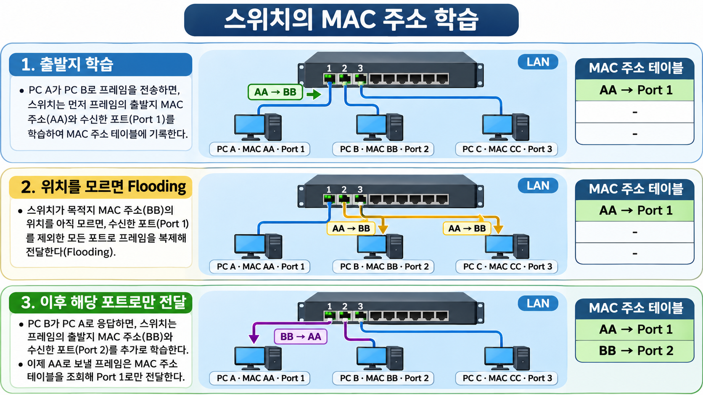
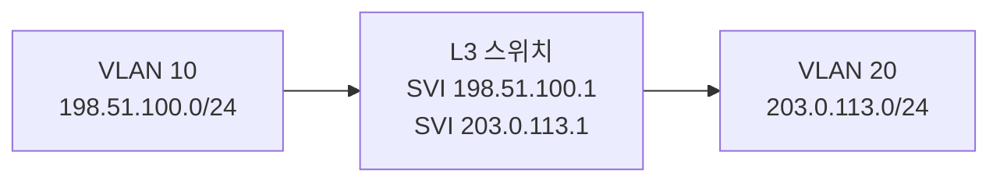
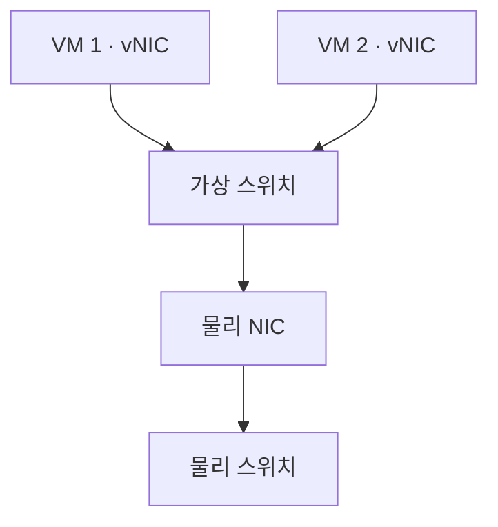

## 목차

- [[#1. 개요|1. 개요]]
- [[#2. 실제 장비의 모습과 내부 구성|2. 실제 장비의 모습과 내부 구성]]
- [[#3. MAC 주소 학습과 프레임 전달|3. MAC 주소 학습과 프레임 전달]]
- [[#4. 브로드캐스트와 알 수 없는 유니캐스트|4. 브로드캐스트와 알 수 없는 유니캐스트]]
- [[#5. L2 스위치와 L3 스위치|5. L2 스위치와 L3 스위치]]
- [[#6. 물리 스위치와 가상 스위치|6. 물리 스위치와 가상 스위치]]
- [[#7. 등장 배경과 발전|7. 등장 배경과 발전]]
- [[#8. 관련 문서|8. 관련 문서]]
- [[#9. 출처|9. 출처]]

## 1. 개요

Switch(스위치)는 같은 Ethernet 네트워크 안에서 목적지 MAC 주소에 맞는 포트로 프레임을 전달하는 장비이다.

PC 두 대를 연결하는 단순한 장치처럼 보이지만, 실제 업무망에서는 수십 대의 서버와 PC를 연결하고 VLAN으로 통신 범위를 나누는 중심 장비가 된다. 스위치는 보통 같은 링크의 전달을 담당하고, 서로 다른 IP 네트워크 사이의 전달은 [[Router|라우터]]가 담당한다.

## 2. 실제 장비의 모습과 내부 구성

앞면의 여러 RJ-45 포트에 PC·서버·다른 스위치가 연결된다. 광통신용 SFP·SFP+·QSFP 포트를 갖춘 장비도 있다. 사진: Jon 'ShakataGaNai' Davis, [Wikimedia Commons 원본](https://commons.wikimedia.org/wiki/File:Network_switches.jpg), [CC BY-SA 3.0](https://creativecommons.org/licenses/by-sa/3.0/). 추가 편집 없이 사용했다.

소형 장비도 CPU·메모리·포트 회로와 스위칭 칩을 갖춘 작은 컴퓨터이다. 사진: Malcolm Koo(Mk2010), [Wikimedia Commons 원본](https://commons.wikimedia.org/wiki/File:ZyXEL_desktop_Ethernet_switch.jpg), [CC BY 4.0](https://creativecommons.org/licenses/by/4.0/). 추가 편집 없이 사용했다.

기업용 스위치의 주요 부품은 다음과 같다.

- **포트와 PHY**: 케이블의 전기·광 신호를 비트로 변환한다.
- **ASIC·NPU**: MAC 주소와 VLAN 등의 정보를 이용해 프레임을 매우 빠르게 전달한다.
- **MAC 주소 테이블**: 어느 MAC 주소가 어느 포트 뒤에 있는지 기록한다.
- **패킷 버퍼**: 출력 포트가 잠시 혼잡할 때 프레임을 대기시킨다.
- **CPU·메모리·네트워크 운영체제**: STP, 관리 접속, 로그와 설정 같은 제어 기능을 수행한다.
- **스위칭 패브릭**: 여러 포트 사이에서 데이터가 동시에 이동하는 내부 통로이다.

따라서 스위치는 단순한 멀티탭이 아니다. 데이터 전달은 주로 전용 칩이 처리하고, CPU는 설정과 프로토콜을 관리한다.

## 3. MAC 주소 학습과 프레임 전달

스위치는 들어온 프레임의 **출발지 MAC 주소**를 보고 학습한다. 목적지 MAC 주소를 학습하는 것이 아니라는 점이 중요하다.

처음에는 `BB`의 위치를 모르므로 들어온 포트를 제외한 같은 VLAN의 포트로 프레임을 보낸다. B가 응답하면 스위치는 B의 출발지 주소를 보고 `BB → 2번 포트`를 학습한다. 이후에는 필요한 포트로만 전달한다.

MAC 주소 테이블의 항목은 영구적이지 않다. 장치가 이동하거나 연결이 바뀔 수 있으므로 일정 시간 사용되지 않은 동적 항목은 사라진다.

## 4. 브로드캐스트와 알 수 없는 유니캐스트

두 동작은 여러 포트로 프레임을 보낸다는 점만 같고 목적이 다르다.

- **브로드캐스트**: 송신자가 같은 VLAN의 모든 장치에 보내도록 목적지 MAC을 `ff:ff:ff:ff:ff:ff`로 지정한다. ARP 요청이 대표 사례이다.
- **알 수 없는 유니캐스트 Flooding**: 특정 MAC 주소 한 곳에 보내려 했지만 스위치가 그 위치를 아직 몰라 여러 포트로 전달한다.
- **Anycast**: 여러 서버가 같은 IP 주소를 알리고 라우팅으로 가까운 경로를 선택하는 L3 방식이다. 스위치의 Flooding과 다른 개념이다.

[[VLAN]]은 하나의 물리 스위치를 여러 논리적 L2 네트워크로 나눈다. 브로드캐스트와 Flooding은 원칙적으로 같은 VLAN 안에 머문다.

## 5. L2 스위치와 L3 스위치

L2 스위치는 MAC 주소를 기준으로 같은 VLAN 안의 프레임을 전달한다. L3 스위치는 이 기능에 IP 라우팅 기능을 더한 장비이다. L3 스위치의 SVI(Switch Virtual Interface)를 각 VLAN의 기본 게이트웨이로 사용할 수 있다.

이름에 스위치가 들어가도 L3 기능을 수행하면 라우터와 같은 원리로 IP 패킷을 전달한다. 장비 이름보다 실제 활성화된 기능과 배치 목적을 확인해야 한다.

## 6. 물리 스위치와 가상 스위치

가상 스위치는 하이퍼바이저나 운영체제 안에서 VM·컨테이너·물리 NIC를 연결하는 소프트웨어이다. 물리 포트 대신 vNIC와 가상 포트를 사용하지만 MAC 학습, VLAN, 필터링 같은 L2 개념은 이어진다.

같은 호스트 안의 두 VM은 물리 케이블로 나가지 않고 가상 스위치 안에서 통신할 수도 있다. Open vSwitch처럼 터널과 SDN 제어 기능까지 제공하는 구현도 있다.[^ovs]

## 7. 등장 배경과 발전

초기 공유 Ethernet의 허브는 들어온 신호를 여러 포트로 그대로 반복했다. 장치가 많아질수록 충돌과 불필요한 트래픽이 늘었다. 브리지는 MAC 주소를 학습해 네트워크 구간을 나누었고, 다수의 포트를 빠르게 처리하는 장비가 오늘날의 Ethernet 스위치로 발전했다.

현대 스위치는 단순한 L2 전달을 넘어 VLAN, 링크 집성, 접근 제어, 라우팅, 원격 측정과 자동화를 제공한다. 그러나 가장 기본적인 역할은 여전히 “같은 L2 네트워크에서 올바른 포트로 프레임을 보내는 일”이다.

## 8. 관련 문서

- [[Networking]] · [[Router]] · [[Internet Routing|인터넷의 통신 구조]]
- [[NIC]] · [[Virtualization]] · [[BGP]]
- [[VLAN]] · [[ARP]] · [[Default Gateway|기본 게이트웨이]]
- 관련 질문: [[네트워크 장비별 처리 계층]]

## 9. 출처

[^ovs]: Open vSwitch, [What Is Open vSwitch?](https://docs.openvswitch.org/en/stable/intro/what-is-ovs/). 가상 스위치의 목적과 물리·가상 환경 지원 범위.

- Cisco, [Catalyst 9300 Series Switches Hardware Installation Guide — Product Overview](https://www.cisco.com/c/en/us/td/docs/switches/lan/catalyst9300/hardware/install/b_c9300_hig/Product-overview.html). 기업용 스위치의 포트·전원·팬·모듈 구성 사례.
- IEEE, [IEEE 802.1Q](https://standards.ieee.org/ieee/802.1Q/6844/). VLAN과 브리지 동작의 표준.

## 둘러보기

[[Knowledge Base/index|전체 개념 목록]] · [[Networking 분류|Networking]]
