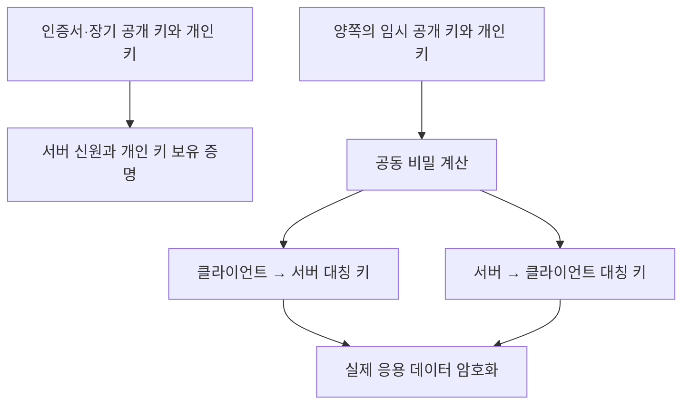
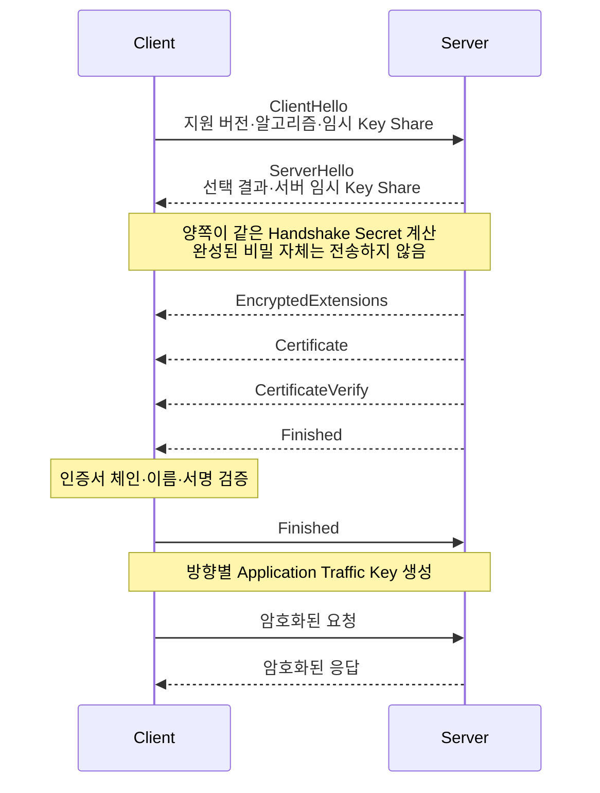

## 목차

- [[#1. 개요|1. 개요]]
- [[#2. TLS가 해결하는 문제|2. TLS가 해결하는 문제]]
- [[#3. 암호 기술의 역할 분담|3. 암호 기술의 역할 분담]]
- [[#4. TLS 1.3 연결 과정|4. TLS 1.3 연결 과정]]
- [[#5. 임시 키 합의와 대칭 트래픽 키|5. 임시 키 합의와 대칭 트래픽 키]]
- [[#6. 인증서와 CertificateVerify|6. 인증서와 CertificateVerify]]
- [[#7. Finished와 핸드셰이크 보호|7. Finished와 핸드셰이크 보호]]
- [[#8. 서버 인증과 상호 인증|8. 서버 인증과 상호 인증]]
- [[#9. TLS와 TCP·HTTP의 관계|9. TLS와 TCP·HTTP의 관계]]
- [[#10. 관련 문서|10. 관련 문서]]
- [[#11. 출처|11. 출처]]

## 1. 개요

TLS(Transport Layer Security)는 신뢰하기 어려운 네트워크에서 통신 상대를 인증하고, 데이터의 기밀성과 무결성을 보호하는 보안 프로토콜이다. HTTPS에서는 TLS가 HTTP 메시지를 보호하지만 TLS 자체는 HTTP에만 종속되지 않는다.

최신 TLS 1.3 표준은 서버와 클라이언트가 알고리즘과 임시 키 정보를 교환하고, 인증서와 전자서명으로 상대의 신원을 검증하며, 연결마다 새로운 대칭 트래픽 키를 만들어 실제 데이터를 보호하는 절차를 정의한다.[^tls13]

### SSL에서 TLS로 이어진 계보

SSL(Secure Sockets Layer)은 Netscape가 개발한 선행 프로토콜이고, IETF가 SSL 3.0을 바탕으로 표준화한 후속 규격이 TLS 1.0이다. TLS 1.0은 SSL 3.0과 설계 계보가 이어지지만 일부 계산과 메시지가 달라 서로 그대로 호환되는 같은 버전은 아니다.[^ssl3][^tls10]

```text
SSL 2.0 → SSL 3.0 → TLS 1.0 → TLS 1.1 → TLS 1.2 → TLS 1.3
```

SSL 2.0·3.0과 TLS 1.0·1.1은 현대 환경에서 사용하지 않는다. IETF는 TLS 1.0과 1.1도 오래된 암호 방식과 불필요한 공격 표면 때문에 폐기했다.[^oldtls] 현재 환경에서는 TLS 1.2와 TLS 1.3 지원 여부를 확인한다.

`SSL 인증서`, `SSL VPN`, `OpenSSL`처럼 SSL이라는 단어가 남은 표현은 역사적으로 굳어진 이름이다. 일반적으로 말하는 SSL 인증서는 SSL 전용 형식이 아니라 TLS 서버 인증에도 사용하는 X.509 인증서이다. 제품 이름에 SSL이 있어도 실제로 허용하는 TLS 버전과 암호 정책은 별도로 확인해야 한다.

## 2. TLS가 해결하는 문제

TLS가 목표로 하는 핵심 성질은 다음 세 가지이다.

| 성질 | 확인할 질문 | 실패할 때의 위험 |
|---|---|---|
| 인증 | 지금 연결한 상대가 의도한 서버인가 | 공격자 서버와 통신 |
| 기밀성 | 중간 관찰자가 내용을 읽을 수 없는가 | 비밀번호·쿠키·본문 노출 |
| 무결성 | 전송 중 내용이 변조되지 않았는가 | 요청·응답 위조 |

암호화만 하고 상대를 확인하지 않으면 공격자가 자신의 공개 키를 제시하여 암호화된 중간자 역할을 할 수 있다. TLS는 키 합의와 인증을 하나의 핸드셰이크에 묶어 이 문제를 다룬다.

## 3. 암호 기술의 역할 분담

TLS는 하나의 키로 모든 문제를 해결하지 않는다.



- 장기 인증 키는 상대가 누구인지 증명한다.
- 임시 키 교환 키는 이번 연결의 공동 비밀을 만든다.
- 대칭 트래픽 키는 실제 요청과 응답을 빠르게 암호화한다.

공개 키 암호 기술은 인증과 키 합의에 유리하지만 대량 데이터 처리에는 상대적으로 비용이 크다. 대칭 암호는 빠르므로 실제 애플리케이션 데이터 보호를 맡는다.

## 4. TLS 1.3 연결 과정



`ClientHello`와 `ServerHello`는 지원 기능과 임시 키 교환 정보를 맞춘다. TLS 1.3에서는 `ServerHello` 이후의 인증 메시지 대부분이 이미 핸드셰이크 키로 보호된다. 인증이 최종 성공하기 전까지 애플리케이션은 연결을 신뢰해서는 안 된다.[^tls13]

## 5. 임시 키 합의와 대칭 트래픽 키

양쪽은 연결마다 임시 공개 키·개인 키를 만들고 공개 값만 교환한다. 각자는 자신의 임시 개인 키와 상대의 임시 공개 키를 이용해 같은 공동 비밀을 계산한다.

```text
클라이언트 임시 개인 키 + 서버 임시 공개 키
                         ↓
                       공동 비밀

서버 임시 개인 키 + 클라이언트 임시 공개 키
                         ↓
                    같은 공동 비밀
```

공동 비밀에서 한 개의 만능 키를 꺼내는 것이 아니라 HKDF 기반 키 일정(Key Schedule)을 통해 핸드셰이크·애플리케이션·방향별 비밀을 파생한다.[^tls13]

```text
공동 비밀
├── 클라이언트 → 서버 Handshake Key
├── 서버 → 클라이언트 Handshake Key
├── 클라이언트 → 서버 Application Key
└── 서버 → 클라이언트 Application Key
```

`대칭`은 공개 키·개인 키처럼 공개 여부가 다른 한 쌍이라는 뜻이 아니다. 통신 당사자들이 같은 비밀에서 대응하는 암호화·복호화 키를 공유한다는 뜻이다. 실제 프로토콜은 방향별 키를 나누어 한 방향의 상태가 다른 방향에 섞이지 않게 한다.

## 6. 인증서와 CertificateVerify

서버 인증서는 서비스 이름과 서버의 장기 공개 키를 신뢰할 수 있는 인증기관의 서명으로 연결한다. 브라우저는 인증서 체인, 서비스 이름, 유효기간과 정책을 검증한다. 자세한 구조는 [[Digital Signature and Certificate|전자서명과 인증서]]에서 설명한다.

인증서 파일은 공개할 수 있으므로 복사본만으로 서버 신원을 증명하기에는 부족하다. TLS 1.3 서버는 `CertificateVerify`에서 지금까지의 핸드셰이크 기록에 인증서의 공개 키와 짝인 개인 키로 전자서명한다. 클라이언트는 인증서의 공개 키로 서명을 검증하여 현재 상대가 개인 키를 실제로 보유했는지 확인한다.[^tls13]

```text
CA 서명 검증
→ 인증서의 공개 키가 서비스 이름과 연결되었는지 확인

CertificateVerify 검증
→ 현재 서버가 그 공개 키와 짝인 개인 키를 보유했는지 확인
```

## 7. Finished와 핸드셰이크 보호

`Finished`는 지금까지 교환한 핸드셰이크 전체의 해시와 파생 비밀을 이용한 MAC을 전달한다. 양쪽은 이를 검증하여 같은 키를 계산했고 핸드셰이크가 변조되지 않았음을 확인한다.[^tls13]

```text
Certificate       누구의 공개 키인가
CertificateVerify 그 개인 키를 실제로 보유했는가
Finished          같은 비밀을 만들었고 앞선 교환이 변조되지 않았는가
```

## 8. 서버 인증과 상호 인증

일반적인 웹 HTTPS는 서버가 인증서를 제시하고 클라이언트는 이를 검증한다. 사용자는 TLS 연결 뒤 비밀번호·쿠키·토큰 등 애플리케이션 방식으로 로그인한다.

서버가 클라이언트 인증서까지 요구하면 클라이언트도 `Certificate`와 `CertificateVerify`를 보낸다. 이를 상호 TLS 인증(mTLS)이라고 한다. 사람의 일반 웹 접속보다 서비스 간 통신과 관리 환경에서 주로 사용한다.

## 9. TLS와 TCP·HTTP의 관계

```text
HTTP/1.1·HTTP/2의 대표 구조
HTTP → TLS → TCP → IP

HTTP/3의 구조
HTTP/3 → QUIC·TLS 1.3 → UDP → IP
```

TCP는 순서·재전송·흐름 제어를 제공하지만 상대의 신원을 인증하거나 데이터를 암호화하지 않는다. TLS가 보안 통로를 만들고 [[HTTP and HTTPS|HTTP]]가 그 안에서 요청과 응답의 의미를 전달한다.

## 10. 관련 문서

- [[HTTP and HTTPS|HTTP와 HTTPS]] · [[Digital Signature and Certificate|전자서명과 인증서]]
- [[SSH]] · [[DNS]] · [[Encapsulation|캡슐화]]
- [[Firewall]] · [[Security Group]]

## 11. 출처

[^tls13]: IETF, [RFC 9846, The Transport Layer Security (TLS) Protocol Version 1.3](https://www.rfc-editor.org/rfc/rfc9846.html). TLS 1.3의 키 교환·키 일정, Certificate·CertificateVerify·Finished와 Record 보호. 2026년에 RFC 8446을 대체한 현행 TLS 1.3 규격.
[^ssl3]: IETF, [RFC 6101, The Secure Sockets Layer (SSL) Protocol Version 3.0](https://www.rfc-editor.org/rfc/rfc6101.html). SSL 3.0을 역사적 기록으로 정리한 문서.
[^tls10]: IETF, [RFC 2246, The TLS Protocol Version 1.0](https://www.rfc-editor.org/rfc/rfc2246.html). TLS 1.0이 SSL 3.0을 기반으로 하지만 직접 호환되지는 않는다는 설명.
[^oldtls]: IETF, [RFC 8996, Deprecating TLS 1.0 and TLS 1.1](https://www.rfc-editor.org/rfc/rfc8996.html). TLS 1.0·1.1의 공식 폐기와 운영상 이유.

## 둘러보기

[[Knowledge Base/index|전체 개념 목록]] · [[Security 분류|Security]] · [[Networking 분류|Networking]]
