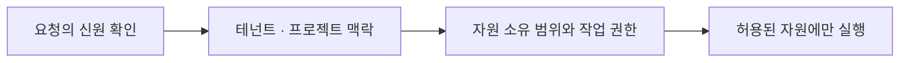
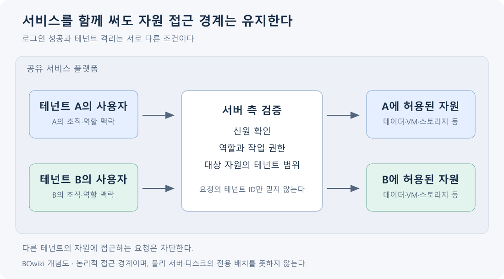

## 1. 개요

Tenant(테넌트)는 하나의 서비스 안에서 사용자·데이터·설정·자원에 대한 독립된 관리와 격리가 필요한 고객 또는 조직 단위이다.

테넌트는 사람 한 명이나 VM 한 대와 동일한 개념이 아니다.[^1]

## 2. 고객·사용자·프로젝트를 나누는 이유

한 고객 조직에도 여러 사용자가 있고, 개발·운영 등 여러 업무 환경이 있다. 이를 모두 같은 개념으로 취급하면 누가 누구의 자원을 사용할 수 있는지 설명하기 어렵다. 테넌트는 고객 조직의 경계, 사용자는 신원의 단위, 프로젝트는 자원을 묶는 작업 범위로 구분해 이해할 수 있다. 실제 제품의 이름과 계층은 다르다.[^1][^2]

예를 들어 회사 A와 B가 같은 클라우드 서비스를 이용하더라도 비용과 자원, 데이터 접근은 구분되어야 한다. A의 개발자에게 개발 프로젝트만 보이게 하는 것은 A와 B 사이의 격리보다 한 단계 안쪽의 권한 구분이다.

권한은 가능한 작업을, 할당량은 사용할 수 있는 자원의 양을, 청구 단위는 사용 비용의 귀속을 정한다. 하나의 계정이 공통 기준으로 쓰일 수 있어도 이 기능들의 목적이 같은 것은 아니다. 테넌트는 물리 장비 하나의 이름보다 서비스의 고객별 관리·격리 단위로 이해하는 편이 정확하다.

## 3. 사용자와 자원 사이의 관리 단위

한 조직에는 여러 사용자가 있고, 사용자는 역할에 따라 자원에 접근한다. 테넌트는 이때 누구의 자원인지와 어느 범위에서 권한을 행사할 수 있는지를 구분하는 기준이 된다.

예를 들어 하나의 서비스에 고객 A와 고객 B가 있다면 두 조직의 사용자가 같은 로그인 화면을 사용하더라도 서로의 데이터에는 접근할 수 없어야 한다. 같은 조직 안의 개발·운영 환경은 프로젝트 등 추가 관리 단위로 나눌 수 있다. 이 예시는 논리적 관계를 설명한 것이며 제품마다 이름과 계층은 다르다.

## 4. 조직·프로젝트·자원의 구성 예시

가상의 서비스 제공자가 연구 조직 A와 B에 클라우드를 제공한다고 하자. A의 여러 구성원은 개발·운영 프로젝트에 서로 다른 역할로 참여하고, 각 프로젝트는 VM·네트워크·볼륨을 가진다. 사용자 계정은 신원을 식별하는 단위, 프로젝트는 작업을 묶는 단위, 정책은 허용되는 행위의 규칙, 테넌트는 고객 조직의 자원 경계를 나타낸다. 이는 제품 중립적인 예시이며 실제 zCompute에서는 Account·Project·사용자·역할·정책이 이런 관계를 구체화한다.[^2][^v-project]

요청 처리에서는 먼저 신원을 확인하고 그 사용자가 어떤 테넌트·프로젝트 범위에서 작업하는지 정한 다음, 대상 자원이 그 범위에 있는지와 요청한 행위가 허용되는지를 검사한다. URL에 적힌 자원 ID가 유효하다는 사실만으로 접근을 허용하면 다른 고객의 자원을 조회하는 문제가 생길 수 있다. AWS의 격리 설명도 인증·권한 부여와 테넌트 자원 범위의 검증을 분리한다.[^v-isolation]

이 그림은 검증할 항목을 설명하며 특정 제품 내부의 정확한 실행 순서를 고정한 것은 아니다.

## 5. 인증과 격리

BOwiki 자체 제작 개념도. 요청에 표시된 테넌트 이름만 믿는 것이 아니라 신원·작업 권한·자원 범위를 확인하는 논리적 경계를 설명한다. 모든 테넌트가 물리 전용 장비를 사용한다는 의미는 아니다.[^v-isolation]

인증은 사용자의 신원을 확인하고, 권한 부여는 허용된 작업을 결정한다. 테넌트 격리는 그 작업이 해당 테넌트의 자원에만 적용되도록 경계를 유지하는 것이다. 로그인에 성공한 사용자라도 다른 테넌트의 자원을 읽으면 격리에 실패한 것이다.[^1]

## 6. Zadara의 Account와 Project

zCompute는 Account → Project → 자원의 관리 계층을 사용한다. Account에 속한 사용자는 할당된 Project에 접근하며, 역할·정책에 따라 볼 수 있거나 관리할 수 있는 자원이 달라진다.[^2] 프로젝트에 사용자를 할당할 때 Member·Tenant Admin 역할과 정책을 설정하는 구체적인 관리 기능이 제공된다.[^v-project]

Tenant는 서비스 격리의 일반 개념이고 Account와 Project는 제품이 제공하는 구체적인 관리 단위이다. 다른 클라우드의 tenant·account·subscription을 이름만 보고 일대일로 대응시키면 안 된다. 예를 들어 Azure의 Entra 테넌트는 신원 디렉터리이며 한 테넌트를 여러 구독이 신뢰할 수 있다. 구독은 테넌트와 별개의 관리 단위이다.[^v-entra]

## 7. 관련 문서

- [[Multi-tenancy]]
- [[Unified Cloud Management Portal]]
- [[Zadara Symphony API]]
- [[Microsoft Azure]]

- [[Server]]

## 8. 출처

[^1]: [AWS — SaaS Architecture Fundamentals: Tenant isolation](https://d1.awsstatic.com/onedam/marketing-channels/website/aws/en_US/events/approved/documents/saas-architecture-fundamentals-whitepaper.pdf)
[^2]: [Zadara — Accounts](https://guides.zadara.com/cs-compute-guide/latest/iam-accounts.html)

[^v-project]: [Zadara — Projects](https://guides.zadara.com/cs-compute-guide/latest/iam-projects.html)

[^v-entra]: [Microsoft — Subscription and Entra directory relationship](https://learn.microsoft.com/en-us/entra/fundamentals/how-subscriptions-associated-directory)

[^v-isolation]: [AWS — Tenant isolation](https://docs.aws.amazon.com/whitepapers/latest/saas-architecture-fundamentals/tenant-isolation.html)

## 둘러보기

[[Knowledge Base/index|전체 개념 목록]] · [[Cloud 분류|Cloud]]
