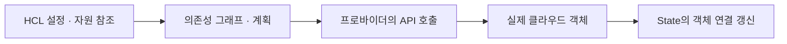

## 1. 개요

Terraform은 인프라를 코드로 정의하고 관리하는 Infrastructure as Code(IaC) 도구이다.

사용자는 원하는 자원의 구성을 선언하고, Terraform은 프로바이더를 통해 대상 플랫폼의 API와 상호작용한다.[^1] 관리 범위는 설정·State·프로바이더가 다루는 자원에 한정되며, 계정의 모든 외부 자원을 자동으로 관리 대상으로 삼는 것은 아니다.

## 2. 주요 구성 요소

| 요소 | 역할 |
|---|---|
| Configuration | 생성·관리할 자원과 속성 정의 |
| Provider | 클라우드 등 외부 서비스 API와 연결 |
| Resource | VM·네트워크 등 관리 대상 표현 |
| Module | 관련 설정을 묶어 재사용 |
| State | 코드의 자원과 실제 객체 간 연결 정보 유지 |

상태 파일은 인프라 데이터의 백업 파일이 아니다. 애플리케이션 DB나 볼륨의 내용은 별도의 데이터 보호 체계가 필요하다.[^1][^2]

## 3. 변경 계획과 적용

`plan`은 기본적으로 원격 자원의 상태를 확인하고 설정과 비교해 변경 계획을 만든다. `-refresh=false`처럼 기본 동작을 바꾸는 옵션도 있다. `apply`는 새로 만든 계획을 확인받아 적용하거나 저장된 계획 파일을 적용할 수 있다. 저장된 계획을 전달하는 방식과 대화형 승인 방식은 다르므로 모든 적용이 매번 같은 승인 화면을 거친다고 생각하면 안 된다.[^v-plan] 속성 변경이 기존 자원의 수정인지 교체인지에 따라 영향이 달라진다. 실행 시점의 외부 상태 변화나 API 오류 때문에 계획이 항상 그대로 완료되는 것은 아니다.

State에는 민감한 값이 포함될 수 있다. `sensitive = true`는 주로 출력에서 값을 숨기는 표시이며 그 자체로 State·plan 파일의 저장을 막지 않는다. 지원되는 ephemeral·write-only 기능은 별도의 조건과 용도를 가진다.[^v-sensitive]

여러 사람이 함께 관리할 때는 접근 통제와 동시 실행 충돌 방지가 중요하다. 상태 잠금은 모든 backend가 지원하는 기능이 아니므로 선택한 backend의 지원 여부를 확인한다.[^v-lock]

## 4. CLI 및 Zadara와의 관계

[[AWS CLI]]는 개별 작업을 명령으로 실행하고 Terraform은 관리할 구성을 선언한다. 코드 외부에서 자원을 변경하면 상태 차이가 발생할 수 있다.

zCompute AWS API 문서는 Terraform 연동 예시와 지원 매개변수 표를 제공한다. 실제 적용은 프로바이더 버전과 API 호환 범위에 맞춰야 하며, 과거 예제의 버전이나 TLS 검증 생략 설정을 그대로 운영 기준으로 삼으면 안 된다.[^3]

## 5. 설정에서 API 변경까지 이어지는 실행 구조

Terraform 설정은 원하는 자원의 속성과 다른 자원에 대한 참조를 표현한다. 실행 프로세스는 이 참조를 바탕으로 의존성 그래프를 구성하고, 프로바이더 플러그인은 특정 서비스의 API를 호출한다. HCL 파일은 설계의 입력, 프로바이더는 서비스 연결 구현, State는 설정의 자원 주소와 실제 객체 ID의 연결, Backend는 State를 보관하는 위치라는 서로 다른 역할이다.[^d-graph]

`init`은 작업 디렉터리의 backend와 필요한 프로바이더·모듈을 준비하고, `plan`은 관리 대상의 원격 상태와 설정을 비교해 변경을 계산한다. `apply`에서는 그래프의 의존성에 맞춰 작업을 진행한다. 예를 들어 VM이 특정 네트워크의 ID를 참조하면 네트워크가 준비되어야 그 값을 사용하는 VM 생성이 가능하다. 파일에 먼저 적은 줄이 언제나 먼저 실행되는 단순 스크립트 모델과 다르다.

이는 이해를 위한 개념 흐름이며 내부 실행은 병렬 작업과 상태 읽기·쓰기를 포함한다. State가 실제 서비스를 대신하지 않으므로 State 파일만 복원해도 삭제된 VM의 디스크 데이터가 되돌아오는 것은 아니다.[^2]

## 6. 교체·드리프트·부분 실패의 운영 의미

어떤 속성은 API로 수정할 수 있지만 어떤 속성 변경은 새 자원 생성과 기존 자원 삭제로 구현된다. 따라서 계획의 “변경 개수”보다 update인지 replace인지와 의존 자원에 미치는 영향을 읽는 것이 중요하다. Lifecycle 설정은 생성·삭제 순서나 보호 의도를 표현할 수 있지만 애플리케이션의 무중단 전환·데이터 이전까지 자동 설계해 주지는 않는다.

코드 밖에서 변경한 원격 상태가 드리프트이고, 이미 존재하는 객체를 관리 대상으로 연결하는 작업은 import의 영역이다. State를 삭제해 관리 연결을 잊게 하는 것은 원격 자원을 원하는 상태로 되돌리는 것과 다르다. 여러 실행이 같은 State를 동시에 갱신하면 같은 객체에 대해 다른 판단을 할 수 있으므로 backend의 잠금과 실행 권한·변경 절차를 함께 설계한다.[^v-lock]

적용 중 일부 API가 실패하면 성공한 자원은 실제 환경에 남아 있을 수 있다. 이때 전체 작업이 자동 롤백되었다고 가정하지 않고 오류가 난 자원·원격 상태·State와 다음 계획을 비교한다. 인증 실패는 프로바이더의 자격 증명·대상 범위, 예상치 못한 교체는 설정·스키마·드리프트, 잠금 오류는 다른 실행·backend 상태라는 식으로 원인을 나눈다. 저장된 계획을 적용하는 방식도 실행 당시의 환경과 보안 맥락에서 다뤄야 한다.[^d-apply]

## 7. 관련 문서

- [[AWS CLI]]
- [[Zadara Symphony API]]
- [[Unified Cloud Management Portal]]

- [[Server]]

- [[Networking]]

## 8. 출처

[^1]: [HashiCorp — What is Terraform?](https://developer.hashicorp.com/terraform/intro)
[^2]: [HashiCorp — State](https://developer.hashicorp.com/terraform/language/state)
[^3]: [Zadara — AWS API](https://guides.zadara.com/cs-compute-guide/latest/aws-ec2-api.html)

[^v-plan]: [HashiCorp — terraform plan](https://developer.hashicorp.com/terraform/cli/commands/plan)

[^v-sensitive]: [HashiCorp — Manage sensitive data](https://developer.hashicorp.com/terraform/language/manage-sensitive-data)

[^v-lock]: [HashiCorp — State locking](https://developer.hashicorp.com/terraform/language/state/locking)

[^d-graph]: [HashiCorp — Dependency Graph](https://developer.hashicorp.com/terraform/internals/graph)

[^d-apply]: [HashiCorp — terraform apply](https://developer.hashicorp.com/terraform/cli/commands/apply)

## 둘러보기

[[Knowledge Base/index|전체 개념 목록]] · [[Cloud 분류|Cloud]]
