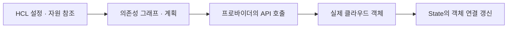

## 목차

- [[#1. 개요|1. 개요]]
- [[#2. 선언형 구성과 명령 실행의 차이|2. 선언형 구성과 명령 실행의 차이]]
- [[#3. 주요 구성 요소|3. 주요 구성 요소]]
- [[#4. 설정 해석과 API 요청의 실행 과정|4. 설정 해석과 API 요청의 실행 과정]]
- [[#5. 변경 계획과 적용|5. 변경 계획과 적용]]
- [[#6. CLI 및 Zadara와의 관계|6. CLI 및 Zadara와의 관계]]
- [[#7. 관련 문서|7. 관련 문서]]
- [[#8. 출처|8. 출처]]

## 1. 개요

Terraform은 인프라를 코드로 정의하고 관리하는 Infrastructure as Code(IaC) 도구이다.

사용자는 원하는 자원의 구성을 선언하고, Terraform은 프로바이더를 통해 대상 플랫폼의 API와 상호작용한다.[^1] 관리 범위는 설정·State·프로바이더가 다루는 자원에 한정되며, 계정의 모든 외부 자원을 자동으로 관리 대상으로 삼는 것은 아니다.

## 2. 선언형 구성과 명령 실행의 차이

명령형 방식은 “네트워크를 만들고 다음으로 VM을 만든다”처럼 수행할 작업을 표현한다. 선언형 방식은 “이 네트워크에 연결된 VM이 있어야 한다”처럼 원하는 구성을 표현한다. Terraform은 선언한 구성과 관리 대상의 상태를 비교해 필요한 변경을 계획한다.[^1][^v-plan]

예를 들어 동일한 구성으로 테스트 환경을 다시 만들 때, 자원 사이 참조와 속성을 코드로 남겨 두면 사람이 화면을 보며 각 항목을 기억해 입력하는 부담을 줄일 수 있다. 프로바이더는 대상 서비스 API를 호출하고 State는 코드의 자원 주소와 실제 객체의 연결을 유지한다. 코드·State·실제 인프라는 각각 다른 역할을 맡는다.[^d-graph]

원하는 상태를 선언했다고 모든 변경이 단순 수정으로 처리되는 것은 아니다. 서비스가 속성 변경을 지원하지 않으면 자원을 교체해야 할 수도 있고, 일부 API 호출만 성공한 상태가 남을 수도 있다. Terraform은 애플리케이션 데이터까지 자동 보존하는 백업 도구가 아니라 인프라 구성의 생성을 계획하고 실행하는 도구이다.[^d-apply]

## 3. 주요 구성 요소

| 요소 | 역할 |
|---|---|
| Configuration | 생성·관리할 자원과 속성 정의 |
| Provider | 클라우드 등 외부 서비스 API와 연결 |
| Resource | VM·네트워크 등 관리 대상 표현 |
| Module | 관련 설정을 묶어 재사용 |
| State | 코드의 자원과 실제 객체 간 연결 정보 유지 |

상태 파일은 인프라 데이터의 백업 파일이 아니다. 애플리케이션 DB나 볼륨의 내용은 별도의 데이터 보호 체계가 필요하다.[^1][^2]

## 4. 설정 해석과 API 요청의 실행 과정

Terraform CLI는 작업 디렉터리의 일반 `.tf` 파일을 하나의 구성으로 해석한다. `main.tf`와 `provider.tf`는 사람이 내용을 찾기 쉽게 붙이는 관례적인 이름이다. `required_providers`는 필요한 플러그인과 버전 제약을 선언하고, `provider` 블록은 해당 플러그인의 접속 설정을 지정한다. `terraform init`으로 작업 디렉터리를 초기화하면 선택된 프로바이더 버전과 패키지 체크섬이 `.terraform.lock.hcl`에 기록된다.[^v-files][^v-deps]

Terraform 설정은 원하는 자원의 속성과 다른 자원에 대한 참조를 표현한다. 실행 프로세스는 이 참조를 바탕으로 의존성 그래프를 구성하고, 프로바이더 플러그인은 특정 서비스의 API를 호출한다. HCL 파일은 원하는 구성을 정의한 입력 파일, 프로바이더는 서비스 연결 구현, State는 설정의 자원 주소와 실제 객체 ID의 연결, Backend는 State를 보관하는 위치라는 서로 다른 역할이다.[^d-graph]

`init`은 작업 디렉터리의 backend와 필요한 프로바이더·모듈을 준비하고, `plan`은 관리 대상의 원격 상태와 설정을 비교해 변경을 계산한다. `apply`에서는 그래프의 의존성에 맞춰 작업을 진행한다. 예를 들어 VM이 특정 네트워크의 ID를 참조하면 네트워크가 준비되어야 그 값을 사용하는 VM 생성이 가능하다. 파일에 먼저 적은 줄이 언제나 먼저 실행되는 단순 스크립트 모델과 다르다.

이는 이해를 위한 개념 흐름이며 내부 실행은 병렬 작업과 상태 읽기·쓰기를 포함한다. State가 실제 서비스를 대신하지 않으므로 State 파일만 복원해도 삭제된 VM의 디스크 데이터가 되돌아오는 것은 아니다.[^2]

예를 들어 서브넷의 `vpc_id = aws_vpc.example.id`에서 왼쪽은 서브넷이 받는 입력 인수이고, 오른쪽은 VPC가 제공하는 ID 속성이다. Terraform은 이 참조를 통해 값을 전달하고 의존 관계도 알아낸다. 같은 방식으로 VM에는 서브넷 ID 하나와 보안 그룹 ID 목록을 전달할 수 있다.[^d-graph]

### VM 배포와 운영체제 초기화

VM의 이미지는 부팅할 운영체제와 초기 디스크 내용을 제공하고, 인스턴스 유형은 vCPU·메모리 등 가상 하드웨어의 사양을 정한다. Terraform 리소스 주소에 쓰는 코드 이름과 콘솔에 표시할 이름 태그도 각각 따로 지정한다. VM을 생성한 후에는 연결된 서브넷과 보안 정책, 운영체제 로그인 가능 여부를 별도로 확인한다.[^3]

cloud-init을 지원하는 이미지에서는 Terraform이 `user_data`로 초기 설정을 전달하고, VM 내부의 cloud-init이 첫 부팅 시 사용자 계정이나 SSH 공개키를 적용할 수 있다. `#cloud-config`는 cloud-init에 전달하는 YAML 형식을 표시한다. 사용자 추가와 같은 인스턴스당 한 번 실행되는 설정은 기존 VM을 재부팅하는 것만으로 일반적으로 다시 실행되지 않는다.[^cloud-init]

브라우저의 가상 콘솔에서는 게스트 운영체제의 계정으로 로그인한다. SSH에는 별도로 네트워크 도달성과 SSH 인증이 필요하다. 공개키 인증에서는 공개키를 VM의 계정에 등록하고 개인키는 접속하는 쪽에서 보관한다. 초기화 데이터에 인증 정보를 다룰 때는 구성 파일, 상태, VM 메타데이터의 접근 범위를 함께 고려한다.[^3][^cloud-init][^v-sensitive]

AWS 호환 환경에서는 이미지가 지원하는 초기화 방식에 따라 두 경로를 사용할 수 있다. 플랫폼에 공개 키를 등록한 뒤 `key_name`으로 키 쌍 이름을 지정하거나, `user_data`의 cloud-init 설정에서 특정 계정의 `ssh_authorized_keys`에 공개 키 문자열을 전달한다. 두 경우 모두 개인 키는 접속하는 쪽에 보관한다. cloud-init을 이용하면 콘솔 로그인용 로컬 계정 비밀번호와 SSH 비밀번호 인증 허용 여부도 각각 설정할 수 있다. [[SSH#4. 서버 호스트 인증과 사용자 인증|SSH 공개 키 인증]] 참고.[^3][^cloud-init][^key-pair]

## 5. 변경 계획과 적용

`fmt`는 구성 파일의 서식을 정리하고, `validate`는 구문과 인수의 일관성을 검사한다. `plan`은 현재 구성으로 어떤 작업이 필요한지 보여준다. 예를 들어 `~ update in-place`는 기존 객체를 유지하며 변경한다는 표시다. 실제 변경 요청의 성공 여부는 적용 결과와 이후 조회에서 확인한다.[^v-validate][^v-plan][^d-apply]

적용 중 오류가 발생하면 실패한 API 작업과 오류 코드를 먼저 확인한다. 생성 요청은 성공했지만 후속 속성 조회가 실패할 수 있다. 이때 콘솔이나 API로 실제 객체를 확인하고 `terraform state list`와 `terraform state show`로 저장된 주소와 ID를 대조한다. 수정 후 일반 Plan에서 변경 없음이 표시되면 그 시점에 Terraform이 비교한 범위에서 구성과 실제 객체가 일치한 것이다.[^2][^v-plan][^d-apply]

`plan`은 기본적으로 원격 자원의 상태를 확인하고 설정과 비교해 변경 계획을 만든다. `-refresh=false`처럼 기본 동작을 바꾸는 옵션도 있다. `apply`는 새로 만든 계획을 확인받아 적용하거나 저장된 계획 파일을 적용할 수 있다. 저장된 계획을 전달하는 방식과 대화형 승인 방식은 다르므로 모든 적용이 매번 같은 승인 화면을 거친다고 생각하면 안 된다.[^v-plan] 속성 변경이 기존 자원의 수정인지 교체인지에 따라 영향이 달라진다. 실행 시점의 외부 상태 변화나 API 오류 때문에 계획이 항상 그대로 완료되는 것은 아니다.

State에는 민감한 값이 포함될 수 있다. `sensitive = true`는 주로 출력에서 값을 숨기는 표시이며 그 자체로 State·plan 파일의 저장을 막지 않는다. 지원되는 ephemeral·write-only 기능은 별도의 조건과 용도를 가진다.[^v-sensitive]

여러 사람이 함께 관리할 때는 접근 통제와 동시 실행 충돌 방지가 중요하다. 상태 잠금은 모든 backend가 지원하는 기능이 아니므로 선택한 백엔드(backend)의 지원 여부를 확인한다.[^v-lock]

## 6. CLI 및 Zadara와의 관계

[[AWS CLI]]는 개별 작업을 명령으로 실행하고 Terraform은 관리할 구성을 선언한다. 코드 외부에서 자원을 변경하면 상태 차이가 발생할 수 있다.

예를 들어 AWS CLI의 VPC 목록 조회는 현재 어떤 객체가 있는지 확인하는 데 쓰고, Terraform의 조회는 기존 객체를 구성에서 참조하거나 변경 계획을 계산하는 데 쓴다. Terraform은 설치된 프로바이더를 통해 대상 API와 통신하며, AWS CLI에서 구성한 공유 인증 프로필을 AWS 프로바이더 설정에서도 지정할 수 있다.[^v-provider]

zCompute AWS API 문서는 Terraform 연동 예시와 지원 매개변수 표를 제공한다. 실제 적용은 프로바이더 버전과 API 호환 범위에 맞춰야 하며, 과거 예제의 버전이나 TLS 검증 생략 설정을 그대로 운영 기준으로 삼으면 안 된다.[^3]

## 7. 관련 문서

- [[Terraform Core]] · [[Terraform Provider]] · [[Terraform Resource와 Data Source]]
- [[Terraform Plan과 Apply]] · [[Terraform State와 Backend]] · [[Terraform Import]]
- [[선언형 구성과 원하는 상태]] · [[구성 드리프트]] · [[cloud-init]]

- [[Infrastructure as Code|IaC]]
- [[AWS CLI]]
- [[Zadara Symphony API]]
- [[Unified Cloud Management Portal]]

- [[Server]]

- [[Networking]]

## 8. 출처

[^1]: [HashiCorp — What is Terraform?](https://developer.hashicorp.com/terraform/intro)
[^2]: [HashiCorp — State](https://developer.hashicorp.com/terraform/language/state)
[^3]: [Zadara — AWS API](https://guides.zadara.com/cs-compute-guide/latest/aws-ec2-api.html)

[^v-plan]: [HashiCorp — terraform plan](https://developer.hashicorp.com/terraform/cli/commands/plan)

[^v-sensitive]: [HashiCorp — Manage sensitive data](https://developer.hashicorp.com/terraform/language/manage-sensitive-data)

[^v-lock]: [HashiCorp — State locking](https://developer.hashicorp.com/terraform/language/state/locking)

[^d-graph]: [HashiCorp — Dependency Graph](https://developer.hashicorp.com/terraform/internals/graph)

[^d-apply]: [HashiCorp — terraform apply](https://developer.hashicorp.com/terraform/cli/commands/apply)

[^v-files]: [HashiCorp — Files and configuration structure](https://developer.hashicorp.com/terraform/language/files)
[^v-deps]: [HashiCorp — Dependency lock file](https://developer.hashicorp.com/terraform/language/files/dependency-lock)
[^v-validate]: [HashiCorp — terraform validate](https://developer.hashicorp.com/terraform/cli/commands/validate)
[^v-provider]: [HashiCorp — AWS Provider authentication and configuration](https://registry.terraform.io/providers/hashicorp/aws/latest/docs)
[^cloud-init]: [cloud-init — Boot stages](https://docs.cloud-init.io/en/24.2/explanation/boot.html), [Module reference](https://docs.cloud-init.io/en/latest/reference/modules.html#users-and-groups)
[^key-pair]: [Zadara — Key Pairs](https://guides.zadara.com/cs-compute-guide/latest/key-pair.html), [AWS — Add or replace a public key](https://docs.aws.amazon.com/AWSEC2/latest/UserGuide/replacing-key-pair.html)

## 둘러보기

[[Knowledge Base/index|전체 개념 목록]] · [[IaC 분류|IaC]] · [[Cloud 분류|Cloud]]
