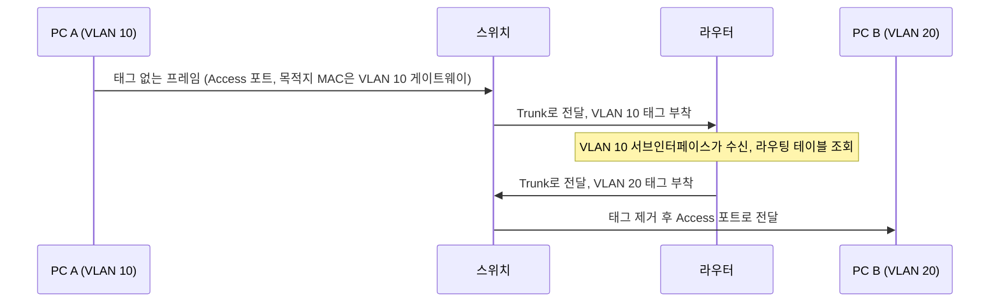

## 목차

- [[#1. 개요|1. 개요]]
- [[#2. 서브넷과 VLAN의 차이|2. 서브넷과 VLAN의 차이]]
- [[#3. Access 포트와 Trunk 포트|3. Access 포트와 Trunk 포트]]
- [[#4. 802.1Q 태그|4. 802.1Q 태그]]
- [[#5. VLAN 사이의 통신|5. VLAN 사이의 통신]]
- [[#6. 흔한 오해|6. 흔한 오해]]
- [[#7. 관련 문서|7. 관련 문서]]
- [[#8. 출처|8. 출처]]

## 1. 개요

VLAN(Virtual LAN)은 하나의 스위치 네트워크를 논리적으로 여러 개의 L2 broadcast domain으로 나누는 기술이다.

VLAN은 장치를 물리적 위치가 아니라 기능, 프로젝트, 용도에 따라 묶는 방법이고, 서로 다른 스위치에 연결된 장치도 같은 VLAN에 속할 수 있다. 브로드캐스트, 멀티캐스트, 유니캐스트 트래픽은 같은 VLAN 안의 장치에만 전달된다.[^ciscovlan] 한 대의 물리 스위치가 여러 개의 독립된 L2 네트워크처럼 동작한다고 이해할 수 있다. 스위치의 프레임 전달은 [[Switch|스위치]]에서 설명한다.

## 2. 서브넷과 VLAN의 차이

서브넷과 VLAN은 서로 다른 계층에서 경계를 만든다.

| 비교 항목 | 서브넷 마스크 | VLAN |
|---|---|---|
| 계층 | L3 (IP 주소) | L2 (프레임) |
| 경계를 강제하는 주체 | 호스트가 마스크로 판단 | 스위치가 포트의 VLAN 소속으로 격리 |
| 설정하는 곳 | 호스트의 IP와 마스크, 라우터 인터페이스 | 스위치의 포트 |
| 경계를 넘으려면 | 기본 게이트웨이 | L3 장치(라우터, L3 스위치) |

같은 VLAN에서 서브넷만 다른 두 호스트는 스위치가 막지 않는다. 호스트가 "다른 네트워크"라고 판단해 상대 MAC 주소로 직접 보내지 않을 뿐이며, 직접 보내면 스위치는 전달한다. 반면 VLAN이 다르면 호스트가 상대 MAC 주소를 알아도 스위치가 전달하지 않고, ARP 브로드캐스트도 VLAN을 넘지 않는다. 서브넷의 판단은 [[IP Address and Subnet|IP 주소와 서브넷]]에서 설명한다.

설계에서는 VLAN 하나에 서브넷 하나를 대응시키는 것이 보통이다. 이는 설계 관례이며 두 개념의 정의가 같은 것은 아니다.

## 3. Access 포트와 Trunk 포트

스위치 포트는 VLAN을 다루는 방식에 따라 두 종류로 나뉜다.

| 구분 | Access 포트 | Trunk 포트 |
|---|---|---|
| 처리하는 VLAN | 하나 | 여러 개 |
| 연결하는 대상 | PC, 프린터 같은 단말 | 스위치, 라우터 |
| 프레임의 태그 | 없음 | 있음 (Native VLAN 제외) |

Access 포트는 하나의 VLAN의 트래픽을 처리하며 보통 단말 연결에 쓰이고, Trunk 포트(IEEE 802.1Q)는 하나의 링크로 여러 VLAN의 트래픽을 처리한다. Trunk는 기본적으로 모든 VLAN에 속하지만 허용 VLAN 목록으로 제한할 수 있다.[^ciscovlan]

스위치가 PC의 프레임이 어느 VLAN의 것인지 아는 방법은 프레임의 내용이 아니라 **포트 설정**이다. 관리자가 포트를 Access 모드로 설정하고 VLAN ID(1~4094)를 지정하면, 그 포트로 들어온 프레임은 해당 VLAN의 것으로 분류된다.[^ciscovlan] PC는 VLAN을 알 필요 없이 일반 프레임을 보낸다.

## 4. 802.1Q 태그

IEEE 802.1Q는 IEEE 802.3 이더넷에 VLAN 지원을 더하는 표준으로, 프레임에 VLAN 소속을 표시하는 방식과 브리지와 스위치가 태그가 붙은 프레임을 다루는 방식을 정한다.[^wiki8021q] 이더넷 프레임의 MAC 헤더 자체에는 VLAN 정보가 없으므로, 한 케이블에 여러 VLAN의 프레임이 섞이는 Trunk에서는 프레임마다 VLAN 표시가 필요하다.

802.1Q는 출발지 주소와 Type/Length 필드 사이에 4바이트 태그를 끼워 넣는다.[^cisco8021q]

```
[목적지 MAC][출발지 MAC][802.1Q 태그 4바이트][Type][데이터][FCS]
```

| 필드 | 크기 | 하는 일 |
|---|---|---|
| TPID | 16비트 (0x8100) | 802.1Q 태그가 붙은 프레임임을 표시 |
| PCP | 3비트 | 우선순위 |
| DEI | 1비트 | 혼잡할 때 버려도 되는 프레임인지 표시 |
| VID | 12비트 | VLAN 식별자 |

TPID와 TCI(PCP, DEI, VID)로 이루어진 구조이다.[^wiki8021q] 12비트 VID로 사용할 수 있는 VLAN은 최대 4,094개이다. VID 0은 우선순위 정보만 담는 priority tag에 쓰이고 VID 4095는 구현용으로 예약되어 있다.[^wiki8021q]

- **태그의 부착과 제거**: Trunk 링크에서 보내는 장치가 태그를 붙이고, 받는 장치가 태그를 제거한 뒤 해당 VLAN으로 전달한다.[^cisco8021q]
- **프레임의 변화**: 프레임이 바뀌므로 FCS를 다시 계산해야 하고, 최대 프레임 크기는 1,518바이트에서 1,522바이트로 늘어난다.[^cisco8021q][^wiki8021q]
- **Native VLAN**: IEEE 802.1Q Trunk의 기본 동작에서는 Native VLAN의 프레임을 태그 없이 보내고, 나머지 VLAN의 프레임에는 태그를 붙인다. Trunk로 들어온 태그 없는 프레임은 해당 포트의 Native VLAN에 속하는 것으로 간주한다. 장비에 따라 Native VLAN에도 태그를 붙이도록 설정할 수 있으며, Trunk 양쪽의 Native VLAN과 태그 처리 방식이 다르면 트래픽이 잘못 전달될 수 있다.[^cisco8021q][^ciscotrunk][^wiki8021q]

쉽게 설명하면 사내 우편 수레(Trunk)에 영업부와 인사부 우편을 함께 싣되 봉투마다 부서 스티커(태그)를 붙여 구분하고, 각 부서 책상(Access 포트)에 전달할 때는 스티커를 떼는 방식이다. 이 비유는 태그의 크기가 정해져 있고 프레임 크기와 검사값까지 바뀐다는 점은 설명하지 못한다.

## 5. VLAN 사이의 통신

각 VLAN은 별도의 논리 네트워크이므로 VLAN 사이의 트래픽은 L3에서 라우팅되어야 한다.[^ciscovlan] 이 라우팅을 맡는 방식은 크게 두 가지이다.

- **Router-on-a-Stick**: 스위치의 Trunk 포트를 라우터 한 인터페이스에 연결하고, 라우터 쪽에서 VLAN마다 서브인터페이스를 만들어 VLAN별 게이트웨이를 둔다.[^cfg] 라우터가 라우팅을 하고 스위치가 VLAN을 만든다.[^ciscopress]
- **L3 스위치의 SVI**: L3 스위치가 SVI(VLAN 인터페이스)로 각 VLAN의 게이트웨이를 맡는다.[^ciscopress] Catalyst 문서는 SVI를 명시적으로 만들고 IP 주소를 지정해야 한다고 설명한다.[^ciscovlan] 이 방식에서는 게이트웨이와 라우터가 같은 장치이다.

Router-on-a-Stick 구성에서 VLAN 10의 PC A가 VLAN 20의 PC B에 보내는 과정은 다음과 같다. 이 흐름은 일반적인 구성을 기준으로 정리한 것이다.



| 구간 | VLAN | 출발지 MAC | 목적지 MAC | 출발지 IP | 목적지 IP |
|---|---|---|---|---|---|
| A에서 라우터 | 10 | A | 라우터의 VLAN 10 인터페이스 | A | B |
| 라우터에서 B | 20 | 라우터의 VLAN 20 인터페이스 | B | A | B |

IP 주소는 끝까지 유지되고 MAC 주소는 구간마다 바뀐다. 각 VLAN의 호스트는 자기 VLAN의 게이트웨이를 설정한다. 게이트웨이의 역할은 [[Default Gateway|기본 게이트웨이]]에서, 같은 서브넷에서 ARP가 동작하는 방식은 [[ARP]]에서 설명한다.

## 6. 흔한 오해

- **같은 스위치에 꽂혀 있으면 같은 네트워크라는 생각**: VLAN이 다르면 같은 스위치에 꽂혀 있어도 다른 L2 네트워크이다.
- **VLAN 사이도 스위치만으로 통신된다는 생각**: VLAN 사이는 L3 장치의 라우팅이 필요하다.
- **PC가 VLAN 태그를 붙여 보낸다는 생각**: 일반 단말은 태그 없이 보내고, 스위치가 포트 설정에 따라 VLAN을 정한다.
- **Trunk 양쪽의 Native VLAN이 달라도 된다는 생각**: 양쪽이 같아야 하며 다르면 트래픽이 잘못 전달될 수 있다.
- **VLAN이 서브넷과 같은 개념이라는 생각**: 하나는 L2 경계이고 하나는 L3 경계이다. 설계에서 하나씩 대응시킬 뿐이다.

## 7. 관련 문서

- [[Networking|네트워크]] · [[Encapsulation|캡슐화]]
- [[Switch|스위치]] · [[Router|라우터]]
- [[IP Address and Subnet|IP 주소와 서브넷]] · [[ARP]] · [[Default Gateway|기본 게이트웨이]]
- [[Unicast Broadcast Multicast Anycast|유니캐스트·브로드캐스트·멀티캐스트·애니캐스트]]

## 8. 출처

[^ciscovlan]: Cisco, [VLAN Configuration Guide, Configure VLAN (Catalyst 9000)](https://www.cisco.com/c/en/us/td/docs/switches/lan/c9000/lyr2-fwd/vlan/vlan-configuration-guide/configure-vlan.html). VLAN의 정의와 트래픽 범위, Access 포트와 Trunk 포트, VLAN 할당, VLAN 사이 트래픽과 SVI.
[^cisco8021q]: Cisco, [Inter-Switch Link and IEEE 802.1Q Frame Format](https://www.cisco.com/c/en/us/support/docs/lan-switching/8021q/17056-741-4.html). 4바이트 태그의 위치, 태그 부착과 제거, FCS 재계산, Native VLAN, 태그 필드와 VID 크기.
[^ciscotrunk]: Cisco, [VLAN Configuration Guide - Configure VLAN Trunking](https://www.cisco.com/c/en/us/td/docs/switches/lan/c9000/lyr2-fwd/vlan/vlan-configuration-guide/configure-vlan-trunks.html). Native VLAN의 기본 비태그 전송과 Native VLAN 태깅 설정.
[^wiki8021q]: Wikipedia, [IEEE 802.1Q](https://en.wikipedia.org/wiki/IEEE_802.1Q). 표준의 범위, TPID와 TCI의 구조, 사용 가능한 VID와 예약 값, 프레임 크기와 FCS 영향, Native VLAN. 보조 자료이다.
[^ciscopress]: Cisco Press, [CCNA 200-301 Official Cert Guide, Volume 1 발췌 (VLAN Routing with Router 802.1Q Trunks, VLAN Routing with Layer 3 Switch SVIs)](https://www.ciscopress.com/articles/article.asp?p=2990405). 라우터가 라우팅을 하고 스위치가 VLAN을 만드는 구성, L3 스위치의 SVI.
[^cfg]: Computing for Geeks, [Cisco Router-on-a-Stick Inter-VLAN Routing](https://computingforgeeks.com/cisco-router-on-a-stick-inter-vlan-routing/). 스위치 쪽 Trunk와 VLAN별 802.1Q 서브인터페이스 게이트웨이 구성. 실습 가이드이며 보조 자료이다.

## 둘러보기

[[Knowledge Base/index|전체 개념 목록]] · [[Networking 분류|Networking]]
