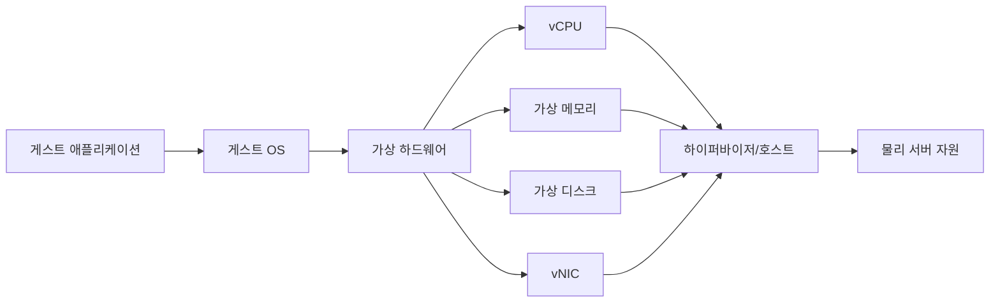

## 목차

- [[#1. 개요|1. 개요]]
- [[#2. VM의 구성 요소|2. VM의 구성 요소]]
- [[#3. VM 부팅 과정|3. VM 부팅 과정]]
- [[#4. vCPU와 메모리의 실제 의미|4. vCPU와 메모리의 실제 의미]]
- [[#5. 가상 디스크의 I/O 경로|5. 가상 디스크의 I/O 경로]]
- [[#6. vNIC와 네트워크 경로|6. vNIC와 네트워크 경로]]
- [[#7. VM의 생명주기와 상태|7. VM의 생명주기와 상태]]
- [[#8. 실시간 이동의 원리와 한계|8. 실시간 이동의 원리와 한계]]
- [[#9. VM의 격리와 공유 장애 영역|9. VM의 격리와 공유 장애 영역]]
- [[#10. VM과 컨테이너의 차이|10. VM과 컨테이너의 차이]]
- [[#11. 관련 문서|11. 관련 문서]]
- [[#12. 출처|12. 출처]]

## 1. 개요

Virtual Machine(VM, 가상 머신)은 하이퍼바이저가 제공하는 가상 CPU·메모리·디스크·네트워크 장치 위에서 독립된 운영체제와 프로그램을 실행하는 소프트웨어 기반의 컴퓨터 환경이다.

VM은 컴퓨터를 흉내 내는 화면이 아니라 실제 CPU 시간·RAM·스토리지·네트워크를 사용하는 실행 환경이다. 게스트 OS는 자신에게 보이는 vCPU와 가상 장치를 일반 하드웨어처럼 관리하고, [[Hypervisor|하이퍼바이저]]는 그 요청을 물리 자원이나 backend에 연결한다.[^redhat]

## 2. VM의 구성 요소

VM은 가상 디스크 파일 하나와 같은 말이 아니다. 완전한 VM을 설명하려면 다음 요소를 구분해야 한다.

| 요소 | 포함 내용 | 없거나 달라질 때의 영향 |
|---|---|---|
| 구성 정보 | vCPU 수, 메모리, 펌웨어, 가상 장치 종류와 연결 | 장치가 달라지거나 부팅하지 못할 수 있음 |
| 가상 디스크 | OS·애플리케이션·파일이 들어 있는 블록 장치 | 시스템과 데이터가 없음 |
| 게스트 OS | 가상 하드웨어를 관리하고 프로그램 실행 | 일반적인 VM으로 부팅할 수 없음 |
| 실행 상태 | CPU 레지스터, 메모리, 장치 상태 | 전원이 켜진 그 순간부터 이어서 실행할 수 없음 |
| 외부 연결 | 가상 네트워크, 공유 스토리지, 보안 정책 | 서비스에 접속하지 못하거나 데이터가 달라질 수 있음 |
| 관리 정보 | ID, 권한, 태그, 자동화·백업 정책 | 운영 체계에서 같은 VM으로 취급되지 않을 수 있음 |

가상 디스크를 다른 호스트에 연결해 새 VM을 부팅할 수는 있다. 그러나 원래 VM의 펌웨어 방식, 디스크 컨트롤러, NIC 모델, MAC 주소, TPM·보안 설정이 다르면 같은 실행 환경이 그대로 복원됐다고 할 수 없다. 실행 중 메모리까지 이어 가려면 CPU와 장치 상태도 함께 저장하거나 이동해야 한다.[^qemu-migration]

## 3. VM 부팅 과정

1. 관리 도구가 하이퍼바이저에 VM 구성을 전달한다.
2. 하이퍼바이저와 장치 모델이 vCPU·메모리 영역·가상 칩셋·디스크·vNIC를 준비한다.
3. 가상 BIOS 또는 UEFI 펌웨어가 부팅 장치를 찾는다.
4. 가상 디스크의 부트로더가 게스트 OS 커널을 메모리에 올린다.
5. 게스트 OS가 가상 장치 드라이버를 불러오고 네트워크와 파일시스템을 준비한다.
6. 게스트의 서비스와 애플리케이션이 시작된다.

전원 버튼을 누른 뒤 OS가 올라오는 물리 컴퓨터와 흐름은 비슷하지만, 펌웨어와 장치가 소프트웨어로 정의되고 실제 물리 자원 접근은 하이퍼바이저가 중재한다. 그래서 P2V·V2V 이전에서는 BIOS/UEFI, 디스크 컨트롤러와 부팅 드라이버, 가상 NIC가 맞지 않으면 데이터가 있어도 부팅이나 통신에 실패할 수 있다. 관련 유형은 [[Server Migration Types]]에서 다룬다.

## 4. vCPU와 메모리의 실제 의미

vCPU는 게스트 OS가 CPU처럼 인식하고 작업을 배치하는 논리 실행 단위이다. 하이퍼바이저나 호스트 스케줄러가 물리 논리 CPU에서 실행 시간을 준다. vCPU 4개인 VM은 게스트에 CPU 실행 단위 4개를 보여 주지만, 전용 물리 코어 4개를 소유한다는 뜻은 아니다.

게스트 OS의 스케줄러와 호스트의 스케줄러가 모두 존재한다. 게스트 안의 스레드가 실행 가능 상태여도 해당 vCPU가 호스트에서 차례를 기다릴 수 있다. VM에 필요 이상으로 많은 vCPU를 주면 여러 vCPU의 실행 기회를 맞추는 비용과 호스트 경합이 커질 수 있으므로, ‘많이 할당할수록 항상 빠르다’는 결론은 틀리다.[^overcommit]

메모리도 두 주소 공간을 거친다. 게스트 프로세스의 가상 주소는 게스트 OS가 게스트 물리 주소로 바꾸고, 하이퍼바이저와 CPU의 SLAT 기능이 다시 호스트의 실제 RAM 페이지로 연결한다. 게스트가 보는 ‘물리 주소’는 DIMM의 실제 위치와 같은 뜻이 아니다.[^kvm-mmu]

호스트는 메모리 ballooning, 페이지 공유, reclaim, swap 등의 정책을 사용할 수 있다. 이런 기능은 평균 사용량을 활용해 통합률을 높일 수 있지만, 실제 수요가 겹치면 지연이나 OOM 위험이 커진다. VM 할당 메모리와 호스트에서 실제로 확보된 메모리, 게스트의 사용량은 서로 다른 지표이다.

## 5. 가상 디스크의 I/O 경로

게스트가 파일 하나를 저장할 때는 여러 층을 지난다.

QCOW2·VMDK·VHDX는 가상 디스크를 표현하는 형식이고, ext4·XFS·NTFS는 게스트가 그 가상 디스크 위에 만드는 파일시스템이다. 둘은 같은 계층이 아니다. 이미지 파일이 호스트 파일시스템에 있을 수도 있지만, VM 디스크가 항상 단일 파일인 것은 아니다. 논리 볼륨이나 원격 블록 장치를 직접 backend로 사용할 수도 있다.[^libvirt-disk]

게스트에서 보이는 I/O 지연은 게스트 파일시스템, 가상 장치 큐, 호스트 캐시, 이미지의 snapshot chain, 네트워크 스토리지, 물리 미디어 어느 곳에서도 생길 수 있다. VM 내부의 `iostat`만으로 물리 스토리지 병목 위치를 단정할 수 없는 이유이다.

## 6. vNIC와 네트워크 경로

vNIC는 게스트 OS에 보이는 네트워크 카드이다. 게스트의 드라이버가 패킷을 vNIC의 큐에 넣으면 가상 스위치나 bridge가 목적지를 판단한다. 같은 호스트의 다른 VM으로 보내면 물리 케이블을 거치지 않을 수 있고, 외부 호스트로 나가면 물리 NIC와 상위 스위치를 지난다.[^libvirt-net]

연결 방식에는 bridge, NAT, 격리된 내부 네트워크, SR-IOV VF 또는 물리 NIC 직접 할당 등이 있다. vNIC가 있다고 자동으로 외부 통신이 되는 것은 아니다. IP·라우팅·DNS·VLAN·가상 스위치·보안 정책과 물리 uplink가 함께 맞아야 한다.

VM을 복제할 때 고정 IP·호스트명·머신 ID를 그대로 복제하면 충돌할 수 있다. 제품의 guest customization이나 cloud-init 같은 초기화 과정이 별도로 필요한 이유이다. ‘클론을 만들면 네트워크 정체성도 자동으로 고유해진다’고 가정하지 않는다.

## 7. VM의 생명주기와 상태

| 작업 | 실제 의미 | 주의점 |
|---|---|---|
| Create | 새 가상 하드웨어 구성과 디스크 준비 | OS가 설치되어 있다는 뜻은 아님 |
| Start/Stop | 게스트 전원 켜기·정상 종료 | 강제 power off는 게스트의 정상 종료와 다름 |
| Suspend/Resume | 실행 상태를 보존하고 멈췄다가 재개 | 저장 위치와 호스트 호환성 필요 |
| Snapshot/Checkpoint | 디스크 또는 메모리 상태를 특정 시점으로 되돌릴 수 있게 기록 | 독립 백업이 아니며 일관성 방식 확인 필요 |
| Clone | VM을 바탕으로 새 VM 생성 | full clone과 부모에 의존하는 linked clone은 다름 |
| Export/Import | 구성과 디스크를 이동 가능한 형식으로 내보내고 등록 | 외부 네트워크·정책까지 모두 포함하지 않을 수 있음 |
| Migrate | VM을 다른 호스트·스토리지로 이동 | offline과 live, compute와 storage 이동을 구분 |
| Delete | 등록과 파일·볼륨 제거 | 영구 데이터와 백업 보존 여부 확인 |

### 스냅샷은 백업이 아닌 이유

스냅샷은 기준 디스크 이후의 변경을 별도 차등 파일에 기록하거나 특정 시점 상태를 보관한다. 기준 디스크와 같은 스토리지에 의존하면 원본 스토리지 손실 때 함께 잃을 수 있다. 실행 중 캡처한 상태도 메모리 포함 여부, 파일시스템 freeze, VSS, 애플리케이션 자체의 flush 여부에 따라 crash-consistent 또는 application-consistent 수준이 달라진다.[^checkpoint]

Microsoft의 Hyper-V 표준 체크포인트는 메모리 상태를 포함할 수 있고, 프로덕션 체크포인트는 VSS나 Linux 파일시스템 freeze를 사용해 데이터 일관성을 목표로 하며 메모리 상태를 저장하지 않는다. 문서도 일반 스냅샷이 완전한 백업이 아니라고 명시한다. 백업은 별도 장애 영역에 보관하고 복구 시험까지 하는 목적이 다르다.[^checkpoint]

### 클론의 독립성

full clone은 복제 시점에 디스크를 독립 사본으로 만드는 반면 linked clone은 부모 또는 기준 디스크를 공유해 공간과 생성 시간을 줄일 수 있다. 후자는 부모 체인이 손상되면 영향을 받을 수 있다. 제품과 방식에 따라 구현이 다르므로 ‘클론은 항상 원본과 독립’이라고 단정하지 않는다.[^clone]

## 8. 실시간 이동의 원리와 한계

live migration은 VM을 실행한 채로 주로 메모리 페이지와 실행 상태를 대상 호스트에 전송하고, 마지막 전환 순간에 짧게 멈춘 뒤 대상에서 이어 실행하는 방식이다. 원본 VM이 메모리를 계속 바꾸므로 여러 차례 변경 페이지를 보내고, 남은 상태를 감당할 수 있는 시점에 stop-and-copy 단계로 전환한다.[^qemu-migration]

‘live’는 정지 시간이 반드시 0이라는 뜻이 아니다. 메모리 변경 속도가 전송 속도보다 빠르면 수렴하지 못할 수 있고, CPU 기능 호환성, 장치·펌웨어 상태, 대상 자원, 네트워크, 인증, 스토리지 접근 조건이 맞아야 한다. 공유 스토리지를 쓰는 방식도 있고 디스크를 함께 옮기는 방식도 있어 ‘라이브 마이그레이션에는 무조건 공유 스토리지가 필요하다’고 일반화할 수 없다.[^rhel-migration]

live migration은 계획된 호스트 정비와 부하 재배치에 유용하지만 백업이나 재해복구와 같은 목적이 아니다. 원본 데이터 손상과 애플리케이션 오류를 그대로 옮길 수 있고, 전체 사이트 장애에 대비한 복제본을 자동으로 만들지는 않는다.

## 9. VM의 격리와 공유 장애 영역

VM은 서로 다른 게스트 커널과 메모리 매핑, 가상 디스크, 가상 네트워크 경계를 가진다. 한 VM의 OS를 재부팅하거나 라이브러리를 바꾸는 일이 다른 VM에 직접 같은 변경을 하지는 않는다. 그러나 다음 의존성은 공유할 수 있다.

- 물리 호스트와 전원·냉각
- 하이퍼바이저와 관리 계층
- CPU 캐시·메모리 대역폭·NUMA 연결
- 물리 NIC와 가상 스위치 uplink
- 데이터스토어·SAN·스토리지 네트워크
- 랙과 상위 네트워크

그래서 WEB·WAS·DB를 각각 VM으로 나누면 OS·자원·변경 경계를 나눌 수 있지만, 세 VM을 같은 호스트와 데이터스토어에 두면 호스트·스토리지 장애는 함께 맞을 수 있다. 논리적 분리와 물리적 고가용성은 별도로 설계한다.

보안도 마찬가지다. 일반적인 게스트 침해가 곧 다른 VM의 메모리 접근 권한을 주는 것은 아니지만, 하이퍼바이저·장치 모델 취약점이나 관리 계정 탈취, 잘못 연결한 네트워크가 경계를 무너뜨릴 수 있다. NIST는 하이퍼바이저, 호스트, 게스트, 가상 네트워크와 관리 인터페이스를 함께 보호하도록 설명한다.[^nist]

## 10. VM과 컨테이너의 차이

| 기준 | VM | 일반적인 컨테이너 |
|---|---|---|
| 실행 경계 | 가상 하드웨어와 각자의 게스트 OS | 호스트 커널을 공유하는 격리된 프로세스 환경 |
| OS 커널 | VM마다 별도 | 보통 호스트와 공유 |
| 시작·이미지 크기 | 대체로 더 크고 느림 | 대체로 더 작고 빠름 |
| 다른 OS 커널 실행 | 하이퍼바이저 지원 범위에서 가능 | 호스트와 호환되는 커널 계열 필요 |
| 대표 용도 | OS 단위 격리, 기존 서버 업무, 다른 OS 병행 | 애플리케이션 패키징·배포·확장 |

컨테이너를 ‘가벼운 VM’이라고만 부르면 커널 경계를 놓친다. 반대로 둘은 배타적인 선택이 아니다. 물리 서버 위에 VM을 만들고 각 VM 안에 컨테이너 노드를 실행하면 인프라 격리와 애플리케이션 배포 단위를 함께 사용할 수 있다.[^container]

## 11. 관련 문서

- [[Virtualization]] · [[Hypervisor]] · [[Bare Metal]]
- [[Server]] · [[CPU]] · [[Memory]] · [[Disk]] · [[NIC]]
- [[Server Migration Types]] · [[Delta Sync]] · [[Cutover]]

## 12. 출처

[^redhat]: Red Hat, [What is virtualization?](https://www.redhat.com/en/topics/virtualization/what-is-virtualization). VM과 가상 자원·하이퍼바이저의 관계.
[^qemu-migration]: QEMU Project, [Migration framework](https://www.qemu.org/docs/master/devel/migration/main.html). VM 실행 상태와 RAM 전송, migration 단계.
[^overcommit]: Red Hat, [Optimizing virtual machine performance](https://docs.redhat.com/en/documentation/red_hat_enterprise_linux/8/html/monitoring_and_managing_system_status_and_performance/optimizing-virtual-machine-performance-in-rhel_monitoring-and-managing-system-status-and-performance). vCPU·메모리 오버커밋과 워크로드 조건.
[^kvm-mmu]: Linux Kernel, [The x86 KVM shadow MMU](https://docs.kernel.org/virt/kvm/x86/mmu.html). 게스트 가상·물리 주소와 호스트 물리 주소 변환.
[^libvirt-disk]: libvirt, [Domain XML — Hard drives, floppy disks, CDROMs](https://libvirt.org/formatdomain.html#hard-drives-floppy-disks-cdroms). 파일·블록·네트워크 기반 가상 디스크 backend.
[^libvirt-net]: libvirt, [Domain XML — Network interfaces](https://libvirt.org/formatdomain.html#network-interfaces). 가상 네트워크 인터페이스 연결 유형.
[^checkpoint]: Microsoft Learn, [Using checkpoints](https://learn.microsoft.com/en-us/windows-server/virtualization/hyper-v/checkpoints). 표준·프로덕션 체크포인트와 백업 차이.
[^clone]: Broadcom Developer, [VirtualMachineRelocateDiskMoveOptions](https://developer.broadcom.com/xapis/vsphere-web-services-api/latest/vim.vm.RelocateSpec.DiskMoveOptions.html). full copy와 부모 backing을 공유하는 디스크 이동·클론 방식의 구분.
[^rhel-migration]: Red Hat, [Migrating virtual machines](https://docs.redhat.com/en/documentation/red_hat_enterprise_linux/8/html/configuring_and_managing_virtualization/migrating-virtual-machines_configuring-and-managing-virtualization). offline·live migration과 스토리지 조건.
[^nist]: NIST SP 800-125, [Guide to Security for Full Virtualization Technologies](https://csrc.nist.gov/pubs/sp/800/125/final). VM·하이퍼바이저·가상 네트워크 보안.
[^container]: Docker Docs, [What is a container?](https://docs.docker.com/get-started/docker-concepts/the-basics/what-is-a-container/). 컨테이너의 프로세스 격리와 커널 공유.

## 둘러보기

[[Knowledge Base/index|전체 개념 목록]] · [[Compute 분류|Compute]]
