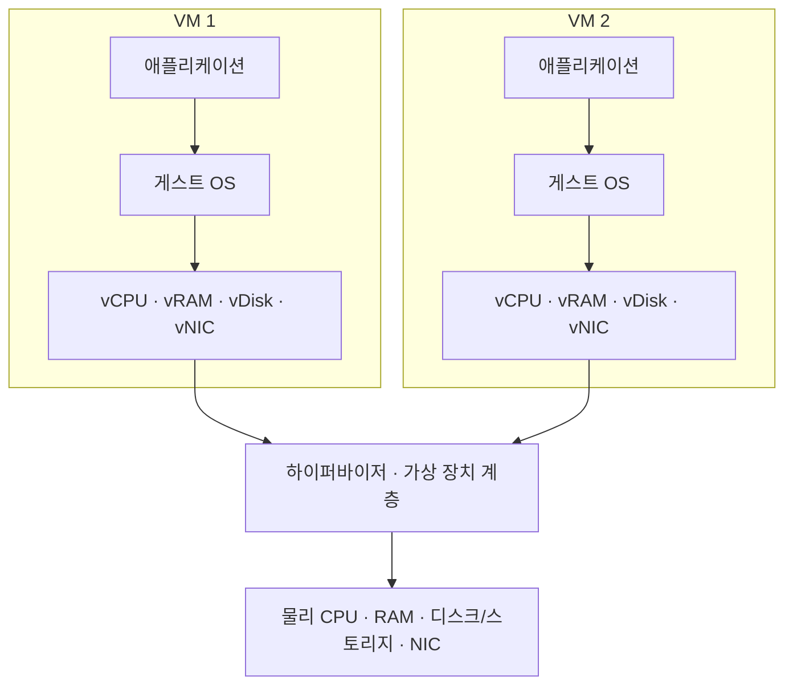

## 1. 개요

Virtualization(가상화)은 물리 자원의 구체적인 형태를 소프트웨어로 추상화하여, 하나의 실제 시스템 위에 서로 분리된 여러 실행 환경이나 논리 자원을 만드는 기술이다.

서버 가상화에서는 실제 [[CPU]]·[[Memory|메모리]]·[[Disk|디스크]]·[[NIC]]를 [[Hypervisor|하이퍼바이저]]가 중재하고, 각 [[Virtual Machine|가상 머신(VM)]]에는 vCPU·가상 메모리·가상 디스크·vNIC라는 형태로 보여 준다. VM 안의 게스트 운영체제는 자신이 독립된 컴퓨터에서 실행된다고 인식하지만, 실제 명령과 데이터는 결국 호스트의 물리 장비에서 처리된다.[^redhat]

가상화는 자원을 복제해 무한히 만드는 기술이 아니다. 여러 VM이 같은 물리 용량을 나누어 쓰게 하고, 각 VM이 보는 하드웨어의 모양을 실제 장비와 분리하는 기술이다. 할당한 vCPU의 합이 물리 CPU보다 많아도 동시에 쓸 수 있는 실제 연산 능력은 물리 장비의 한계를 넘지 않는다.

가상화에는 서버뿐 아니라 스토리지·네트워크·데스크톱 등 여러 대상이 있다. 이 문서는 그중 물리 컴퓨터의 실행 자원을 여러 운영체제에 제공하는 **서버 가상화**를 중심으로 다룬다.

## 2. 가상화가 등장한 배경

초기의 대형 컴퓨터는 값비싼 중앙 자원을 여러 사용자가 함께 써야 했다. IBM은 1964년 CP-40이라는 실험적 시분할 연구를 시작했고, CP-67을 거쳐 1972년 VM/370을 발표했다. 이 계열은 한 대의 메인프레임에서 여러 독립 실행 환경을 제공하며 현대 VM의 기반을 놓았다.[^ibm-history]

이후 값이 낮아진 x86 서버가 업무별로 늘어나자 다른 문제가 생겼다. 한 서버에 한 운영체제와 한 업무만 배치하면 장애 범위를 나누기 쉽지만, 평균 사용률이 낮은 서버도 랙 공간·전력·냉각·관리 비용을 계속 사용한다. x86 가상화는 여러 저사용 서버를 더 적은 물리 호스트에 통합하고, 운영체제별 환경을 분리해 배치하는 방법으로 확산되었다.

2000년대 중반부터 Intel VT-x와 AMD-V 같은 CPU 지원 기능이 도입되면서, 게스트 운영체제의 민감한 동작을 하이퍼바이저가 더 효율적으로 통제할 수 있게 되었다.[^intel-vmx] KVM은 2006년에 발표되어 2007년 Linux 커널에 병합되었다.[^kvm-history] 현대 가상화는 CPU뿐 아니라 메모리 주소 변환, I/O 장치 격리와 가상 장치 처리에도 하드웨어 지원을 활용한다.

가상화와 클라우드는 같은 말이 아니다. 가상화는 자원을 추상화하는 **기술**이고, 클라우드는 주문형 셀프서비스·네트워크 접근·자원 풀·빠른 탄력성·측정 가능한 사용량 같은 특성을 가진 **운영·서비스 방식**이다. 클라우드가 VM을 기반으로 제공되는 경우가 많지만 [[Bare Metal|베어메탈]], 컨테이너, 관리형 서비스도 클라우드로 제공될 수 있다.[^nist-cloud]

## 3. 서버 가상화의 구성 요소

| 구성 요소 | 의미 | 실제 예시 |
|---|---|---|
| 물리 호스트 | CPU·메모리·저장장치·NIC가 들어 있는 실제 서버 | 랙에 장착된 x86 서버 |
| [[Hypervisor]] | VM을 만들고 실행하며 물리 자원 접근을 중재하는 계층 | VMware ESXi, Microsoft Hyper-V, KVM |
| [[Virtual Machine|VM]] | 가상 하드웨어와 게스트 OS를 가진 독립 실행 환경 | Linux 웹 서버 VM, Windows DB 서버 VM |
| 게스트 OS | VM 안에서 실행되는 운영체제 | Ubuntu, RHEL, Windows Server |
| 가상 장치 | 게스트에 보이는 CPU·메모리·디스크·NIC | vCPU, VHDX·QCOW2, virtio-net |
| 관리 계층 | 여러 호스트와 VM의 생성·배치·정책·상태를 관리 | vCenter 계열 관리, libvirt 기반 도구, Hyper-V 관리 도구 |

하이퍼바이저와 관리 플랫폼을 같은 것으로 보면 안 된다. 하이퍼바이저는 VM 실행과 자원 중재의 핵심 계층이고, 관리 플랫폼은 여러 하이퍼바이저 호스트를 묶어 배치·모니터링·권한·클러스터 기능을 제공한다. KVM 환경에서도 Linux 커널의 KVM, 가상 머신과 장치를 모델링하는 QEMU, 관리 API를 제공하는 libvirt는 역할이 다르다. QEMU는 KVM과 결합하면 게스트 코드를 호스트 CPU에서 가속하고, 가속기 없이 다른 아키텍처를 소프트웨어로 에뮬레이션할 수도 있다.[^qemu]

## 4. 물리 자원이 가상 자원으로 보이는 원리

### CPU 가상화

VM의 vCPU는 물리 코어 자체가 아니라 게스트 OS에 보이는 실행 단위이다. 하이퍼바이저와 호스트 스케줄러는 여러 vCPU가 물리 논리 CPU에서 실행될 시간을 배정한다. 일반 명령은 하드웨어 지원을 받아 실제 CPU에서 실행하고, 호스트 전체에 영향을 줄 수 있는 특권 동작은 하이퍼바이저가 통제한다. 따라서 vCPU 8개를 할당했다고 물리 코어 8개가 반드시 전용된 것은 아니다.

### 메모리 가상화

게스트 OS는 자신이 0번지부터 연속된 물리 메모리를 가진 것처럼 주소를 관리한다. 실제로는 게스트가 보는 주소를 호스트의 실제 RAM 페이지로 한 번 더 연결해야 한다. 현대 CPU의 SLAT(Second Level Address Translation)는 Intel EPT나 AMD NPT 같은 2단계 주소 변환을 하드웨어로 돕는다. 호스트가 여유 RAM보다 많은 가상 메모리를 약속하는 메모리 오버커밋도 가능하지만, 실제 사용이 동시에 몰리면 스왑·OOM·심한 지연으로 이어질 수 있다.[^overcommit]

### 저장장치 가상화

게스트는 가상 디스크를 로컬 디스크처럼 파티션하고 파일시스템을 만든다. 그 뒤에는 VMDK·VHDX·QCOW2 같은 디스크 이미지 파일, 논리 볼륨, SAN LUN 또는 클라우드 [[Block Storage|블록 스토리지]]가 있을 수 있다. 게스트의 블록 I/O는 가상 컨트롤러와 하이퍼바이저의 저장 계층을 거쳐 실제 저장장치에 도달한다. 가상 디스크가 파일이라는 설명은 흔한 형태를 말할 뿐 모든 구현이 단일 파일인 것은 아니다.

### 네트워크 가상화

VM의 vNIC는 가상 스위치에 연결되고, 가상 스위치는 같은 호스트의 VM 사이에서 프레임을 전달하거나 물리 NIC의 uplink를 통해 외부 네트워크로 보낸다. VLAN·가상 라우터·보안 정책을 함께 사용할 수 있다. vNIC가 있어도 물리 NIC와 상위 스위치의 대역폭·장애를 벗어나는 것은 아니다.

장치 전체를 VM에 직접 할당하는 PCI passthrough나 SR-IOV는 중간 계층의 일부를 줄여 성능과 장치 기능을 확보할 수 있다. 대신 스냅샷·실시간 이동·오버커밋 같은 기능에 제약이 생길 수 있으므로, ‘가상화는 항상 같은 경로로 I/O를 처리한다’고 일반화하면 안 된다.[^qemu]

## 5. 가상화가 바꾸는 운영 방식

가상화의 핵심 가치는 단순히 서버 수를 줄이는 데 있지 않다.

- **통합**: 평균 사용량이 낮은 여러 업무를 한 호스트에 배치해 자원 이용률을 높인다.
- **환경 분리**: 서로 다른 OS와 라이브러리를 VM 단위로 나눈다. 한 VM의 재부팅은 보통 다른 VM의 재부팅을 요구하지 않는다.
- **표준화와 빠른 생성**: 가상 하드웨어와 이미지·템플릿을 이용해 같은 구성을 반복해서 만든다.
- **이동성**: 호환되는 호스트 사이에서 VM의 상태와 디스크를 옮길 수 있다. 실행 중 이동하는 live migration도 가능하지만 CPU 호환성·네트워크·스토리지와 제품 조건을 충족해야 하며 무중단을 절대 보장하는 용어는 아니다.[^migration]
- **복구와 변경 관리**: 스냅샷이나 체크포인트로 특정 시점의 상태를 되돌릴 수 있다. 그러나 원본 스토리지와 장애 영역을 공유하는 스냅샷은 독립 백업이 아니며, Microsoft도 일반 스냅샷이 완전한 백업이 아니라고 명시한다.[^snapshot]

## 6. 가상화의 비용과 한계

| 기대 효과 | 함께 생기는 비용·위험 |
|---|---|
| 여러 VM의 자원 공유 | 동시에 부하가 몰리면 CPU ready, 메모리 압박, I/O 지연이 증가 |
| VM 단위 격리 | 하이퍼바이저·펌웨어 취약점과 관리 권한 탈취 가능성은 남음 |
| 물리 서버 통합 | 한 호스트 장애가 그 위의 여러 VM에 동시에 영향을 줌 |
| 빠른 복제와 생성 | 방치된 VM, 이미지 취약점, 라이선스·비용 증가 가능 |
| 추상화된 하드웨어 | 장치 직접 접근, 실시간 처리, 특수 라이선스에는 제약 가능 |
| 스냅샷과 이동 | 디스크 체인·공간·호환성·일관성 관리가 추가됨 |

VM끼리 분리되어 있다는 말은 장애와 보안이 완전히 독립이라는 뜻이 아니다. 같은 CPU 캐시, 메모리 대역폭, 스토리지, NIC, 전원과 하이퍼바이저를 공유한다. 한 VM이 공유 자원을 많이 사용해 다른 VM의 지연을 키우는 현상을 흔히 noisy neighbor라고 부른다. 또한 VM을 여러 개 만들었어도 모두 같은 물리 호스트에 있으면 호스트 고장은 공통 장애가 된다.

오버커밋은 ‘할당량의 합’이 물리량보다 큰 상태이지 실제 자원이 늘어난 상태가 아니다. 평균 부하가 낮다는 가정이 맞으면 통합률을 높이지만, 부하가 겹치면 응답 시간이 급격히 나빠질 수 있다. Red Hat도 운영 환경의 CPU·메모리 오버커밋은 워크로드별 충분한 시험 없이 적용하지 말라고 설명한다.[^overcommit]

## 7. 가상화와 현대 인프라

클라우드의 VM 인스턴스는 사용자가 하이퍼바이저를 직접 관리하지 않더라도 서버 가상화의 결과물을 서비스로 받는 사례이다. AWS Nitro 계열처럼 네트워크·스토리지·관리 기능을 전용 하드웨어로 분리한 구조도 있으며, 같은 클라우드 안에서 일반 VM과 bare metal 인스턴스를 함께 제공한다.[^aws-nitro]

컨테이너는 VM과 다른 경계이다. VM은 각자 게스트 OS 커널을 실행하는 반면 컨테이너는 일반적으로 호스트 커널을 공유하면서 프로세스와 자원을 격리한다. 컨테이너가 VM 위에서 실행될 수도 있으므로 둘은 반드시 대체 관계가 아니다. 클라우드에서는 물리 서버 → 하이퍼바이저 → VM → 컨테이너라는 계층도 흔하다.

Confidential VM은 메모리 암호화와 검증 기능을 이용해 호스트 운영자나 하이퍼바이저를 포함한 위협 모델에 대한 보호 범위를 넓히려는 현대적 발전이다. 그렇다고 기존 VM이 암호화만 켜면 모든 위협에서 안전해지는 것은 아니며, 지원 CPU·펌웨어·게스트·관리 체계가 함께 필요하다.

## 8. 대표 구현과 기업

| 기업·프로젝트 | 대표 기술 | 이 문서에서의 의미 |
|---|---|---|
| IBM | CP-40·CP-67·VM/370, 현재 z/VM | 메인프레임 시분할과 VM 역사의 핵심 계보 |
| Broadcom VMware | ESXi와 vSphere 계열 | 기업 데이터센터의 Type 1 하이퍼바이저·통합 관리 사례[^vmware] |
| Microsoft | Hyper-V | 하이퍼바이저 위 root partition과 child partition을 사용하는 Type 1 구조 사례[^hyperv] |
| Linux·Red Hat 생태계 | KVM, QEMU, libvirt | 커널 가상화, 머신·장치 모델, 관리 API가 결합하는 개방형 구현 사례 |
| Oracle | VirtualBox | 기존 호스트 OS 위에서 실행하는 hosted(Type 2) 하이퍼바이저 사례[^virtualbox] |
| AWS | Nitro System, EC2 VM·metal | 가상화 기능의 하드웨어 오프로딩과 클라우드형 제공 사례 |

제품 이름은 계층이 서로 다르므로 단순 시장 목록으로 외우지 않는다. ESXi·Hyper-V·KVM은 VM 실행 계층을 가리키지만 vSphere 같은 이름은 관리 제품군까지 포함할 수 있고, QEMU와 libvirt는 KVM과 역할이 다르다.

## 9. 관련 문서

- [[Hypervisor]] · [[Virtual Machine]] · [[Bare Metal]]
- [[Server]] · [[CPU]] · [[Memory]] · [[Disk]] · [[NIC]]
- [[Physical Server Configuration]] · [[Server Migration Types]] · [[Cloud 분류]]

## 10. 출처

[^redhat]: Red Hat, [What is virtualization?](https://www.redhat.com/en/topics/virtualization/what-is-virtualization). 가상화·VM·하이퍼바이저와 클라우드의 관계.
[^ibm-history]: IBM, [z/VM History: Timeline](https://www.ibm.com/support/pages/zvm/history/timeline.html). CP-40, CP-67, VM/370의 연혁.
[^intel-vmx]: Intel, [Intel 64 and IA-32 Architectures Software Developer Manuals](https://www.intel.com/content/www/us/en/developer/articles/technical/intel-sdm.html), Volume 3C의 VMX 설명. 하드웨어 보조 가상화의 제어 구조.
[^kvm-history]: Red Hat, [What is KVM?](https://www.redhat.com/en/topics/virtualization/what-is-KVM). KVM의 Linux 통합 연혁과 구성 개요.
[^nist-cloud]: NIST SP 800-145, [The NIST Definition of Cloud Computing](https://csrc.nist.gov/pubs/sp/800/145/final). 클라우드 컴퓨팅의 다섯 핵심 특성.
[^qemu]: QEMU Project, [About QEMU](https://www.qemu.org/docs/master/about/) 및 [System emulation introduction](https://www.qemu.org/docs/master/system/introduction.html). 머신 모델·KVM 가속·장치 에뮬레이션과 passthrough.
[^overcommit]: Red Hat, [Optimizing virtual machine performance in RHEL 8](https://docs.redhat.com/en/documentation/red_hat_enterprise_linux/8/html/monitoring_and_managing_system_status_and_performance/optimizing-virtual-machine-performance-in-rhel_monitoring-and-managing-system-status-and-performance), §14.6. vCPU·메모리 오버커밋의 조건과 위험.
[^migration]: Red Hat, [Migrating virtual machines](https://docs.redhat.com/en/documentation/red_hat_enterprise_linux/8/html/configuring_and_managing_virtualization/migrating-virtual-machines_configuring-and-managing-virtualization). offline·live migration과 스토리지 조건.
[^snapshot]: Microsoft Learn, [Using checkpoints](https://learn.microsoft.com/en-us/windows-server/virtualization/hyper-v/checkpoints). 표준 체크포인트와 프로덕션 체크포인트, 스냅샷과 백업의 차이.
[^aws-nitro]: AWS, [AWS Nitro System](https://docs.aws.amazon.com/ec2/latest/instancetypes/ec2-nitro-instances.html). Nitro 구성과 가상화 기능의 오프로딩 사례.
[^hyperv]: Microsoft Learn, [Hyper-V architecture](https://learn.microsoft.com/en-us/virtualization/hyper-v-on-windows/reference/hyper-v-architecture). 하이퍼바이저·root partition·child partition의 관계.
[^virtualbox]: Oracle, [About Oracle VirtualBox](https://docs.oracle.com/en/virtualization/virtualbox/7.2/user/Introduction.html). hosted(Type 2) 구조와 가상 하드웨어.
[^vmware]: VMware, [What is a bare-metal hypervisor?](https://www.vmware.com/topics/bare-metal-hypervisor). ESXi와 Type 1 하이퍼바이저의 제품 사례.

## 둘러보기

[[Knowledge Base/index|전체 개념 목록]] · [[Compute 분류|Compute]]
