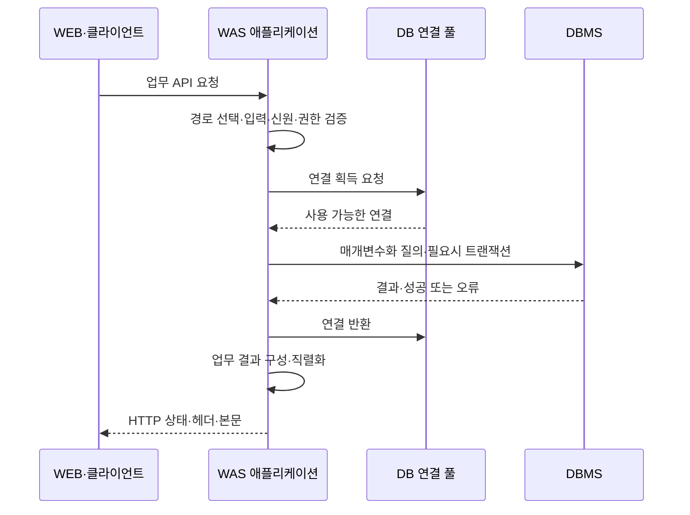

## 목차

- [[#1. 개요|1. 개요]]
- [[#2. OS·프로세스·런타임의 구성|2. OS·프로세스·런타임의 구성]]
- [[#3. 업무 요청의 응답 생성 과정|3. 업무 요청의 응답 생성 과정]]
- [[#4. Tomcat과 언어별 웹 실행 환경|4. Tomcat과 언어별 웹 실행 환경]]
- [[#5. 동시 요청·스레드·큐·연결 풀|5. 동시 요청·스레드·큐·연결 풀]]
- [[#6. 세션·상태와 수평 확장|6. 세션·상태와 수평 확장]]
- [[#7. 트랜잭션·재시도·입력 처리|7. 트랜잭션·재시도·입력 처리]]
- [[#8. 웹 문서에서 업무 애플리케이션으로의 확장|8. 웹 문서에서 업무 애플리케이션으로의 확장]]
- [[#9. 관련 문서|9. 관련 문서]]
- [[#10. 출처|10. 출처]]

## 1. 개요

Web Application Server(WAS)는 웹 요청에 따라 애플리케이션의 업무 코드를 실행하고 필요한 데이터·외부 서비스와 연동해 응답을 만드는 서버 실행 환경이다.

국내 인프라 설명에서는 WEB 뒤의 동적 업무 처리 계층을 WAS라고 부르는 경우가 많다. 그러나 모든 언어·제품이 같은 이름과 기능 범위를 사용하는 것은 아니다. 이 문서는 일반적인 애플리케이션 계층을 설명하되 Java·Tomcat을 구체적인 구현 예로 사용한다. [[Web Server|WEB]]·WAS·[[Database|DB]]의 책임 차이는 [[3-Tier Architecture]]에서 함께 볼 수 있다.

## 2. OS·프로세스·런타임의 구성

Java 애플리케이션의 예에서는 물리 호스트 또는 VM에 OS가 있고, 그 위의 JVM 프로세스에서 Tomcat과 애플리케이션 코드가 실행된다. CPU는 그 코드를 실행하고, 메모리는 객체·실행 스택·캐시 등에 사용되며, NIC는 사용자·DB·외부 API 통신에, 저장소는 배포 파일·로그·필요한 데이터에 사용된다.

| 구성 | 역할 | 자원·운영과의 연결 |
|---|---|---|
| HTTP Connector | 요청 연결 수신과 응답 전송 | 수신 주소·포트·연결·큐·시간 제한 |
| 애플리케이션 컨테이너 | 배포된 웹 앱과 요청 처리 연결 | 라우팅·생명주기·설정 |
| JVM·런타임 | 코드 실행과 메모리 관리 | CPU·힙·GC·스레드·네이티브 메모리 |
| 업무 코드·라이브러리 | 인증·검증·업무 규칙 수행 | 예외·의존성·처리 시간 |
| DB 연결 풀 | 제한된 DB 연결 재사용 | 최대 연결·획득 대기·반환·DB 부하 |
| 로그·관측 기능 | 처리 결과와 내부 상태 기록 | 요청 추적·예외·지연 원인 |

Tomcat의 Connector·Engine·Host·Context는 통신·요청 처리·호스트 이름·웹 애플리케이션을 나누는 내부 구성 개념이다. 여기서 Server라는 설정 이름도 물리 서버 본체와 같은 뜻은 아니다.[^architecture]

JVM 힙 제한을 VM의 전체 메모리와 동일하게 잡으면 OS·스레드 스택·클래스 메타데이터·네이티브 메모리 등을 위한 공간이 부족할 수 있다. Java의 힙 사용과 프로세스의 전체 메모리, 호스트의 전체 사용량은 같은 지표가 아니다.[^jvm]

## 3. 업무 요청의 응답 생성 과정

그림의 순서는 이해를 돕기 위한 예시이다. 프레임워크가 트랜잭션과 연결 반환을 관리하기도 하고, 캐시에서 결과를 얻어 DB를 호출하지 않기도 한다. 핵심은 HTTP 요청 수신만으로 업무가 끝나지 않으며 권한·데이터·하위 시스템까지 관여한다는 점이다.

예를 들어 주문 생성은 “로그인되어 있는가”와 “해당 주문을 만들 권한이 있는가”, “재고가 있는가”, “중복 요청인가”를 별도로 다룬다. WEB에서 HTTPS 연결을 성공시켰다는 사실만으로 이러한 업무 검증을 대신할 수 없다.

## 4. Tomcat과 언어별 웹 실행 환경

Tomcat은 Jakarta Servlet·Pages 등 명시된 웹 관련 사양을 구현하는 컨테이너이다. 전체 Jakarta EE 플랫폼의 모든 기능을 제공하는 서버와 동일시하면 안 된다. 필요한 기능은 Tomcat과 라이브러리 또는 별도 서비스를 조합해 제공할 수도 있다.[^tomcat]

Python·Node.js·.NET 등의 웹 애플리케이션도 요청을 받아 업무를 실행하지만 코드 실행·동시성·배포 방식은 다르다. Java의 JVM·서블릿·스레드 설정을 다른 런타임에 그대로 적용하지 않는다. “WAS가 처리한다”는 설명 다음에는 실제 제품·버전·애플리케이션의 구성을 적어야 운영에서 의미가 생긴다.

WAS는 자체 HTTP 기능을 가질 수 있으므로 앞에 별도 WEB을 반드시 두어야 하는 것은 아니다. 별도 프록시를 두면 TLS·접근 제어·캐시·정적 콘텐츠·공통 라우팅을 관리하기 쉬울 수 있지만 네트워크 홉과 설정·장애 지점이 늘어난다.[^connector]

## 5. 동시 요청·스레드·큐·연결 풀

여러 요청은 CPU·스레드와 DB 연결 같은 자원을 나누어 사용한다. Tomcat의 동기식 요청 처리에서는 처리하는 동안 스레드가 사용되고, 처리 자원이 부족하면 연결·요청이 대기하거나 제한에 걸릴 수 있다. `maxThreads`, `maxConnections`, `acceptCount`는 같은 수를 조절하는 옵션이 아니다.[^connector]

비동기 I/O나 이벤트 루프는 기다리는 동안 스레드가 묶이는 비용을 줄일 수 있지만, CPU 계산·DB 연결·외부 서비스 처리량의 한도를 없애지 않는다. 큐가 계속 길어지면 사용자는 오래 기다리다가 시간 초과를 겪는다. 대기 제한·동시성 제한·실패 응답 등으로 과부하를 제어하는 것이 무한 대기보다 예측 가능할 수 있다.

DB 연결 풀은 매 요청마다 새 연결을 만드는 비용을 줄이고 DB 동시 접근을 제한한다. 연결을 빌린 뒤 반환하지 않거나 긴 트랜잭션이 연결을 오래 점유하면 앱의 CPU가 낮아도 새 요청이 연결 획득을 기다릴 수 있다. 풀 크기를 크게 바꾸면 DB 쪽 경합이 늘어날 수 있으므로 풀 대기와 DB 실행·잠금을 함께 본다.[^pool]

배치 규모도 중요하다. WAS 3개가 각 40개 연결을 허용하면 앱 전체의 잠재 DB 연결 수는 120개이며, 여기에 다른 업무·운영 연결이 더해질 수 있다. 이 숫자는 단순한 용량 산정 예시이다. 인스턴스 자동 확장 정책과 DB의 수용 한도를 함께 설계한다.

## 6. 세션·상태와 수평 확장

쿠키는 브라우저가 요청에 정보를 전달하는 수단이고 세션은 서버 측 사용자 상태를 관리하는 개념이다. 브라우저가 세션 식별자를 쿠키로 전달하고 WAS가 그 식별자로 상태를 찾는 구성이 가능하다. 토큰 인증 등 다른 방식도 있으며 쿠키·세션·토큰을 같은 객체로 보면 안 된다.

한 WAS 메모리에만 세션이 있으면 다음 요청이 다른 인스턴스로 갈 때 상태가 없을 수 있다. 고정 세션은 같은 대상으로 보내도록 돕지만 해당 대상의 장애까지 해결하지 않는다. 공유 저장소나 세션 복제는 여러 대상에서 상태를 사용할 수 있게 하지만 지연·일관성·별도 저장소의 가용성을 다뤄야 한다. Tomcat도 세션 복제에 필요한 설정과 애플리케이션 조건을 별도로 설명한다.[^session]

“무상태 WAS”는 업무 데이터가 전혀 없다는 뜻보다, 요청을 처리하기 위해 특정 인스턴스의 휘발성 로컬 상태에 매달리지 않게 설계한다는 의미로 이해하는 것이 유용하다. 사용자 데이터는 DB·공유 저장소 등 적절한 위치에 남을 수 있다.

## 7. 트랜잭션·재시도·입력 처리

재고 차감과 주문 저장처럼 함께 성공해야 하는 DB 변경은 적절한 트랜잭션 경계를 가진다. 다만 DB 트랜잭션 하나가 외부 결제 API까지 자동으로 되돌리지는 않는다. 외부 호출·재시도·중복 실행·부분 실패를 애플리케이션에서 별도로 설계해야 한다.

SQL을 사용자 문자열의 단순 연결로 만들면 입력이 질의 구조를 바꿀 수 있다. 매개변수화된 질의는 데이터와 질의 구조를 구분하는 기본 수단이다. 인증된 사용자 입력도 검증 대상이며, 매개변수화가 업무 권한 확인까지 대신하는 것은 아니다.[^sql]

연결 시간 초과·DB 질의 시간 제한·전체 요청 시간 제한은 서로 다른 대기 구간을 다룬다. WEB의 시간 제한을 늘린다고 DB 잠금이 풀리는 것은 아니며, 클라이언트가 포기한 뒤 서버에서 업무 처리가 계속되는지도 고려해야 한다.

## 8. 웹 문서에서 업무 애플리케이션으로의 확장

저장된 웹 문서를 전달하는 것만으로는 로그인한 사용자의 주문 내역, 재고 확인, 결제 결과처럼 상황에 따라 달라지는 응답을 만들기 어렵다. 애플리케이션 서버는 웹 요청을 프로그램의 실행과 연결하고, 그 프로그램이 DB나 다른 서비스를 사용해 결과를 만들도록 한다. 이것이 파일 제공 역할과 구분되는 본질적인 이유이다.

예를 들어 주문 조회 애플리케이션은 요청에서 사용자와 주문 번호를 확인하고, DB에서 데이터를 조회한 뒤, 필요한 항목을 JSON이나 HTML로 구성한다. Tomcat 같은 실행 환경은 요청을 애플리케이션에 전달하는 공통 기능을 제공하고, 실제 주문 규칙은 개발한 업무 코드가 처리한다.[^architecture][^tomcat]

현대의 웹 애플리케이션은 하나의 서버 프로그램에 모든 업무를 담을 수도 있고 여러 서비스로 나눌 수도 있다. 물리 서버·VM·컨테이너 중 어디에 배치하더라도 업무 코드를 실행한다는 역할은 같다. Java의 Tomcat 구성, Python 웹 애플리케이션, Node.js 서비스가 모두 같은 제품은 아니지만 요청을 프로그램의 실행 결과로 바꾼다는 공통점이 있다.

따라서 WAS를 “동적인 것을 처리하는 특별한 장비”로 외우기보다, 요청을 받아 업무 코드를 실행하는 환경으로 이해하는 편이 정확하다. [[3-Tier Architecture]]는 이 역할을 웹 진입·데이터 관리 역할과 나누어 설명하는 대표적인 구조이다.

## 9. 관련 문서

- [[Web Server]], [[Database]], [[3-Tier Architecture]]
- [[Server]], [[Networking]], [[Storage]], [[Harbor]]

## 10. 출처

[^architecture]: [Apache Tomcat — Architecture Overview](https://tomcat.apache.org/tomcat-10.1-doc/architecture/overview.html)
[^jvm]: [Oracle — Native Memory Tracking](https://docs.oracle.com/en/java/javase/21/vm/native-memory-tracking.html)
[^tomcat]: [Apache Tomcat — Documentation and implemented specifications](https://tomcat.apache.org/tomcat-10.1-doc/)
[^connector]: [Apache Tomcat — HTTP Connector and request concurrency](https://tomcat.apache.org/tomcat-10.1-doc/config/http.html)
[^pool]: [Apache Tomcat — JNDI Datasource How-To](https://tomcat.apache.org/tomcat-10.1-doc/jndi-datasource-examples-howto.html)
[^session]: [Apache Tomcat — Clustering and Session Replication](https://tomcat.apache.org/tomcat-10.1-doc/cluster-howto.html)
[^sql]: [OWASP — SQL Injection Prevention: Parameterized Queries](https://cheatsheetseries.owasp.org/cheatsheets/SQL_Injection_Prevention_Cheat_Sheet.html)

## 둘러보기

[[Knowledge Base/index|전체 개념 목록]] · [[Compute 분류|Compute]]
