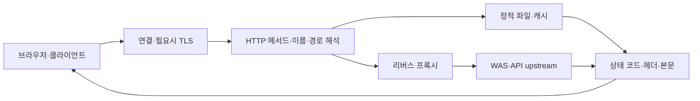

## 목차

- [[#1. 개요|1. 개요]]
- [[#2. 서버 프로세스와 실행 환경|2. 서버 프로세스와 실행 환경]]
- [[#3. HTTP 요청이 처리되는 순서|3. HTTP 요청이 처리되는 순서]]
- [[#4. 정적 콘텐츠와 동적 응답|4. 정적 콘텐츠와 동적 응답]]
- [[#5. 리버스 프록시·로드밸런싱·캐시|5. 리버스 프록시·로드밸런싱·캐시]]
- [[#6. 연결 재사용·TLS·HTTP 버전의 차이|6. 연결 재사용·TLS·HTTP 버전의 차이]]
- [[#7. 대표적인 웹 서버와 활용 방식|7. 대표적인 웹 서버와 활용 방식]]
- [[#8. 웹 서버의 등장 배경|8. 웹 서버의 등장 배경]]
- [[#9. 관련 문서|9. 관련 문서]]
- [[#10. 출처|10. 출처]]

## 1. 개요

Web Server(웹 서버)는 HTTP 요청을 받아 웹 콘텐츠를 직접 제공하거나 다른 애플리케이션의 응답을 전달하는 소프트웨어와 그 실행 시스템이다.

업무에서 “WEB 서버”라고 하면 NGINX·Apache HTTP Server·IIS 같은 프로그램을 뜻하기도 하고 그 프로그램이 설치된 VM을 뜻하기도 한다. [[Web Application Server|WAS]]와의 구분은 책임의 구분이지 서로 다른 모양의 필수 하드웨어를 뜻하지 않는다. 여기서는 웹 요청의 진입·정적 콘텐츠·프록시 역할을 중심으로 설명한다.[^nginx]

## 2. 서버 프로세스와 실행 환경

물리 서버나 VM의 OS 위에서 웹 서버 프로세스가 실행되고, 지정된 주소와 포트에서 연결을 받는다. NIC로 들어온 패킷은 OS 네트워크 처리와 소켓을 거쳐 프로세스에 전달된다. 정적 파일을 요청하면 파일 경로·권한·캐시와 저장 장치가, 프록시 요청이면 다음 서버의 연결 상태가 응답에 영향을 준다.

NGINX는 master가 설정과 worker를 관리하고 worker가 실제 요청을 처리하는 구조를 사용한다. 이벤트 기반 처리로 여러 연결을 다루지만 그것이 CPU·메모리·파일 디스크립터나 upstream 처리량의 한계를 없앤다는 뜻은 아니다.[^process] Apache HTTP Server는 MPM에 따라 프로세스·스레드 처리 방식이 달라지므로 모든 웹 서버를 “요청 하나당 프로세스 하나”로 설명하면 안 된다.[^mpm]

서버 프로세스 하나가 여러 이름의 사이트를 제공할 수도 있고, 로드밸런서 뒤의 여러 VM이 하나의 사이트를 제공할 수도 있다. 물리 장비·VM·프로세스·사이트 주소는 서로 다른 수와 범위를 가진다.

## 3. HTTP 요청이 처리되는 순서

DNS 조회는 웹 서버에 요청이 도착하기 전에 서비스 주소를 알아내는 별도 기능이다. TCP 기반 HTTPS의 경우 전송 연결과 TLS 협상이 선행되고, 이후 HTTP 요청의 메서드·대상·헤더 등을 해석한다. HTTP/3는 UDP 기반 QUIC를 사용하므로 모든 HTTP 연결을 TCP로 단정하지 않는다.[^http3]

NGINX의 일반적인 이름 기반 설정에서는 수신 주소·포트와 HTTP Host 등을 사용해 처리할 서버 블록을 선택하고 URI에 맞는 location을 선택한다. 설정한 기본 서버와 이름·경로가 기대와 다르면 같은 장비에 도달했어도 다른 콘텐츠가 반환될 수 있다.[^routing]

HTTPS에서 TLS는 HTTP보다 먼저 협상된다. SNI는 클라이언트가 TLS 협상에서 접속하려는 서버 이름을 알리는 기능이며, HTTP Host와 같은 시점에 처리되는 필드는 아니다. 인증서 이름·유효기간·신뢰 체인이 올바른지와 HTTP 요청 라우팅이 올바른지는 나눠 봐야 한다.[^sni]

## 4. 정적 콘텐츠와 동적 응답

HTML·CSS·JavaScript·이미지처럼 저장된 파일을 그대로 제공하는 것이 정적 콘텐츠의 대표 예이다. JavaScript 파일 자체는 정적으로 전달될 수 있지만 브라우저가 그 코드를 실행하면서 별도 API를 호출해 동적인 화면을 만들 수 있다. 화면이 바뀐다는 사실과 최초 파일이 서버에서 동적으로 생성됐다는 사실은 다르다.

동적인 업무 응답은 사용자의 입력·권한·DB 결과에 따라 만들어진다. WEB이 `/images/`는 파일로 제공하고 `/api/`는 WAS로 보내도록 구성할 수 있다. 이는 역할 분리 예시이며 URL만 보고 실제 구현이 반드시 정적·동적이라고 판단할 수는 없다.[^nginx]

Tomcat처럼 HTTP와 정적 파일 제공을 지원하는 애플리케이션 실행 환경도 있다. 따라서 별도 WEB 프로그램이 항상 필수인 것은 아니다. 분리 여부는 TLS·캐시·접근 통제·배포·확장·운영 책임 등의 필요로 결정한다.

## 5. 리버스 프록시·로드밸런싱·캐시

리버스 프록시는 클라이언트 대신 upstream에 요청하고 그 응답을 클라이언트에 전달한다. 사용자가 특정 내부 WAS 주소를 직접 알 필요 없이 공통 진입점으로 접속하게 할 수 있다. 여러 upstream을 선택해 분산하는 기능은 로드밸런싱이고, 모든 프록시 구성이 자동으로 부하 분산·상태 확인을 수행하는 것은 아니다.[^proxy]

프록시에는 클라이언트 연결과 upstream 연결이라는 두 구간이 있다. 연결 시간 초과, 응답 읽기 시간 초과, 버퍼링, 요청 본문 크기 제한 같은 설정이 서로 다른 실패를 만들 수 있다. NGINX의 `proxy_read_timeout`은 전체 응답의 총 시간을 한 번에 제한하는 값이 아니라 연속된 읽기 사이의 시간 제한이라는 점이 중요하다.[^timeout]

캐시는 재사용 가능한 응답으로 upstream 부하와 지연을 줄인다. 캐시 키·유효기간·무효화·인증 응답 처리에 따라 내용의 최신성과 사용자별 분리가 달라진다. 모든 응답을 무조건 캐시하면 개인 데이터가 잘못 공유될 수 있고, 캐시가 있다고 DB 백업이 되는 것은 아니다. [[CDN]]은 이런 콘텐츠 전달을 여러 분산 거점에서 수행하는 서비스와 연결된다.[^cache]

## 6. 연결 재사용·TLS·HTTP 버전의 차이

HTTP keep-alive는 연결을 재사용해 매 요청마다 새 연결을 만드는 비용을 줄일 수 있다. HTTP/2는 하나의 연결에서 여러 스트림을 다루는 등 HTTP/1.1과 다른 프레이밍을 사용한다. 연결 수와 요청 수가 항상 같다고 가정하면 처리량과 제한을 잘못 해석할 수 있다.[^http2]

TLS 종료 위치는 암호화 경계이다. 로드밸런서에서 HTTPS를 종료하고 WEB 또는 WAS로 평문 HTTP를 보내는 구성도 있고, 내부 구간을 다시 TLS로 연결하는 구성도 있다. 외부 주소에 자물쇠가 표시된다는 사실만으로 모든 내부 홉이 암호화된 것은 아니다.[^upstreamtls]

프록시 뒤에서는 서버가 보는 원격 주소가 프록시 주소일 수 있다. 실제 사용자 주소를 전달하는 헤더를 이용할 수 있지만 외부 사용자가 보낸 값을 무조건 신뢰하면 안 된다. NGINX realip 모듈도 주소 치환을 허용할 신뢰 대상과 헤더를 지정하는 구조이다.[^realip]

## 7. 대표적인 웹 서버와 활용 방식

NGINX·Apache HTTP Server·IIS는 웹 서버 소프트웨어의 대표적인 예이다. 같은 HTTP 요청을 처리하더라도 프로세스·스레드·이벤트 처리 방식과 제공하는 모듈은 다를 수 있다. 웹 서버라는 공통 역할과 개별 제품의 구현을 구분하면 새로운 제품도 이해하기 쉽다.[^process][^mpm]

개인 소개 페이지나 BOwiki처럼 미리 만들어 둔 HTML·CSS·이미지를 제공하는 서비스는 정적 파일 제공만으로도 구성할 수 있다. 반면 로그인한 사용자의 주문 내역을 보여 주는 서비스는 요청마다 다른 결과가 필요하므로 웹 서버가 애플리케이션 서버로 요청을 전달하는 구성을 사용할 수 있다.

웹 서버를 여러 대 두는 것은 같은 역할을 여러 실행 환경에 나누는 방식이다. 리버스 프록시는 내부 서버로 요청을 전달하고, 로드밸런싱은 여러 대상 중 처리할 서버를 고르며, 캐시는 이전 응답을 재사용한다. 셋은 함께 사용될 수 있지만 각각 해결하는 문제가 다르다.[^proxy][^cache]

## 8. 웹 서버의 등장 배경

CERN에서 제안된 웹은 서로 다른 컴퓨터의 정보를 하이퍼텍스트로 연결해 접근하려는 요구에서 출발했다. 1989년의 제안과 1990년 무렵의 최초 브라우저·서버 구현은 구분되는 사건이다.[^history] 이후 웹 서버는 파일 전달뿐 아니라 암호화된 진입점, 프록시·캐시·분산 처리의 역할까지 함께 맡는 경우가 많아졌다. 다만 특정 제품의 기능은 해당 버전·모듈의 문서를 기준으로 이해한다.

## 9. 관련 문서

- [[Server]], [[Networking]], [[3-Tier Architecture]]
- [[Web Application Server]], [[Database]], [[CDN]]

## 10. 출처

[^nginx]: [NGINX — Beginner's Guide: static and proxy examples](https://nginx.org/en/docs/beginners_guide.html)
[^process]: [NGINX — Processes and event-based processing](https://nginx.org/en/docs/beginners_guide.html)
[^mpm]: [Apache HTTP Server — Multi-Processing Modules](https://httpd.apache.org/docs/2.4/mpm.html)
[^http3]: [IETF — RFC 9114: HTTP/3](https://www.rfc-editor.org/rfc/rfc9114.html)
[^routing]: [NGINX — How nginx processes a request](https://nginx.org/en/docs/http/request_processing.html)
[^sni]: [IETF — RFC 6066, Server Name Indication](https://www.rfc-editor.org/rfc/rfc6066.html#section-3)
[^proxy]: [NGINX — Reverse Proxy](https://docs.nginx.com/nginx/admin-guide/web-server/reverse-proxy/)
[^timeout]: [NGINX — proxy_read_timeout](https://nginx.org/en/docs/http/ngx_http_proxy_module.html#proxy_read_timeout)
[^cache]: [NGINX — Content Caching](https://docs.nginx.com/nginx/admin-guide/content-cache/content-caching/)
[^http2]: [IETF — RFC 9113: HTTP/2](https://www.rfc-editor.org/rfc/rfc9113.html)
[^upstreamtls]: [NGINX — Securing HTTP Traffic to Upstream Servers](https://docs.nginx.com/nginx/admin-guide/security-controls/securing-http-traffic-upstream/)
[^realip]: [NGINX — ngx_http_realip_module](https://nginx.org/en/docs/http/ngx_http_realip_module.html)

[^history]: [CERN — The birth of the Web](https://home.cern/science/computing/the-birth-of-the-web)

## 둘러보기

[[Knowledge Base/index|전체 개념 목록]] · [[Compute 분류|Compute]]
