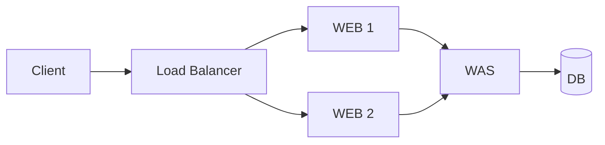

## 목차

- [[#질문|질문]]
- [[#해답|해답]]
- [[#도입 판단 기준|도입 판단 기준]]
- [[#관련 문서|관련 문서]]
- [[#출처|출처]]

## 질문

현재 3-Tier 구성에는 로드밸런서가 필요한가?

## 해답

로드밸런서는 3-Tier 아키텍처의 필수 구성 요소가 아닙니다. 3-Tier는 프레젠테이션·애플리케이션·데이터 역할을 논리적으로 분리하는 설계이며, 각 계층이 반드시 여러 서버로 구성되어야 한다는 뜻은 아닙니다.[^1]

단일 WEB·WAS로 동작을 확인하는 실습이라면 로드밸런서 없이도 충분합니다. 반면 같은 역할의 서버가 두 대 이상이고 요청 분산, 상태 확인, 단일 접속 주소 또는 장애 서버 제외가 필요하다면 로드밸런서를 검토합니다. 로드밸런서는 요청을 등록된 대상에 전달하고 상태 확인을 통과한 대상으로 트래픽을 보낼 수 있습니다.[^2]

## 도입 판단 기준

다음 요구가 생길 때 도입 가치가 커집니다.

- 동일 계층을 수평 확장하여 두 대 이상 운영하는 경우
- 장애가 발생한 서버로 요청을 보내지 않아야 하는 경우
- 사용자가 접속할 단일 주소가 필요한 경우
- 점검 중인 서버를 서비스에서 순차적으로 제외해야 하는 경우
- TLS 종료, 경로 기반 라우팅 또는 세션 처리 기능이 필요한 경우

로드밸런서 한 대만 두면 그 장비가 다시 단일 장애점이 될 수 있으므로, 실제 운영에서는 로드밸런서 자체의 이중화나 관리형 서비스의 가용성도 함께 검토해야 합니다.

## 관련 문서

- [[3-Tier Architecture]]
- [[Web Server]]
- [[Web Application Server]]
- [[Networking]]

## 출처

[^1]: 3-Tier는 논리적 서비스 계층이며 물리 장비 배치와 반드시 일치하지 않는다. [Microsoft Learn, Using a Three-Tier Architecture Model](https://learn.microsoft.com/en-gb/windows/win32/cossdk/using-a-three-tier-architecture-model)
[^2]: 로드밸런서는 등록된 대상의 상태를 확인하고 정상 대상으로 요청을 분산한다. [AWS 공식 문서, How Elastic Load Balancing works](https://docs.aws.amazon.com/elasticloadbalancing/latest/userguide/how-elastic-load-balancing-works.html)

## 둘러보기

[[Questions/index|Questions]] · [[Knowledge Base/index|Knowledge Base]] · [[Projects/index|Projects]]
