## 목차

- [[#질문|질문]]
- [[#한 문장 해답|한 문장 해답]]
- [[#마이그레이션 중 서비스가 계속 운영되는 원리|마이그레이션 중 서비스가 계속 운영되는 원리]]
- [[#최종 전환에서 짧은 중단이 발생하는 이유|최종 전환에서 짧은 중단이 발생하는 이유]]
- [[#RMM Migration과 DR의 데이터 경로|RMM Migration과 DR의 데이터 경로]]
- [[#Stage 1과 Stage 2의 역할|Stage 1과 Stage 2의 역할]]
- [[#DR에서 Image Pool이 필요한 이유|DR에서 Image Pool이 필요한 이유]]
- [[#직접 복제 기반 DR의 실제 사례|직접 복제 기반 DR의 실제 사례]]
- [[#Cold·Warm·Hot Standby와 Active-Active의 차이|Cold·Warm·Hot Standby와 Active-Active의 차이]]
- [[#잘못된 변경까지 복제되는 문제|잘못된 변경까지 복제되는 문제]]
- [[#가용성과 복구 가능성의 구분|가용성과 복구 가능성의 구분]]
- [[#계획된 전환과 실제 장애의 차이|계획된 전환과 실제 장애의 차이]]
- [[#Image Pool을 안전하게 운영하기 위한 조건|Image Pool을 안전하게 운영하기 위한 조건]]
- [[#설계 판단 기준|설계 판단 기준]]
- [[#관련 문서|관련 문서]]
- [[#출처|출처]]

## 질문

RackWare RMM은 마이그레이션 중에도 어떻게 소스 서비스를 계속 운영할 수 있으며, 최종 전환에서는 왜 짧은 중단이 발생하는가?

RMM의 DR 정책은 왜 Source와 Target을 직접 동기화하지 않고 Stage 1과 Stage 2를 거치며, Image Pool은 어떤 역할을 하는가?

Source와 DR Target을 직접 동기화해 두고 장애 시 트래픽만 바꾸는 구조도 실제로 존재하는가? 그렇다면 Image Pool을 사용하는 방식과 비교해 어떤 장단점이 있는가?

## 한 문장 해답

마이그레이션은 운영 중인 Source의 데이터를 미리 복제하고 변경분만 반복해 따라가므로 긴 중단을 피할 수 있지만, 최종 정합성을 확정하고 서비스 경로를 넘기는 [[Knowledge Base/Cutover|컷오버]]에서는 짧은 중단이 필요할 수 있습니다.

RackWare의 공개 DR 안내는 Source의 보호 사본을 RMM Storage Pool에 먼저 저장한 뒤 Target으로 복구하는 Store-and-Forward 구조를 설명합니다. 이 구조는 Direct Sync보다 복구 시간이 늘어날 수 있지만 Source·Target과 독립된 복구 기준을 제공하고, Cold·Warm·Hot 정책과 시점별 복구를 같은 보호 데이터로 운영할 수 있게 합니다.[^rackware-oracle][^ibm-rmm]

## 마이그레이션 중 서비스가 계속 운영되는 원리

서버의 전체 데이터를 복사하는 데 몇 시간이 걸리더라도 그 시간 동안 Source를 반드시 중지할 필요는 없습니다. RMM은 먼저 일관된 복제 기준을 만들고 대부분의 데이터를 미리 옮긴 뒤, 이후 달라진 내용만 [[Knowledge Base/Delta Sync|Delta Sync]]로 반영합니다. RackWare는 이를 사전 데이터 적재와 변경분 동기화를 이용한 Near-Zero Downtime Cutover로 설명합니다.[^rackware-migration]

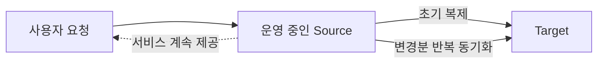

RackWare의 공개 FAQ는 Linux에서는 LVM Snapshot, Windows에서는 VSS Snapshot을 이용해 입출력을 디스크에 반영한 정적인 복제 기준을 만든다고 설명합니다. 복제 도중 새로 들어오는 쓰기는 운영 파일시스템에서 계속 처리하고, 다음 동기화에서 변경분으로 따라잡습니다.[^rackware-faq]

쉽게 설명하면 영업 중인 식당을 이전할 때 모든 집기를 한꺼번에 옮기려고 문을 며칠 닫는 대신, 사용하지 않는 물건부터 새 점포에 옮겨 놓고 마지막 영업이 끝난 뒤 남은 물건만 옮기는 방식과 비슷합니다.

예를 들어 사용 중인 데이터가 1TB라면 다음과 같은 흐름이 가능합니다.

| 시점 | 전송 내용 | Source 서비스 |
|---|---|---|
| 초기 복제 | 기존 데이터 대부분 | 계속 운영 |
| 반복 동기화 | 초기 복제 중 발생한 변경분 | 계속 운영 |
| 컷오버 직전 | 마지막 소량의 변경분 | 쓰기 제한 또는 중지 |
| 전환 이후 | Target에서 신규 요청 처리 | Source 격리 |

## 최종 전환에서 짧은 중단이 발생하는 이유

초기 복제와 반복 동기화가 끝나도 Source는 계속 변하고 있습니다. 마지막 동기화가 끝난 뒤에도 Source가 새로운 쓰기를 받으면 Target과 차이가 다시 생깁니다.

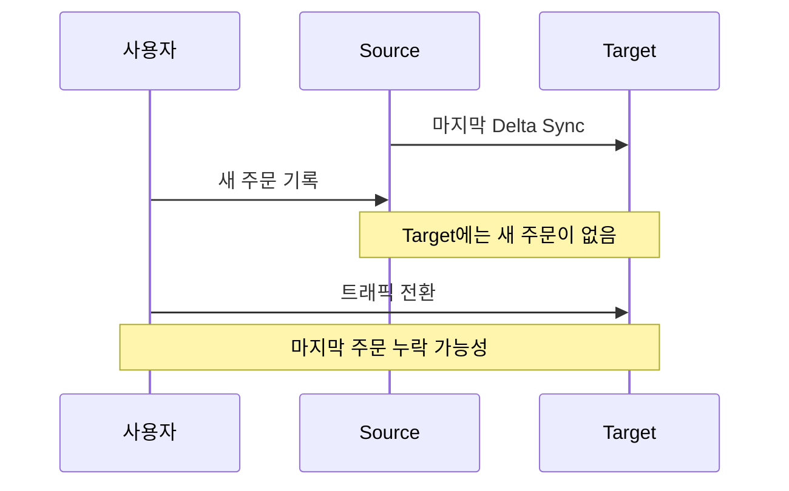

계획된 컷오버에서는 일반적으로 신규 쓰기를 제한하고, 메모리와 DB의 변경 내용을 디스크에 반영한 뒤 마지막 동기화를 수행합니다. 이후 Target을 기동·검증하고 DNS·NAT·로드밸런서 등의 서비스 경로를 전환합니다. 중단 시간은 전체 데이터를 복사하는 시간이 아니라 이 마지막 정합성 확정, Target 기동, 서비스 검증과 네트워크 전환에 걸리는 시간입니다.[^rackware-migration][^aws-cutover]

따라서 `Near-Zero Downtime`은 중단이 절대 없다는 뜻이 아닙니다. 애플리케이션의 특성과 데이터 변경량, DB 종료 절차, Target 부팅, DNS와 로드밸런서 전환 방식에 따라 짧은 중단이 발생할 수 있습니다.

## RMM Migration과 DR의 데이터 경로

Migration과 DR은 비슷한 복제 기술을 사용하더라도 목적과 데이터 경로가 다를 수 있습니다.

### Migration의 Direct Sync

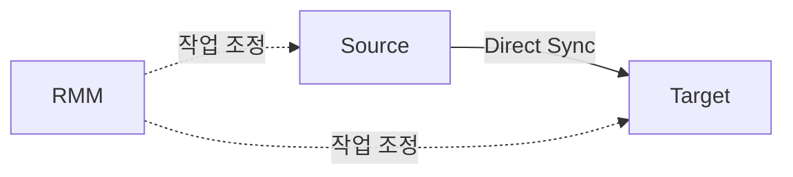

IBM의 공개 RackWare 설계 문서는 Direct Sync를 Source에서 Target으로 데이터를 직접 전달하고 RMM이 작업을 조정하는 방식으로 설명합니다. Source와 Target이 동시에 존재하고 서로 데이터를 전달할 수 있는 일회성 Migration에 적합합니다.[^ibm-rmm]

### DR의 Staged Sync

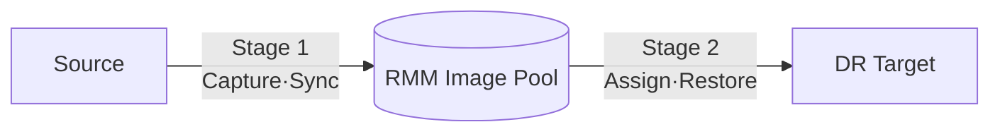

RackWare의 공개 Oracle Cloud DR 안내는 RMM DR이 Store-and-Forward 방식을 사용하며 Source의 사용 중인 데이터를 RMM에 연결된 블록 스토리지에 압축해 보관한다고 설명합니다. IBM의 공개 설계 문서도 Stage 1을 Source에서 RMM의 ZFS Storage Pool로 복사하는 단계, Stage 2를 Pool에서 Target으로 복사하는 단계로 구분합니다.[^rackware-oracle][^ibm-rmm]

제품 버전·라이선스·대상 환경에 따라 화면과 세부 정책은 달라질 수 있으므로 실제 적용 시 해당 버전의 공식 지원 문서를 함께 확인해야 합니다. 이 문서는 공개 자료에서 확인되는 설계 원리를 설명합니다.

## Stage 1과 Stage 2의 역할

### Stage 1의 보호 사본 생성

Stage 1은 Source에서 일관된 복제 기준을 만들고 RMM Image Pool에 저장하거나 기존 이미지를 변경분으로 갱신하는 단계입니다.

- Source의 전체 데이터 또는 변경분 수집
- 운영체제·파일시스템·볼륨 구성 정보 보존
- 장애 시 선택할 복구 시점 확보
- Source와 Target 작업 시점 분리

Stage 1이 15분마다 성공하도록 정책을 구성했다면 장애 시점에 따라 최대 약 15분의 최근 변경이 보호 사본에 없을 수 있습니다. 이 간격은 RPO를 결정하는 요소 가운데 하나입니다.

### Stage 2의 Target 복구

Stage 2는 Image Pool의 보호 사본을 Target에 적용해 실제로 부팅 가능한 복구 서버를 만드는 단계입니다.

- 기존 Target 갱신 또는 신규 Target 프로비저닝
- 파티션·파일시스템·볼륨 구성
- 데이터 복원과 필요한 드라이버·부팅 구성 적용
- Target 기동과 서비스 검증

여러 서버의 복구 순서가 필요하다면 DB·스토리지처럼 선행되어야 하는 시스템을 먼저 복구하고 WAS와 WEB을 뒤에 복구하도록 오케스트레이션해야 합니다. 복구 순서를 정하는 일은 Source 데이터를 수집하는 Stage 1보다 Target을 실제 서비스 상태로 만드는 Stage 2와 더 밀접합니다.

## DR에서 Image Pool이 필요한 이유

여기서 Image는 AWS AMI와 같은 빈 운영체제 설치 템플릿만을 뜻하지 않습니다. Source에서 캡처한 운영체제·애플리케이션·설정·데이터와 복구에 필요한 메타데이터를 포함한 보호 사본에 가깝습니다.

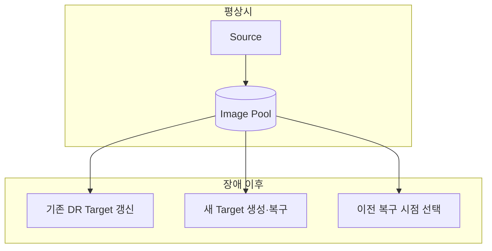

Image Pool은 다음 문제를 해결합니다.

1. Source가 완전히 사라져도 마지막 성공한 보호 사본으로 복구할 수 있습니다.
2. Target이 손상되거나 삭제되어도 다시 만들 수 있습니다.
3. Source 수집 시간과 Target 복구 시간을 분리할 수 있습니다.
4. Cold·Warm·Hot Standby에서 같은 보호 데이터를 서로 다른 방식으로 사용할 수 있습니다.
5. 보존 정책이 구성되어 있다면 최신 상태가 손상됐을 때 이전 복구 시점을 선택할 수 있습니다.[^rackware-dr]

비유하면 Direct Sync는 현재 문서를 다른 컴퓨터에 그대로 열어 놓고 계속 수정 내용을 전달하는 방식이고, Image Pool은 날짜별 저장본을 별도의 보관함에 남긴 뒤 필요할 때 원하는 컴퓨터에 꺼내는 방식입니다.

## 직접 복제 기반 DR의 실제 사례

Source와 Standby를 직접 동기화한 뒤 장애 시 Standby를 승격하고 트래픽을 전환하는 구조도 실제로 널리 사용됩니다. 특히 애플리케이션이 자기 데이터 구조를 이해하는 DB 복제에서 대표적입니다.

### PostgreSQL Streaming Replication

PostgreSQL Standby는 Primary에서 전달받은 WAL 기록을 계속 적용합니다. 장애 시 `pg_ctl promote` 또는 `pg_promote()`를 실행해 Standby를 새로운 Primary로 승격할 수 있습니다.[^postgresql]

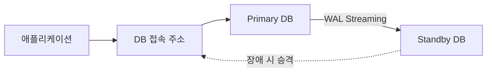

### SQL Server Always On

SQL Server Always On Availability Group은 Primary Replica와 Secondary Replica를 동기화하고 장애 시 Replica의 역할을 전환합니다. 애플리케이션은 Availability Group Listener라는 고정된 접속 지점을 사용하므로 어느 서버가 Primary인지 직접 알 필요가 없습니다.[^sql-listener]

### Azure Site Recovery

Azure Site Recovery는 VM을 Primary 위치에서 Secondary 위치로 지속적으로 복제하고 장애 시 선택한 복구 지점으로 Target VM을 생성·기동합니다. 데이터는 계속 복제되지만 장애 전환에는 VM 기동과 검증이 포함되므로 언제나 트래픽 변경만으로 끝나는 것은 아닙니다.[^azure-asr]

### Active-Active 서비스

두 사이트가 평소에도 모두 요청을 처리하도록 구성하면 장애 시 Global Load Balancer나 DNS가 정상 사이트로만 트래픽을 보낼 수 있습니다. 이 방식은 전환이 빠르지만 양쪽에서 동시에 발생하는 쓰기 충돌, 세션, 캐시와 DB 일관성을 해결해야 하므로 설계와 운영 난도가 높습니다.

## Cold·Warm·Hot Standby와 Active-Active의 차이

Direct Sync와 Stage 1·2는 데이터가 이동하는 경로를 나타냅니다. Cold·Warm·Hot·Active-Active는 Target을 평소 어느 상태로 유지하는지를 나타냅니다. 두 기준은 같은 개념이 아닙니다.

| 방식 | 평상시 Target 상태 | 장애 시 주요 작업 | 복구 속도 | 일반적인 비용 |
|---|---|---|---|---|
| Cold Standby | VM이 없거나 데이터만 보관 | VM 생성·복원·기동·전환 | 느림 | 낮음 |
| Warm Standby | VM 또는 디스크가 준비되고 VM은 중지·최소 상태 | 기동·최종 구성·검증·전환 | 보통 | 보통 |
| Hot Standby | 즉시 서비스할 수 있는 대기 시스템 | 승격·검증·전환 | 빠름 | 높음 |
| Active-Active | 양쪽 모두 운영 요청 처리 | 장애 사이트를 트래픽에서 제외 | 매우 빠름 | 매우 높음 |

IBM의 RackWare DR 설계 예시는 Hot Standby를 계속 실행되는 DR VM, Warm Standby를 전원이 꺼진 DR VM으로 설명하고 비용과 RTO의 차이를 비교합니다.[^ibm-resilience]

Hot Standby라고 해서 반드시 Direct Sync인 것은 아닙니다. RMM의 Stage 1·2 구조에서도 Stage 2를 주기적으로 수행해 Target을 최신 상태에 가깝게 유지할 수 있습니다. 반대로 Direct Sync를 사용하더라도 Target을 장애 시 기동한다면 운영 상태는 Cold 또는 Warm에 가까울 수 있습니다.

## 잘못된 변경까지 복제되는 문제

복제는 가용성을 높이지만 복제 대상의 내용이 올바른지 판단하지는 못합니다. 정상적인 쓰기와 운영자의 실수, 애플리케이션 오류, 랜섬웨어에 의한 암호화를 모두 변경으로 볼 수 있습니다.

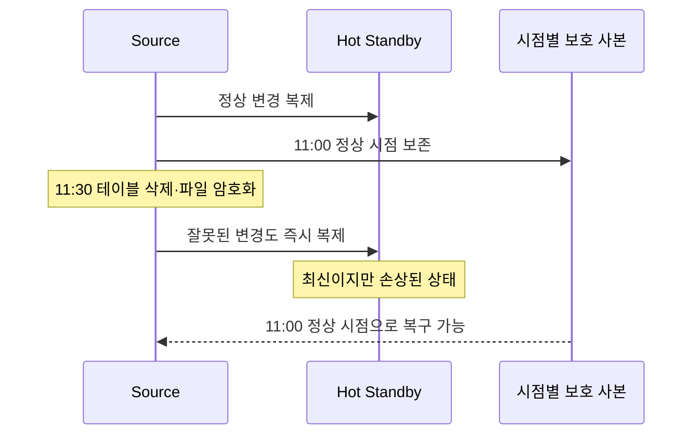

쉽게 설명하면 복사 담당자는 원고의 문장이 좋은지 나쁜지 판단하지 않고 원본과 똑같이 복사합니다. 원본에서 한 쪽을 실수로 지우면 대기 사본에서도 같은 쪽이 사라질 수 있습니다.

CISA는 자동 클라우드 동기화만으로 충분하지 않을 수 있다고 설명합니다. 로컬 파일이 암호화되면 암호화된 파일이 클라우드로 동기화되어 정상 사본을 덮어쓸 수 있기 때문입니다. 따라서 오프라인·암호화·불변 백업과 정기적인 복구 시험을 권고합니다.[^cisa]

## 가용성과 복구 가능성의 구분

Hot Standby와 Image Pool은 서로 대체하는 기능이라기보다 서로 다른 문제를 해결합니다.

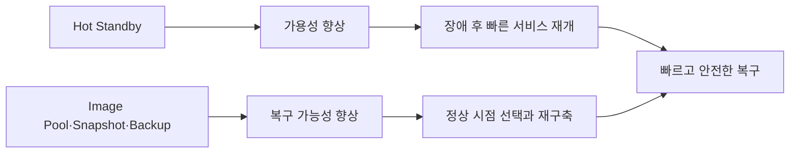

- Hot Standby의 중심 질문: 장애 후 얼마나 빨리 서비스를 다시 제공할 수 있는가?
- Image Pool과 Backup의 중심 질문: 데이터가 손상됐을 때 어느 정상 시점으로 돌아갈 수 있는가?

따라서 중요한 시스템은 Hot Standby와 시점별 Snapshot·Image Pool·Backup을 함께 구성하기도 합니다. 전자는 RTO를 줄이고 후자는 데이터 손상 시 선택할 수 있는 복구 지점을 제공합니다.

## 계획된 전환과 실제 장애의 차이

### 계획된 전환과 DR 훈련

Source가 살아 있으므로 마지막 Stage 1을 수행할 수 있습니다.

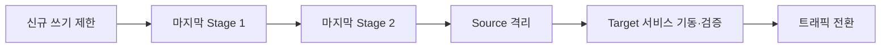

### 실제 주센터 장애

Source가 이미 사용할 수 없으므로 장애 이후에 새로운 Stage 1을 수행할 수 없습니다.

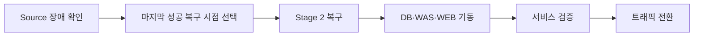

실제 장애에서 복구 가능한 최신 시점은 마지막으로 성공한 Stage 1과 보존 정책에 의해 결정됩니다. 계획된 전환에서는 최종 동기화를 수행해 데이터 차이를 더 줄일 수 있습니다.

## Image Pool을 안전하게 운영하기 위한 조건

Image Pool이 있다고 자동으로 안전해지는 것은 아닙니다. Pool도 삭제·손상·랜섬웨어·용량 부족·권한 탈취의 영향을 받을 수 있습니다.

- 장애 영역 분리: RMM과 Pool을 보호하려는 Source와 같은 장애 영역에만 두지 않습니다.
- 용량 계획: Source의 실제 사용량, 증가량과 보존할 시점 수를 반영합니다. RackWare 공개 안내는 Source의 사용 중인 데이터와 Point-in-Time Snapshot을 고려하라고 설명합니다.[^rackware-oracle]
- 보존 정책: 정상 시점을 선택할 수 있도록 필요한 복구 지점 수와 기간을 정합니다.
- 접근 통제: 운영 계정과 백업 관리 권한을 분리하고 최소 권한을 적용합니다.
- 불변·오프라인 사본: Image Pool만을 최종 백업으로 간주하지 않고 별도의 불변 또는 격리 백업을 검토합니다.[^cisa]
- 복구 시험: 사본이 존재하는지만 보지 않고 실제 Target 기동과 애플리케이션 검증을 반복합니다.

RMM과 Pool이 주센터에만 존재한다면 주센터 장애 때 복구 제어 계층과 보호 데이터가 함께 사라질 수 있습니다. 따라서 Target 사이트나 별도의 장애 영역에서 생존하도록 배치하는 것이 논리적으로 중요합니다. 구체적인 지원 배치는 제품 버전과 공식 설계 지침에 따라 확인해야 합니다.

## 설계 판단 기준

| 요구 사항 | 우선 검토할 방식 | 이유 |
|---|---|---|
| 일회성 서버 이전 | Direct Sync 또는 Staged Sync | Source와 Target이 함께 존재하며 최종 목적이 운영 위치 이전임 |
| 낮은 비용의 DR | Image Pool + Cold·Warm Standby | 평상시 Compute 비용을 줄일 수 있음 |
| 짧은 RTO | Warm·Hot Standby | Target 준비 시간을 줄일 수 있음 |
| DB의 빠른 자동 전환 | DB 전용 복제와 Listener | 애플리케이션이 데이터 구조와 트랜잭션을 이해함 |
| 랜섬웨어·오삭제 복구 | 시점별 Snapshot + 불변·격리 Backup | 최신 Replica도 함께 손상될 수 있음 |
| 가장 높은 가용성 | Active-Active + 별도 Backup | 빠른 전환이 가능하지만 비용과 일관성 설계 난도가 큼 |

하나의 서비스에서도 계층별로 다른 방법을 조합할 수 있습니다.

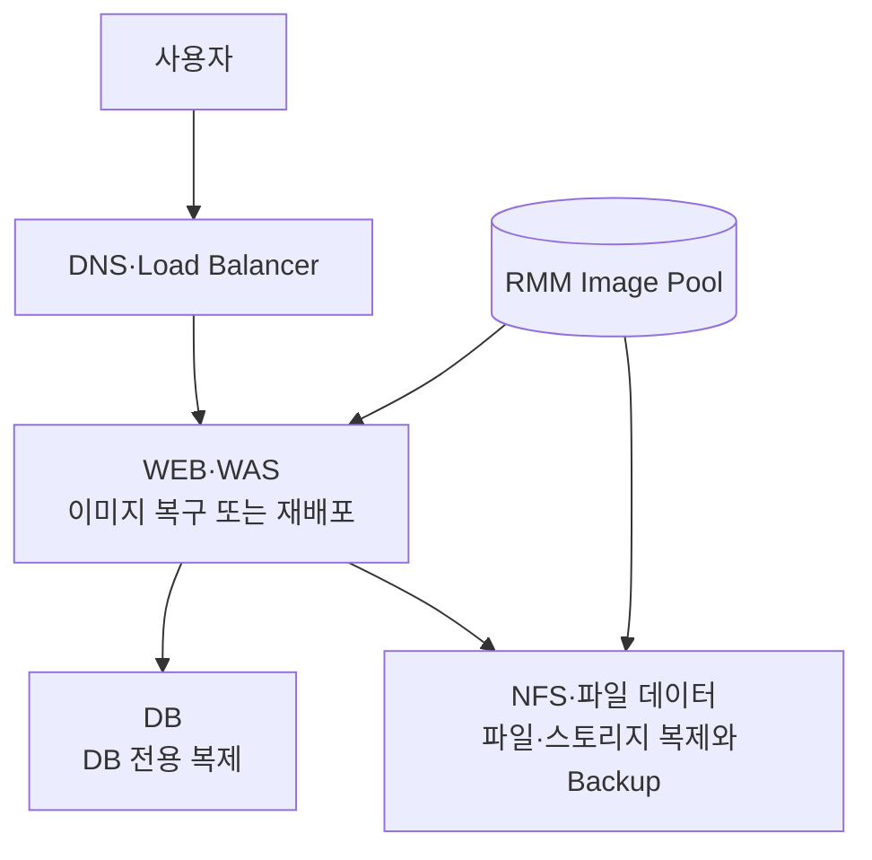

DB는 DB 전용 복제로 RPO와 전환 시간을 줄이고, WEB·WAS·NFS 서버는 RMM으로 운영체제와 애플리케이션 구성을 보호하며, 별도의 Backup으로 과거 정상 시점을 보존하는 혼합 구성이 가능합니다.

## 관련 문서

- [[Knowledge Base/Rackware|RackWare]]
- [[Knowledge Base/Delta Sync|Delta Sync]]
- [[Knowledge Base/Replication Levels|Replication Levels]]
- [[Knowledge Base/Cutover|Cutover]]
- [[서버 마이그레이션의 네트워크 준비와 전환 시점]]
- [[타깃 프로비저닝 방식에 따른 마이그레이션 절차]]
- [[DR 컷오버와 서비스 복구 순서]]
- [[백업 서버의 분리와 아키텍처 표기]]

## 출처

[^rackware-migration]: [RackWare — Multi-Cloud Migration](https://www.rackwareinc.com/rackware-platform/migration). 사전 데이터 적재, Delta Sync와 Near-Zero Downtime Cutover 설명.
[^rackware-faq]: [RackWare — Frequently Asked Questions](https://www.rackwareinc.com/post/frequently-asked-questions). LVM·VSS Snapshot, 입출력 반영과 정적 Snapshot 기반 복제 설명.
[^rackware-oracle]: [RackWare — Disaster Recovery Getting Started for Oracle Cloud Marketplace](https://www.rackwareinc.com/rackware-rmm-disaster-recovery-for-oracle-marketplace-paid-cpu). DR의 Store-and-Forward 구조, RMM Storage Pool과 용량 고려 사항 설명.
[^ibm-rmm]: [IBM Cloud — Migrating IBM Cloud VMware VCF to IBM Cloud VPC by using RackWare](https://cloud.ibm.com/docs/virtualization-solutions?topic=virtualization-solutions-virt-sol-vpc-migration-design-rmm-guide). Direct Sync와 Staged Sync, Stage 1과 Stage 2의 데이터 경로 설명.
[^rackware-dr]: [RackWare — Multi-Cloud Disaster Recovery and Backup](https://www.rackwareinc.com/rackware-platform/disaster-recovery). Active·Standby, 복구 지점, Failover·Failback과 보존 정책 설명.
[^aws-cutover]: [AWS Prescriptive Guidance — Cutover Stage](https://docs.aws.amazon.com/prescriptive-guidance/latest/best-practices-migration-cutover/cutover-stage.html). 최종 동기화, 애플리케이션 종료·시작과 트래픽 전환을 포함한 Cutover 단계 설명.
[^ibm-resilience]: [IBM Cloud — Designing Resilience for IBM Cloud VPC Virtual Servers](https://cloud.ibm.com/docs/virtualization-solutions?topic=virtualization-solutions-virt-sol-vpc-vpc-resiliency-design). RackWare Hot·Warm Standby의 Target 상태, 비용과 RTO 비교.
[^postgresql]: [PostgreSQL Documentation — Log-Shipping Standby Servers](https://www.postgresql.org/docs/current/warm-standby.html). WAL Streaming과 Standby 승격 설명.
[^sql-listener]: [Microsoft Learn — Availability Group Listener Overview](https://learn.microsoft.com/en-us/sql/database-engine/availability-groups/windows/availability-group-listener-overview). SQL Server Replica와 고정된 Client 접속 지점 설명.
[^azure-asr]: [Microsoft Learn — Reliability in Azure Site Recovery](https://learn.microsoft.com/en-us/azure/reliability/reliability-site-recovery). 지속적인 VM 복제와 장애 시 Failover 설명.
[^cisa]: [CISA — StopRansomware Guide](https://www.cisa.gov/sites/default/files/2023-10/StopRansomware-Guide-508C-v3_1.pdf). 자동 동기화가 손상된 파일을 덮어쓸 위험과 오프라인·암호화·불변 Backup 권고.

## 둘러보기

[[Questions/index|Questions]] · [[Knowledge Base/index|Knowledge Base]]
