## 목차

- [[#질문|질문]]
- [[#해답|해답]]
- [[#학습용 DR 아키텍처|학습용 DR 아키텍처]]
- [[#아키텍처를 DR센터로 옮기는 전체 과정|아키텍처를 DR센터로 옮기는 전체 과정]]
- [[#복제와 컷오버의 구분|복제와 컷오버의 구분]]
- [[#계획된 전환과 실제 재해의 차이|계획된 전환과 실제 재해의 차이]]
- [[#3-Tier 서비스의 복구 순서|3-Tier 서비스의 복구 순서]]
- [[#컷오버 이후의 검증과 롤백|컷오버 이후의 검증과 롤백]]
- [[#관련 문서|관련 문서]]
- [[#출처|출처]]

## 질문

DR에서 데이터 복제와 컷오버는 어떻게 다르며, 여러 계층으로 구성된 서비스는 어떤 순서로 복구해야 하는가?

## 해답

복제는 소스의 운영체제·애플리케이션·데이터를 타깃에 준비하고 변경분을 동기화하는 과정입니다. 컷오버는 최종 동기화와 타깃 기동을 거쳐 DNS·라우팅·로드밸런서 등의 서비스 경로를 타깃으로 넘기는 최종 전환입니다.[^aws-cutover][^aws-overview]

서비스 복구 순서는 서버 이름이 아니라 의존 관계에 따라 정합니다. 일반적인 3-Tier 예에서는 네트워크와 관리 경로를 먼저 확인하고, 데이터 계층, 애플리케이션 계층, 웹 계층을 차례로 기동한 뒤 사용자 트래픽을 전환합니다.

## 학습용 DR 아키텍처

아래 그림은 주센터와 축소된 Warm Standby DR센터를 가정해 직접 만든 학습용 아키텍처입니다.

> 이 그림은 개인 학습을 위해 구성한 가상 아키텍처이며 실제 회사·고객 환경과 무관합니다. 표기된 사설 IP 역시 구조를 설명하기 위한 예시입니다.

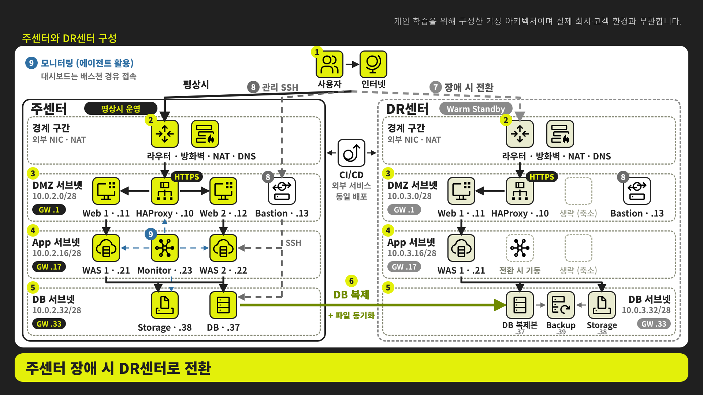

주센터는 다음 10대의 VM을 가정합니다.

| 영역 | VM | 역할 |
|---|---|---|
| 경계 | Router·Firewall·NAT·DNS | 외부·내부 경로와 접근 정책 제공 |
| DMZ | HAProxy, Web 1·2, Bastion | 요청 분산, 웹 처리, 관리 접속 |
| APP | WAS 1·2, Monitor | 애플리케이션 실행과 상태 수집 |
| DATA | DB, NFS Server | 구조화 데이터와 공유 파일 제공 |

CI/CD는 외부 서비스를 사용한다고 가정하므로 VM 복제 대상에서는 제외합니다. 경계 VM은 타깃 VM에 접근할 통신 기반을 제공해야 하므로 먼저 구축합니다. 나머지 9대는 Auto-provisioning으로 생성하거나 관리자가 사전 생성한 뒤 RMM으로 복제할 수 있습니다.

Warm Standby에서는 DR센터를 주센터와 같은 크기로 항상 실행하지 않고 최소 구성만 준비할 수 있습니다. 예를 들어 Web 1·WAS 1·DB·NFS와 경계·관리 경로를 유지하고, Web 2·WAS 2·전체 모니터링 기능은 전환 시 확장할 수 있습니다. 어느 VM을 평상시에 실행할지는 목표 RTO와 비용을 함께 고려해 정합니다.

## 아키텍처를 DR센터로 옮기는 전체 과정

### 0단계 · 보호 대상과 의존 관계 확인

먼저 아이콘 하나를 VM 한 대라고 단정하지 않고 실제 자원 유형과 의존성을 확인합니다.

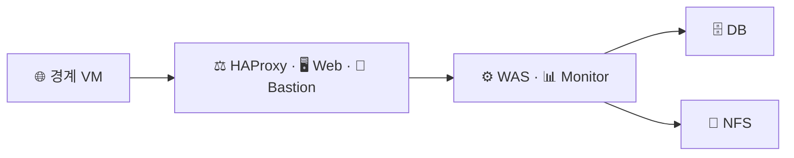

확인할 내용은 다음과 같습니다.

- 각 아이콘이 실제 VM인지 관리형 서비스인지
- DB와 NFS가 서로 의존하는지
- Web·WAS가 참조하는 주소가 DNS인지 고정 IP인지
- 파일시스템과 애플리케이션 데이터의 일관성 확보 방법
- 평상시 DR센터에서 실행할 최소 VM 수
- 장애 전환 시 추가로 시작할 VM과 필요한 시간

### 1단계 · 타깃 네트워크와 관리 경로 준비

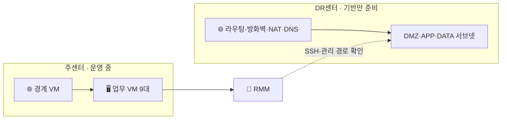

이 단계에서는 아직 사용자가 DR센터로 접속하지 않습니다. 타깃 경계 네트워크, 서브넷, 방화벽, DNS, RMM의 접근 경로와 격리 시험망을 준비합니다.

### 2단계 · 타깃 VM 준비

API 자동 생성과 타깃 사전 생성의 차이는 이 단계에서 나타납니다.

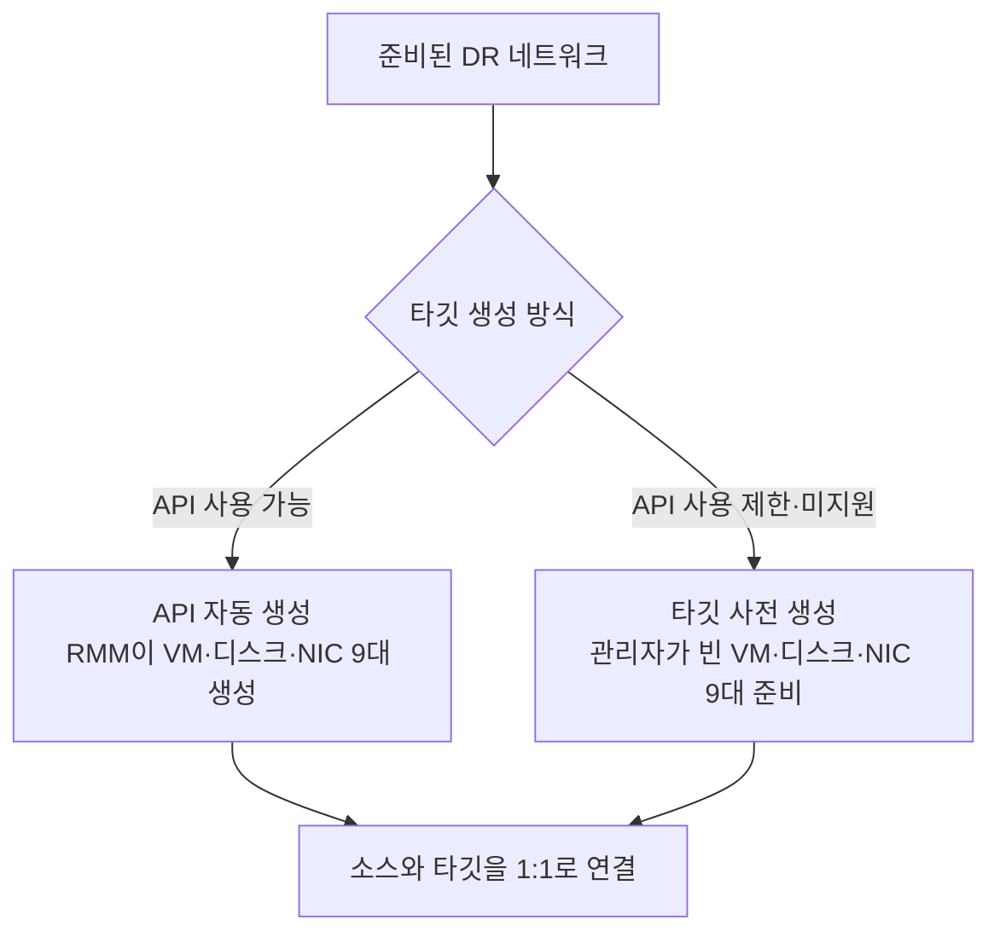

Auto-provisioning에서는 RMM이 API 호출 결과를 이용해 자신이 만든 타깃과 소스를 연결합니다. 사전 생성에서는 관리자가 타깃 주소나 호스트 정보를 지정해야 합니다. VM이 50대라면 50개의 논리적 대응 관계가 필요하지만 CSV 템플릿과 Wave로 일괄 등록할 수 있습니다.[^ibm-rmm]

### 3단계 · 초기 복제

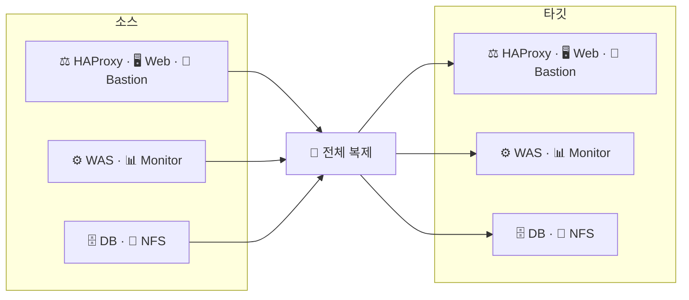

소스의 OS·애플리케이션·설정·데이터를 타깃에 처음으로 준비합니다. 이때 사용자는 계속 주센터를 이용합니다. DB와 NFS는 복제 성공뿐 아니라 애플리케이션이 사용할 수 있는 일관된 상태인지 별도로 확인해야 합니다.

### 4단계 · 변경분 동기화와 격리 시험

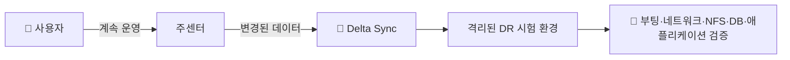

시험 타깃이 운영망과 연결되면 동일 IP, 호스트명, DNS 등록과 애플리케이션 쓰기가 충돌할 수 있습니다. Microsoft도 비운영 VNet에서 시험하고 운영 VNet과의 연결로 인한 VM·DNS 중복을 피하도록 안내합니다.[^azure-migrate]

시험 항목은 다음과 같습니다.

- 모든 타깃 VM의 부팅과 드라이버
- NIC·IP·게이트웨이·DNS·라우팅
- RMM·배스천에서의 관리 접속
- NFS export와 클라이언트 마운트
- DB 복구 상태와 읽기·쓰기
- WAS의 DB·NFS 연결
- Web의 WAS 연결
- HAProxy의 백엔드 헬스 체크
- 모니터링 에이전트와 수집 경로

### 5단계 · 컷오버 준비와 최종 동기화

계획된 전환이라면 사용자의 신규 쓰기를 중지하고 소스의 애플리케이션과 DB를 정해진 절차에 따라 멈춘 뒤 마지막 변경분을 반영합니다. 실제 재해로 소스에 접근할 수 없다면 이 단계를 수행하지 못하고 마지막 정상 복제 지점으로 복구합니다.

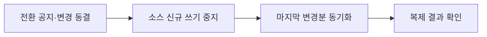

### 6단계 · 타깃 서비스의 의존 순서에 따른 기동

```text
경계 네트워크·관리 경로
→ NFS·DB
→ WAS
→ Web
→ HAProxy
→ 모니터링 전체 활성화
```

파일 서버와 DB가 서로 독립적이면 병렬로 기동할 수 있습니다. WAS가 NFS 마운트와 DB 연결을 모두 필요로 한다면 두 데이터 서비스가 정상이라는 확인 뒤에 WAS를 시작합니다. Web과 HAProxy는 백엔드가 준비된 뒤 외부 요청을 받도록 합니다.

### 7단계 · 사용자 경로 전환과 운영 확정

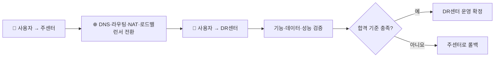

사용자가 DR센터로 접속하기 시작하는 전환점이 컷오버입니다. 타깃에서 쓰기가 시작된 뒤에는 소스가 오래된 상태가 될 수 있으므로, 단순히 경로만 원상 복구해서는 안 되는 경우가 있습니다. 롤백 기준과 타깃에서 새로 생성된 데이터의 처리 방침을 사전에 정해야 합니다.[^aws-cutover]

## 복제와 컷오버의 구분

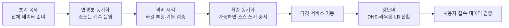

Azure Migrate는 초기 복제 뒤 변경분을 주기적으로 복제하고 소스를 운영 상태로 유지하면서 시험 마이그레이션을 수행할 수 있다고 설명합니다. 계획된 최종 이전에서는 소스 VM을 종료한 뒤 마지막 변경분을 동기화하는 선택지를 제공합니다.[^azure-migrate]

AWS의 컷오버 지침은 신규 입력 중지, 최종 백업과 데이터 동기화, DNS·로드밸런서 등의 라우팅 변경, 서비스 검증을 주요 단계로 제시합니다.[^aws-cutover]

## 계획된 전환과 실제 재해의 차이

| 구분 | 계획된 전환 | 실제 재해에 따른 전환 |
|---|---|---|
| 소스 접근 | 일반적으로 가능 | 불가능할 수 있음 |
| 신규 쓰기 중지 | 사전에 통제 가능 | 정상 종료를 수행하지 못할 수 있음 |
| 최종 동기화 | 마지막 변경분을 반영할 수 있음 | 마지막 정상 복구 지점을 사용 |
| 데이터 손실 | 절차가 정상이라면 최소화 가능 | RPO 범위의 변경분 손실 가능 |
| 목적 | 계획된 마이그레이션·훈련·점검 | 서비스 장애 대응 |

실제 재해에서는 소스 시스템에 접근할 수 없어 최종 동기화를 수행하지 못할 수 있습니다. 이때 복구되는 데이터 시점은 마지막 정상 복제 시점이며, 허용 가능한 데이터 손실 범위는 [[Replication Levels|RPO]]로 관리합니다.

## 3-Tier 서비스의 복구 순서

아래 그림은 네트워크 경계, Web·WAS·DB와 파일 서버로 구성된 일반적인 예입니다. 모든 환경의 고정 순서가 아니라 실제 의존 관계를 확인하기 위한 기준입니다.

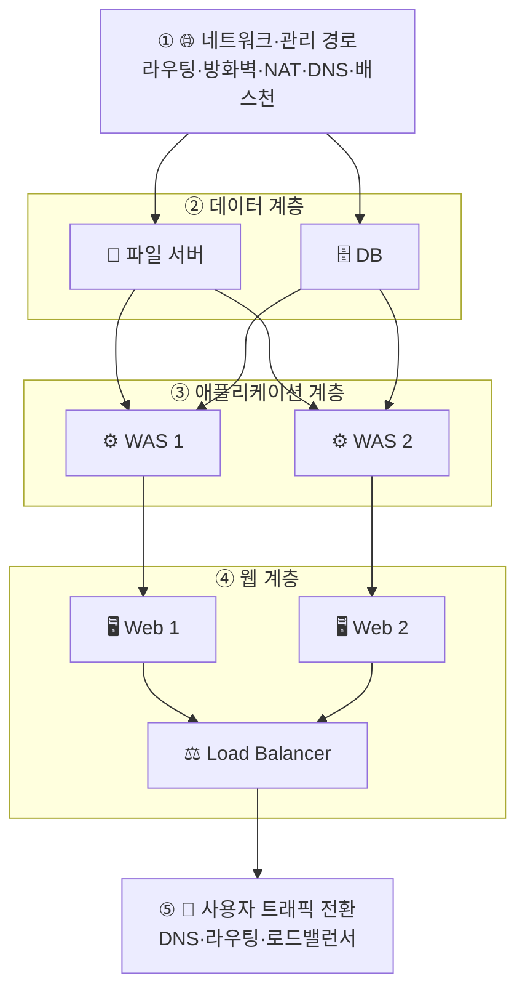

파일 서버가 DB와 무관하면 둘은 병렬로 기동할 수 있습니다. 반대로 DB 데이터나 애플리케이션 파일이 해당 파일 서버에 의존한다면 파일시스템과 마운트를 먼저 확인해야 합니다. 로드밸런서는 미리 실행할 수 있지만 정상 백엔드가 준비되기 전까지 사용자 트래픽을 보내지 않아야 합니다.

복구 과정의 기본 확인 항목은 다음과 같습니다.

1. 라우팅·방화벽·DNS와 관리 접속 확인
2. 파일시스템 마운트와 읽기·쓰기 확인
3. DB 기동, 복구 상태와 데이터 조회 확인
4. WAS의 DB·파일 서버 연결 확인
5. Web의 WAS 연결과 헬스 체크 확인
6. 로드밸런서의 정상 백엔드 등록 확인
7. DNS·라우팅 또는 로드밸런서 정책을 타깃으로 전환

## 컷오버 이후의 검증과 롤백

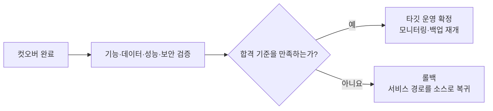

검증에는 사용자 접속, 주요 업무 기능, DB 읽기·쓰기, 파일 접근, 로그, CPU·메모리·디스크·네트워크, 외부 연동을 포함합니다. AWS는 전환 뒤 타깃이 새로운 주 데이터베이스가 되면 소스 데이터베이스가 오래된 상태가 될 수 있다고 경고합니다.[^aws-cutover] 따라서 롤백 가능 시점과 타깃에서 새로 생성된 데이터의 처리 방침을 전환 전에 정해야 합니다.

## 관련 문서

- [[Cutover]]
- [[Delta Sync]]
- [[Replication Levels|복제 수준과 RPO·RTO]]
- [[3-Tier Architecture]]
- [[서버 마이그레이션의 네트워크 준비와 전환 시점]]
- [[타깃 프로비저닝 방식에 따른 마이그레이션 절차]]
- [[DR 직접 복제와 이미지 풀의 역할]]

## 출처

[^aws-cutover]: [AWS Prescriptive Guidance — Cutover stage](https://docs.aws.amazon.com/prescriptive-guidance/latest/best-practices-migration-cutover/cutover-stage.html). 신규 입력 중지, 최종 동기화, 라우팅 변경, 검증과 롤백 고려 사항을 설명합니다.
[^aws-overview]: [AWS Prescriptive Guidance — Overview of the cutover phase](https://docs.aws.amazon.com/prescriptive-guidance/latest/best-practices-migration-cutover/overview-cutover-phase.html). 컷오버를 기존 엔드포인트에서 새 자원으로 네트워크 트래픽을 옮기는 단계로 설명합니다.
[^azure-migrate]: [Microsoft Learn — Migrate Hyper-V VMs with Azure Migrate](https://learn.microsoft.com/en-us/azure/migrate/tutorial-migrate-hyper-v). 초기 복제, 변경분 복제, 시험 마이그레이션과 계획된 최종 이전을 설명합니다.
[^ibm-rmm]: [IBM Cloud Docs — Migrating VMware VCF Classic to IBM Cloud VPC by using RackWare RMM](https://cloud.ibm.com/docs/virtualization-solutions?topic=virtualization-solutions-virt-sol-vpc-migration-design-rmm-tutorial). 초기 복제, 검증, 변경분 동기화와 컷오버로 이어지는 공개 사례입니다.

## 둘러보기

[[Questions/index|질문과 해답]] · [[Knowledge Base/index|Knowledge Base]] · [[Projects/index|Projects]]
