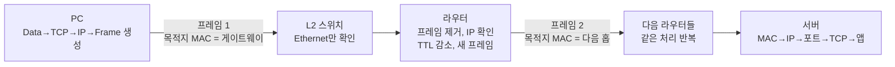

## 목차

- [[#질문|질문]]
- [[#해답|해답]]
- [[#장비별 처리 범위|장비별 처리 범위]]
- [[#홉마다 바뀌는 값과 유지되는 값|홉마다 바뀌는 값과 유지되는 값]]
- [[#흔한 오해|흔한 오해]]
- [[#관련 문서|관련 문서]]
- [[#출처|출처]]

## 질문

PC에서 인터넷의 서버로 보낸 프레임이 스위치, 라우터, 서버를 차례로 지날 때 각 장비는 어느 헤더까지 열어 보고 무엇을 근거로 어떤 동작을 하는가?

처음에는 라우터를 지날 때 MAC 주소가 유지되고 나머지가 바뀐다고 거꾸로 이해하기 쉽다. 이 문서는 그 오해를 바로잡으며, 각 장비의 동작을 프레임·패킷·세그먼트 가운데 어디까지 벗기는가라는 [[Encapsulation|캡슐화]] 관점으로 다시 정리한다.

## 해답

장비는 자신의 역할에 필요한 헤더까지만 열어 판단한다. L2 스위치는 Ethernet 헤더만 보고, 라우터는 링크 계층 헤더를 벗겨 IP 헤더까지 보며, 최종 수신 호스트는 TCP를 거쳐 애플리케이션 데이터까지 벗긴다.

이 구조 덕분에 한 계층의 장비는 다른 계층의 내용에 의존하지 않고 자신의 일만 수행할 수 있다. 스위치는 안쪽 IP 주소를 몰라도 되고, 라우터는 TCP 포트를 몰라도 목적지까지 패킷을 전달할 수 있다.

## 장비별 처리 범위

| 장비 | 열어 보는 헤더 | 판단 근거 | 동작 |
|---|---|---|---|
| L2 스위치 | Ethernet | 목적지 MAC 주소와 MAC 테이블 | 해당 포트로 프레임 전달 |
| 라우터 | Ethernet을 벗기고 IP | 목적지 IP 주소와 라우팅 테이블 | TTL 감소, 새 프레임으로 교체 후 전달 |
| 서버 | Ethernet, IP, TCP를 차례로 | MAC, IP, 포트 | 애플리케이션에 데이터 전달 |

**스위치**는 같은 L2 네트워크에서 출발지 MAC 주소를 보고 어느 포트에 어느 장치가 있는지 학습하고, 목적지 MAC 주소로 내보낼 포트를 고른다. 안쪽 IP 패킷은 열어 보지 않는다. 자세한 동작은 [[Switch|스위치]]에 정리되어 있다.

**라우터**는 받은 프레임의 링크 계층 헤더를 제거하고 IP 헤더를 수정한 뒤 새 링크 계층 헤더를 붙여 내보낸다.[^rfc1812] 처리 순서는 다음과 같다.

1. 프레임이 자신에게 전달된 것인지 확인하고 받는다.
2. 프레임 헤더를 벗기고 목적지 IP 주소를 확인한다.
3. 라우팅 테이블에서 가장 구체적으로 일치하는 경로를 찾아 다음 홉과 출구 인터페이스를 고른다.
4. TTL을 줄인다. 값이 0이 되면 패킷은 폐기된다.[^rfc791]
5. 다음 홉의 MAC 주소를 ARP로 알아내어 새 프레임을 만들고 내보낸다.[^rfc826]

라우팅 테이블이 고르는 것은 목적지가 속한 프리픽스에 대응하는 다음 홉과 출구 인터페이스이다. 대역은 일치 여부를 판단하는 기준일 뿐이고, 패킷을 넘기는 대상은 다음 홉 장비이다. 라우터는 기본적으로 TCP 헤더를 열지 않지만, NAT나 방화벽 같은 별도 기능을 겸하면 포트까지 볼 수 있다. 이 기능들은 라우팅과 구분되는 기능이다. 자세한 내용은 [[Router|라우터]]에 있다.

**서버**는 바깥쪽 헤더부터 벗기며 세 가지를 확인한다. 이 프레임이 자신의 인터페이스로 온 것인지, 이 패킷이 자신이 가진 IP 주소로 온 것인지, 이 데이터를 어느 프로세스에 전달할지이다. 목적지가 자신이 아닌 IP 데이터그램은 조용히 폐기하는 것이 호스트의 요구사항이다.[^rfc1122]

## 홉마다 바뀌는 값과 유지되는 값

NAT 같은 주소 변환이 없는 기본 상황을 기준으로 정리한다.

| 항목 | 홉을 지날 때 | 이유 |
|---|---|---|
| 출발지·목적지 IP 주소 | 유지 | 종단 간 주소이기 때문 |
| 출발지·목적지 MAC 주소 | 매 홉 교체 | 한 링크 안의 전달 대상이기 때문 |
| TTL | 매 라우터에서 감소 | 패킷의 수명 상한이기 때문 |
| TCP 포트 | 유지 | 양 끝 호스트에서만 해석하기 때문 |

프레임의 목적지 MAC 주소에는 서버의 MAC 주소가 아니라 다음 홉의 MAC 주소가 들어간다. PC가 다른 네트워크의 서버로 보낼 때는 기본 게이트웨이의 MAC 주소를 ARP로 알아내어 사용한다.

## 흔한 오해

- **MAC이 유지되고 IP가 바뀐다**: 반대이다. IP 주소가 유지되고 MAC 주소가 홉마다 바뀐다.
- **라우터가 MAC 주소를 바꾸기 때문에 라우팅이다**: 링크마다 새 프레임이 필요해서 MAC 주소가 바뀔 뿐이며, 라우팅 판단의 기준은 목적지 IP와 경로표이다.
- **서버가 프레임을 받으면 곧바로 사용자에게 보여 준다**: 서버의 최종 수신자는 서버 프로세스이다. 요청을 처리한 응답이 다시 캡슐화되어 PC로 돌아간 뒤 브라우저가 화면을 그린다.

## 관련 문서

- [[Encapsulation|캡슐화]] · [[Switch|스위치]] · [[Router|라우터]] · [[NIC]]
- [[Internet Routing|인터넷의 통신 구조]]
- [[연결 거부와 시간 초과의 차이]]

## 출처

[^rfc1812]: IETF, [RFC 1812 — Requirements for IP Version 4 Routers](https://www.rfc-editor.org/rfc/rfc1812.html). 1 Introduction의 링크 계층 헤더 제거와 교체.
[^rfc791]: IETF, [RFC 791 — Internet Protocol](https://www.rfc-editor.org/rfc/rfc791.html). Time to Live의 감소와 0일 때의 폐기.
[^rfc826]: IETF, [RFC 826 — An Ethernet Address Resolution Protocol](https://www.rfc-editor.org/rfc/rfc826.html). 로컬 네트워크에서 프로토콜 주소에 대응하는 하드웨어 주소 확인.
[^rfc1122]: IETF, [RFC 1122 — Requirements for Internet Hosts: Communication Layers](https://www.rfc-editor.org/rfc/rfc1122.html). 3.2.1.3 Addressing의 목적지가 아닌 데이터그램 폐기.

## 둘러보기

[[Questions/index|질문과 해답]] · [[Knowledge Base/index|Knowledge Base]] · [[Projects/index|Projects]]
