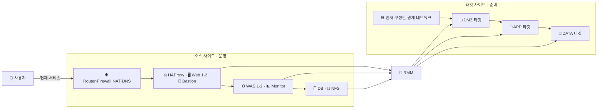
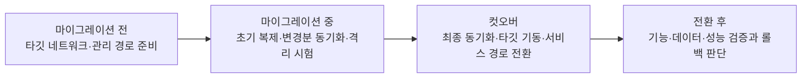
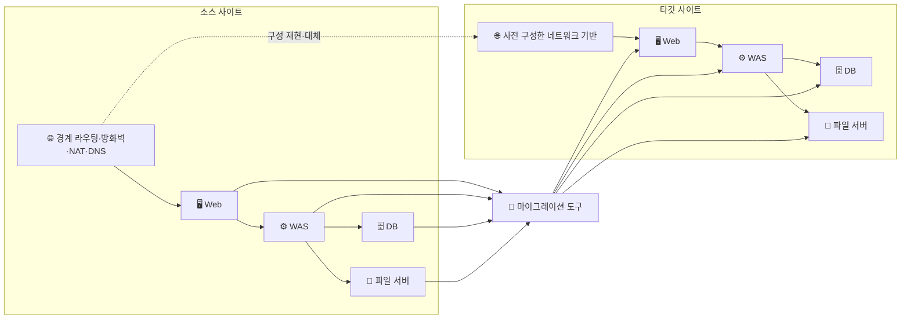
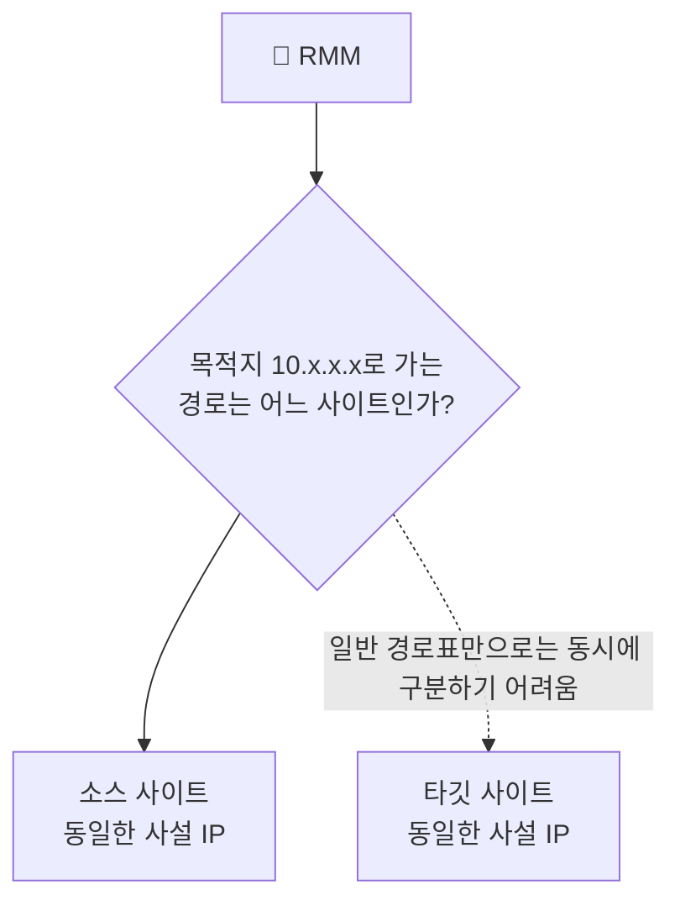

## 목차

- [[#질문|질문]]
- [[#해답|해답]]
- [[#네트워크 설정의 두 영역|네트워크 설정의 두 영역]]
- [[#학습용 DR 아키텍처의 보호 대상 분류|학습용 DR 아키텍처의 보호 대상 분류]]
- [[#마이그레이션 전·중·후의 작업|마이그레이션 전·중·후의 작업]]
- [[#가상 머신과 네트워크 기반의 이동 방식|가상 머신과 네트워크 기반의 이동 방식]]
- [[#출발지와 목적지에 따른 차이|출발지와 목적지에 따른 차이]]
- [[#동일한 사설 IP 사용 시 고려 사항|동일한 사설 IP 사용 시 고려 사항]]
- [[#관련 문서|관련 문서]]
- [[#출처|출처]]

## 질문

서버를 다른 데이터센터나 클라우드로 마이그레이션할 때 네트워크는 이전 전·중·후 중 어느 시점에 구성해야 하는가?

## 해답

타깃 네트워크와 관리 경로는 마이그레이션 전에 준비하고, 가상 머신별 NIC와 IP 설정은 타깃 생성·시험 과정에서 적용하며, 실제 사용자의 서비스 경로는 최종 [[Cutover|컷오버]]에서 전환합니다.

따라서 “네트워크를 먼저 구성하는가, 서버를 옮긴 뒤 구성하는가”라는 질문에는 하나의 시점만으로 답할 수 없습니다. 네트워크 기반, 가상 머신별 설정, 사용자 트래픽 전환은 서로 다른 단계에서 수행됩니다.

## 네트워크 설정의 두 영역

가상 머신 마이그레이션에서 네트워크 설정은 운영체제 내부와 타깃 인프라의 두 영역으로 나뉩니다.

| 영역 | 대표 항목 | 일반적인 처리 |
|---|---|---|
| 운영체제 내부 | 인터페이스 설정, IP, 게이트웨이, DNS, 정적 경로 | 복제된 운영체제 설정을 타깃 환경에 맞게 유지하거나 변경 |
| 타깃 인프라 | VPC·VNet, VLAN, 서브넷, 가상 NIC, 라우팅, 방화벽, NAT | 타깃 환경에서 사전 구성하거나 플랫폼 API로 생성 |
| 서비스 진입점 | 공인 IP, DNS 레코드, 로드밸런서 백엔드, 서비스 검색 정보 | 컷오버 시 타깃으로 전환 |

운영체제 디스크를 복제해도 클라우드의 VPC·보안 그룹·공인 IP가 디스크 안에 함께 들어가는 것은 아닙니다. Microsoft도 시험 마이그레이션에서 타깃 VNet과 각 NIC가 연결될 서브넷을 별도로 선택하도록 안내합니다.[^azure-test]

## 학습용 DR 아키텍처의 보호 대상 분류

다음은 하나의 경계 VM과 9대의 업무 VM으로 구성한 가상의 학습용 예입니다. 실제 고객 환경이나 회사 내부 구성이 아닙니다.

| 영역 | 구성 요소 | 수량 | DR 처리의 기본 방향 |
|---|---|---:|---|
| 경계 | Router·Firewall·NAT·DNS VM | 1 | 타깃 접근 경로를 제공하므로 먼저 구축하거나 타깃 서비스로 대체 |
| DMZ | HAProxy, Web 1·2, Bastion | 4 | 타깃 네트워크가 준비된 뒤 VM 복제 가능 |
| APP | WAS 1·2, Monitor | 3 | VM 복제 후 DB·파일 서버 연결과 에이전트 설정 검증 |
| DATA | DB, NFS Server | 2 | VM 복제뿐 아니라 애플리케이션·파일 데이터의 일관성 검증 필요 |
| 외부 서비스 | CI/CD | DR 범위 밖 | 외부 서비스가 계속 제공된다는 전제 아래 연결 정보만 검증 |

아이콘은 모두 서버처럼 보이지만 역할은 다릅니다. 경계 VM은 나머지 타깃에 도달할 경로를 제공하는 기반이고, Web·WAS·DB·NFS는 그 경로 위에서 실행되는 업무 워크로드입니다. 따라서 이 예에서는 경계 VM을 먼저 준비하고 나머지 9대를 마이그레이션 대상으로 보는 것이 출발점입니다.

이 분류가 “외부 연결 VM은 모두 사전 생성하고 내부 VM만 복제한다”는 뜻은 아닙니다. HAProxy·Web·Bastion처럼 DMZ에 있는 VM도 업무 워크로드라면 복제할 수 있습니다. 먼저 구성해야 하는 것은 타깃 서브넷·라우팅·방화벽·NAT·DNS와 관리 접속 경로입니다. 공인 IP, 외부 DNS, 로드밸런서의 사용자 진입점은 복제 대상이 아니라 컷오버에서 전환할 대상입니다.

## 마이그레이션 전·중·후의 작업

### 마이그레이션 전

- 타깃 주소 대역과 서브넷 설계
- 라우팅·방화벽·NAT·DNS 구성
- 마이그레이션 도구가 소스와 타깃에 접근할 관리 경로 확보
- VPN·전용선·배스천 등 필요한 연결 준비
- 타깃 IP·호스트명·DNS 변경 계획 작성
- 격리된 시험 네트워크와 롤백 경로 준비

IBM Cloud의 RackWare 공개 절차도 Auto-provisioning을 구성하기 전에 타깃 VPC·서브넷과 필요한 클라우드 구성 요소를 준비하도록 안내합니다.[^ibm-rmm]

### 마이그레이션 중

- 소스의 초기 데이터 복제
- 운영 중 발생하는 변경분의 반복 동기화
- 타깃 VM·디스크·NIC 생성 또는 기존 타깃 연결
- 타깃 환경에 맞는 부팅·드라이버·네트워크 설정 조정
- 운영망과 분리된 네트워크에서 부팅과 애플리케이션 시험

Azure Migrate는 초기 복제 후 변경분 복제를 계속하면서 소스 VM을 운영 상태로 유지하고, 비운영 VNet에서 시험 마이그레이션을 수행하도록 권장합니다.[^azure-migrate] 운영망과 연결된 VNet에서 시험하면 VM이나 DNS 항목이 중복될 수 있다는 경고도 제공합니다.[^azure-test]

### 컷오버와 전환 후

- 가능하면 소스의 신규 쓰기 중지
- 마지막 변경분 동기화
- 타깃 서비스의 의존 순서에 따른 기동
- DNS·라우팅·로드밸런서·서비스 검색 정보 전환
- 사용자 접속과 데이터 정합성 검증
- 실패 시 소스로 되돌리는 롤백 수행

AWS는 컷오버에서 최종 데이터 동기화 뒤 DNS 레코드나 로드밸런서 대상을 변경하여 사용자를 타깃으로 보내고, 이후 서비스를 검증하는 순서를 안내합니다.[^aws-cutover]

## 가상 머신과 네트워크 기반의 이동 방식

다음 그림에서 경계 라우팅·방화벽·NAT·DNS는 타깃 통신 기반으로 먼저 준비하고, 그 위에서 실행되는 업무 VM은 복제 대상으로 다룹니다.

라우터나 방화벽이 가상 머신이어도 항상 일반 업무 VM과 같은 방식으로 복제하는 것은 아닙니다. 타깃 라우터가 다른 타깃 VM으로 가는 경로를 제공해야 한다면 라우터를 먼저 구성해야 합니다. 클라우드에서는 소스의 라우터 VM 기능을 VPC 라우팅·관리형 NAT·보안 정책·DNS 같은 서비스로 대체할 수도 있습니다. 이는 제품의 고정 규칙이 아니라 타깃 경로가 먼저 존재해야 한다는 의존 관계에서 나온 설계 판단입니다.

## 출발지와 목적지에 따른 차이

기반 네트워크를 먼저 준비하고 서비스 경로를 마지막에 전환한다는 원리는 같지만, 구현 자원은 환경에 따라 달라집니다.

| 경로 | 마이그레이션 전에 준비할 대표 항목 | VM별 네트워크 적용 | 컷오버의 대표 작업 |
|---|---|---|---|
| 온프레미스 → 클라우드 | VPC·VNet, 서브넷, VPN·전용선, 보안 정책, DNS 연동 | 클라우드 NIC와 사설 IP 할당 | DNS·공인 진입점·로드밸런서 전환 |
| 클라우드 → 온프레미스 | VLAN, 라우터, 방화벽, 가상화 클러스터, 관리망 | 가상 NIC와 VLAN·IP 연결 | 경계 라우팅·NAT·DNS 전환 |
| 온프레미스 → 온프레미스 | 타깃 데이터센터의 WAN·VLAN·방화벽·DNS | 타깃 포트 그룹·VLAN·IP 연결 | WAN 경로·DNS·VIP 전환 |
| 클라우드 → 클라우드 | 타깃 계정, VPC·VNet, 피어링·VPN, IAM, 보안 정책 | 타깃 제공자의 NIC·IP 모델 적용 | DNS·로드밸런서·서비스 검색 전환 |

소스의 방화벽 VM을 클라우드에 그대로 옮길 수도 있지만, 클라우드 고유 라우팅과 보안 서비스로 기능을 재구현할 수도 있습니다. 어느 쪽이 맞는지는 방화벽 기능, 라이선스, 성능, 운영 책임과 타깃 제공자의 지원 범위를 비교해 결정합니다.

## 동일한 사설 IP 사용 시 고려 사항

서로 완전히 분리된 네트워크에서는 소스와 타깃이 같은 사설 IP를 가질 수 있습니다. 그러나 하나의 마이그레이션 서버가 같은 주소를 가진 양쪽 VM에 동시에 접속하려면 서로 다른 라우팅 영역, NAT 주소, 프록시·배스천 또는 별도의 관리 주소가 필요합니다.

또한 같은 네트워크에 동일한 IP의 두 VM을 동시에 연결하면 주소 충돌이 발생할 수 있습니다. 같은 IP를 유지하려면 시험 단계에서 타깃을 격리하고, 컷오버 시 소스를 중지한 뒤 경로를 타깃으로 전환하는 계획이 필요합니다. AWS의 대규모 마이그레이션 지침도 일반적으로 중복되지 않는 타깃 주소 대역을 권장하며, 기존 IP를 유지할 때는 서브넷 단위 또는 서버별 경로 전환을 계획하도록 안내합니다.[^aws-landing]

마이그레이션 서버가 동일한 주소의 소스와 타깃을 동시에 관리하는 상황은 다음과 같습니다.

해결 방법은 환경에 따라 다음 중 하나를 사용합니다.

- 소스와 타깃에 서로 다른 관리용 IP 부여
- 한쪽 주소를 NAT로 변환해 RMM에서 고유하게 식별
- VRF와 같은 별도 라우팅 영역 사용
- 서로 다른 배스천·프록시·터널을 경유
- 사이트별 마이그레이션 서버 배치
- 시험 중 타깃을 격리하고 컷오버 시에만 기존 주소 활성화

같은 서비스 IP를 유지할 수 있다는 사실과 하나의 관리 서버가 두 사이트의 동일 주소를 동시에 구분할 수 있다는 사실은 서로 다른 문제입니다.

## 관련 문서

- [[Networking]]
- [[Server Migration Types]]
- [[Agentless Migration]]
- [[Cutover]]
- [[타깃 프로비저닝 방식에 따른 마이그레이션 절차]]
- [[DR 컷오버와 서비스 복구 순서]]

## 출처

[^ibm-rmm]: [IBM Cloud Docs — On-premises to IBM Cloud VPC migration with RMM](https://cloud.ibm.com/docs/infrastructure-hub?topic=infrastructure-hub-migrating-on-prem-cloud-vpc). VPC·서브넷의 사전 준비와 Auto-provisioning 절차를 설명합니다.
[^azure-migrate]: [Microsoft Learn — Migrate Hyper-V VMs with Azure Migrate](https://learn.microsoft.com/en-us/azure/migrate/tutorial-migrate-hyper-v). 초기 복제, 변경분 복제, 시험 마이그레이션과 최종 이전 단계를 설명합니다.
[^azure-test]: [Microsoft Learn — Test migrate replicating virtual machines](https://learn.microsoft.com/en-us/azure/migrate/how-to-test-replicating-virtual-machines). 시험 VNet·서브넷 매핑과 운영망 격리의 필요성을 설명합니다.
[^aws-cutover]: [AWS Prescriptive Guidance — Cutover stage](https://docs.aws.amazon.com/prescriptive-guidance/latest/best-practices-migration-cutover/cutover-stage.html). 최종 동기화, 라우팅 변경과 검증 절차를 설명합니다.
[^aws-landing]: [AWS Prescriptive Guidance — Landing zone considerations for a large migration](https://docs.aws.amazon.com/prescriptive-guidance/latest/large-migration-foundation-playbook/landing-zone.html). 타깃 주소 설계와 기존 IP 유지 시 경로 전환 고려 사항을 설명합니다.

## 둘러보기

[[Questions/index|질문과 해답]] · [[Knowledge Base/index|Knowledge Base]] · [[Projects/index|Projects]]

