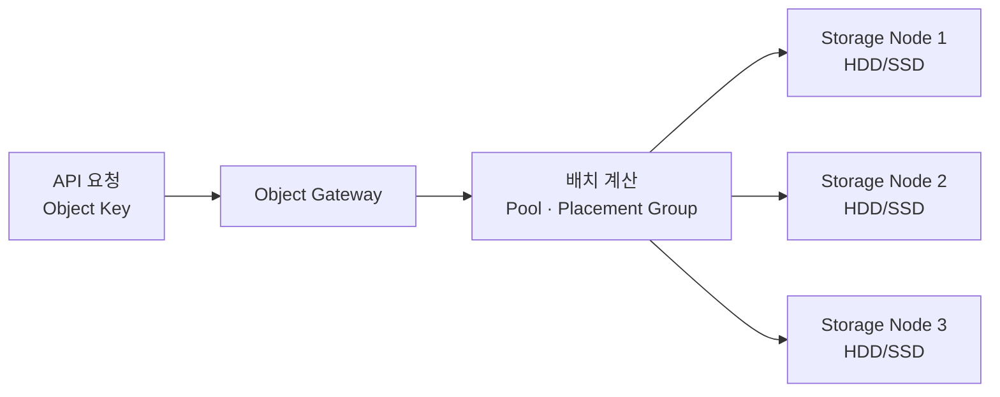

## 목차

- [[#질문|질문]]
- [[#해답|해답]]
- [[#논리 오브젝트에서 물리 장비까지|논리 오브젝트에서 물리 장비까지]]
- [[#관련 문서|관련 문서]]
- [[#출처|출처]]

## 질문

오브젝트 스토리지의 오브젝트는 물리 장비에 어떻게 저장되는가?

## 해답

오브젝트는 물리 디스크의 고정된 저장 단위가 아니라 데이터·메타데이터·고유 키를 묶어 API로 다루는 논리 단위입니다. 실제 저장 단계에서는 스토리지 소프트웨어가 오브젝트를 내부 블록이나 조각으로 변환하여 여러 서버의 HDD·SSD에 기록합니다.

## 논리 오브젝트에서 물리 장비까지

1. 사용자가 키와 함께 오브젝트를 업로드합니다.
2. 시스템은 키·클러스터 상태·배치 정책을 이용해 저장 위치를 결정합니다.
3. 데이터는 하나 이상의 복제본으로 저장되거나 데이터 조각과 패리티 조각으로 나뉩니다.
4. 각 조각은 여러 스토리지 노드의 HDD·SSD에 물리적인 비트로 기록됩니다.
5. 사용자는 내부 디스크 위치를 알 필요 없이 같은 키와 API로 다시 읽습니다.

Ceph를 예로 들면 오브젝트는 풀과 배치 그룹을 거쳐 OSD에 배치되며, 풀은 전체 복제 방식이나 삭제 코딩 방식을 선택할 수 있습니다.[^1] 삭제 코딩은 오브젝트를 데이터 조각과 복구용 코딩 조각으로 나누어 서로 다른 OSD에 분산합니다.[^2] 제품마다 내부 구현은 다르므로 Ceph의 구조를 모든 오브젝트 스토리지의 유일한 방식으로 일반화해서는 안 됩니다.

## 관련 문서

- [[Object Storage]]
- [[Storage]]
- [[Block Storage]]
- [[File Storage]]
- [[Disk]]

## 출처

[^1]: Ceph는 오브젝트를 풀과 배치 그룹을 거쳐 OSD에 배치하고 복제 또는 삭제 코딩으로 보호한다. [Ceph 공식 문서, Beginner's Guide](https://docs.ceph.com/en/latest/start/beginners-guide/)
[^2]: 삭제 코딩이 오브젝트를 데이터 조각과 코딩 조각으로 나누는 방식. [Ceph 공식 문서, Erasure code profiles](https://docs.ceph.com/en/latest/rados/operations/erasure-code-profile/)

## 둘러보기

[[Questions/index|Questions]] · [[Knowledge Base/index|Knowledge Base]] · [[Projects/index|Projects]]
