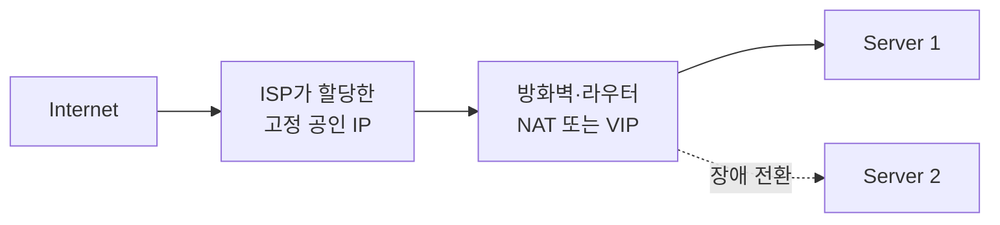

## 목차

- [[#질문|질문]]
- [[#해답|해답]]
- [[#Elastic의 의미|Elastic의 의미]]
- [[#온프레미스 대응 구성|온프레미스 대응 구성]]
- [[#관련 문서|관련 문서]]
- [[#출처|출처]]

## 질문

AWS의 EIP는 온프레미스에서 어떤 구성에 해당하는가?

## 해답

EIP(Elastic IP address)는 AWS 계정에 할당하여 사용하는 고정 공인 IPv4 주소입니다. 일반 공인 IP처럼 인터넷에서 접근할 수 있지만, 인스턴스가 바뀌어도 주소를 계정에 유지하고 다른 인스턴스나 네트워크 인터페이스에 다시 연결할 수 있다는 점이 핵심입니다.[^1]

## Elastic의 의미

`Elastic`은 주소 값이 자주 바뀐다는 뜻이 아니라, **고정된 주소를 필요에 따라 다른 클라우드 자원에 유연하게 재연결할 수 있다**는 뜻입니다. 장애가 난 인스턴스에서 정상 인스턴스로 EIP를 다시 연결하면 외부 사용자는 같은 공인 IP를 계속 사용할 수 있습니다.[^1]

## 온프레미스 대응 구성

온프레미스에는 EIP와 완전히 같은 단일 기능이 없습니다. 가장 가까운 구성은 다음 요소의 조합입니다.

- ISP에서 할당받은 고정 공인 IPv4 주소
- 경계 라우터나 방화벽의 정적 NAT 규칙[^2]
- 고가용성이 필요할 때 사용하는 방화벽 클러스터·로드밸런서·가상 IP(VIP)[^3]
- 장비 교체나 장애 전환 시 공인 IP의 연결 대상을 바꾸는 운영 절차

따라서 “마이그레이션 서버 VM의 EIP로 접속한다”는 표현은 AWS 환경에서는 자연스럽습니다. 온프레미스라면 “마이그레이션 서버에 연결된 고정 공인 IP 또는 방화벽의 NAT 주소로 접속한다”가 더 정확합니다. 직접 접근할 수 없다면 Bastion이나 VPN을 통한 관리 경로를 사용합니다.

## 관련 문서

- [[Networking]]
- [[NIC]]
- [[SSH]]
- [[Microsoft Azure]]

## 출처

[^1]: EIP는 계정에 할당되는 고정 공인 IPv4 주소이며 다른 인스턴스나 네트워크 인터페이스로 다시 연결할 수 있다. [AWS 공식 문서, Elastic IP addresses](https://docs.aws.amazon.com/AWSEC2/latest/UserGuide/elastic-ip-addresses-eip.html)
[^2]: NAT는 한 주소 영역의 IP 주소를 다른 주소 영역의 주소로 변환하는 기능이다. [RFC Editor, RFC 3022](https://www.rfc-editor.org/rfc/rfc3022)
[^3]: VRRP는 여러 라우터가 하나의 가상 IP 주소를 공유하고 장애 시 다른 라우터가 역할을 이어받도록 정의한다. [RFC Editor, RFC 5798](https://www.rfc-editor.org/rfc/rfc5798)

## 둘러보기

[[Questions/index|Questions]] · [[Knowledge Base/index|Knowledge Base]] · [[Projects/index|Projects]]
