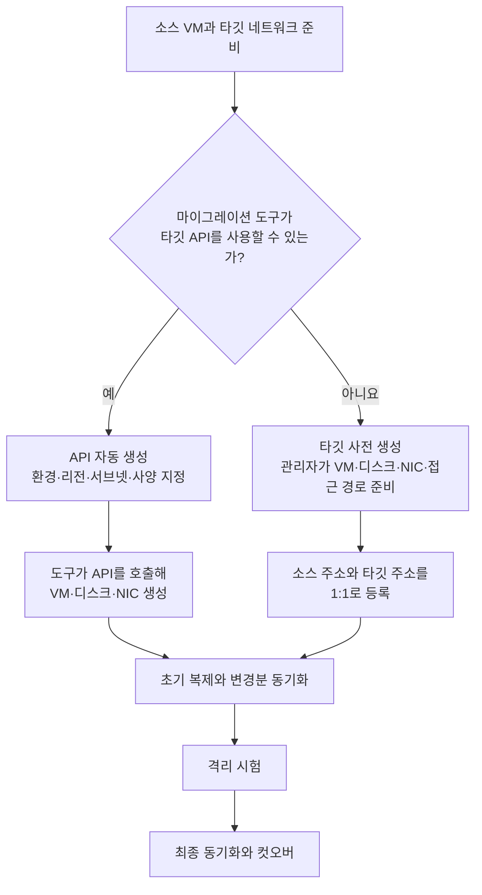
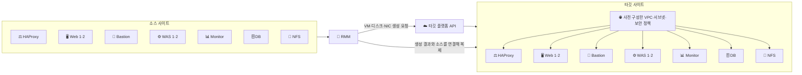
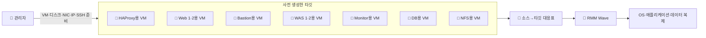
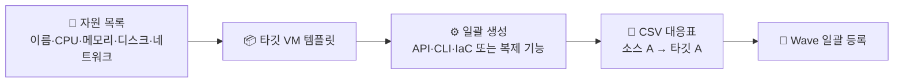
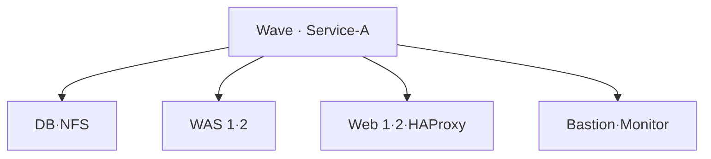
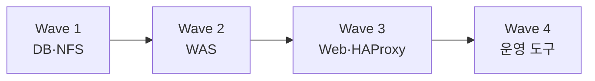

## 목차

- [[#질문|질문]]
- [[#해답|해답]]
- [[#자동 생성과 사전 생성의 차이|자동 생성과 사전 생성의 차이]]
- [[#두 방식의 처리 과정|두 방식의 처리 과정]]
- [[#9대 업무 VM을 자동 생성하는 과정|9대 업무 VM을 자동 생성하는 과정]]
- [[#9대 업무 VM을 사전 생성하는 과정|9대 업무 VM을 사전 생성하는 과정]]
- [[#대규모 사전 생성과 일괄 매핑|대규모 사전 생성과 일괄 매핑]]
- [[#Wave 구성 기준|Wave 구성 기준]]
- [[#자주 발생하는 설계 오류|자주 발생하는 설계 오류]]
- [[#API 존재 여부와 제품 지원의 구분|API 존재 여부와 제품 지원의 구분]]
- [[#관련 문서|관련 문서]]
- [[#출처|출처]]

## 질문

마이그레이션 도구의 API 자동 생성과 타깃 사전 생성 방식은 어떻게 다르며, 많은 VM을 사전 생성할 때 소스와 타깃의 대응 관계는 어떻게 관리하는가?

## 해답

API 자동 생성에서는 마이그레이션 도구가 타깃 플랫폼 API를 호출해 VM·디스크·NIC를 만들고 대응 관계를 관리합니다.[^rackware-migration] 타깃 사전 생성에서는 관리자가 목적지 VM을 먼저 만든 뒤 각 소스와 타깃의 주소·호스트 정보를 연결합니다. 대규모 환경에는 VM 수만큼의 논리적 대응 관계가 필요하지만, CSV 템플릿과 Wave를 이용하면 GUI에서 한 대씩 반복 입력하지 않고 일괄 등록할 수 있습니다.[^ibm-rmm]

## 자동 생성과 사전 생성의 차이

| 구분 | API 자동 생성 | 타깃 사전 생성 |
|---|---|---|
| 타깃 VM 생성 | 마이그레이션 도구가 플랫폼 API로 생성 | 관리자가 직접 생성 |
| 기존 타깃 주소 | 생성 전에는 없음 | IP 또는 FQDN이 미리 존재 |
| 플랫폼 권한 | VM·디스크·NIC를 만들 API 권한 필요 | 마이그레이션 도구의 VM 생성 권한은 일반적으로 불필요 |
| 타깃 네트워크 | 사전에 설계·준비 | 사전에 설계·준비 |
| 소스→타깃 대응 | 도구가 생성 결과와 연결 | 관리자가 기존 타깃을 지정 |
| 적합한 상황 | 지원 클라우드에 많은 VM을 반복 생성 | API 사용 제한, 미지원 플랫폼, 물리 서버, 세밀한 사전 구성 |

RackWare의 공개 IBM Cloud 절차는 Auto-provisioning을 사용할 때 타깃을 직접 준비하지 않아도 되며, 타깃의 Friendly Name과 클라우드 환경·리전 등의 정보를 제공한다고 설명합니다.[^ibm-rmm] 다른 IBM Cloud 공개 예시는 Auto-provisioning을 사용하지 않고 타깃 VM과 데이터 디스크를 직접 만든 뒤 `Existing System`으로 연결합니다.[^ibm-existing]

## 두 방식의 처리 과정



Auto-provisioning이 네트워크 설계를 생략한다는 뜻은 아닙니다. 타깃 계정·리전·VPC·서브넷·보안 정책과 API 권한은 먼저 준비해야 합니다. 반대로 사전 생성은 완성된 애플리케이션을 새로 설치한다는 뜻이 아니라, 복제 데이터를 받을 목적지 VM·디스크·NIC와 접속 경로를 먼저 마련한다는 의미입니다.

## 9대 업무 VM을 자동 생성하는 과정

다음은 경계 네트워크가 이미 준비된 타깃에 9대의 업무 VM을 Auto-provisioning으로 만드는 학습용 예입니다.



| 단계 | 관리자가 준비하는 내용 | RMM 또는 타깃 플랫폼의 역할 | 확인할 결과 |
|---|---|---|---|
| 1. 환경 준비 | 타깃 계정·리전·VPC·서브넷·보안 정책 | API 접근 환경 제공 | RMM이 타깃 API에 접근 가능 |
| 2. 생성 정책 | VM 이름, 사양, 디스크, 배치 위치와 네트워크 | API로 VM·디스크·NIC 생성 | 필요한 타깃 자원 생성 완료 |
| 3. 대응 관계 | 소스 호스트와 타깃 이름·환경 지정 | 자신이 생성한 타깃과 소스를 연결 | 소스별 타깃이 고유하게 식별됨 |
| 4. 초기 복제 | 실행 일정과 병렬 처리 범위 결정 | OS·애플리케이션·데이터 복제 | 전체 데이터 준비 완료 |
| 5. 변경분 복제 | 복제 주기와 시험 일정 결정 | 변경분만 반복 반영 | 목표 RPO 안에서 동기화 |
| 6. 시험 | 격리 네트워크와 검증 항목 준비 | 타깃 부팅·변환 지원 | OS·네트워크·서비스 정상 |

API 자동 생성은 “아무 정보 없이 원본과 같은 VM을 알아서 만든다”는 뜻이 아닙니다. 타깃 플랫폼이 요구하는 위치·네트워크·권한·사양 정보를 제공해야 하며, 생성 결과가 정책과 일치하는지 확인해야 합니다.

## 9대 업무 VM을 사전 생성하는 과정

사전 생성 방식에서는 관리자가 타깃 VM을 먼저 만들고 RMM에 기존 시스템으로 알려 줍니다. IBM Cloud의 공개 RackWare 예시도 타깃 VM과 데이터 디스크를 직접 준비한 뒤 소스와 타깃 주소를 Wave에 등록합니다.[^ibm-existing]



이때 확인해야 할 대응 관계는 다음과 같습니다.

| 소스 역할 | 사전 생성한 타깃 역할 | 사전 준비 사항 | 복제 후 검증 |
|---|---|---|---|
| HAProxy | 타깃 HAProxy | NIC·IP·접속 계정 | 백엔드 주소·헬스 체크·TLS 설정 |
| Web 1·2 | 타깃 Web 1·2 | 두 개의 고유한 타깃 주소 | WAS 연결과 정적 파일 |
| Bastion | 타깃 Bastion | 관리망·인증·접근 정책 | 타깃 내부 서버 SSH 경로 |
| WAS 1·2 | 타깃 WAS 1·2 | 애플리케이션용 네트워크 | DB·NFS 연결과 서비스 기동 |
| Monitor | 타깃 Monitor | 수집 경로·저장 용량 | 에이전트 재연결과 대시보드 |
| DB | 타깃 DB | 데이터 디스크와 정합성 절차 | DB 복구 상태·읽기·쓰기 |
| NFS | 타깃 NFS | 데이터 디스크와 파일 공유망 | 파일시스템·export·마운트 |

타깃 VM을 만들었다는 사실만으로 준비가 끝나는 것은 아닙니다. 각 타깃은 RMM이 도달할 수 있어야 하고, 소스 데이터를 수용할 디스크 용량과 올바른 네트워크 연결을 가져야 합니다. 동일한 타깃을 두 소스에 잘못 연결하지 않도록 이름·주소·역할을 고유하게 관리해야 합니다.

## 대규모 사전 생성과 일괄 매핑

VM 50대를 모두 사전 생성 방식으로 보호한다면 타깃 VM 50대와 소스→타깃 대응 관계 50개가 논리적으로 필요합니다. 그러나 50번의 GUI 입력이 반드시 필요한 것은 아닙니다.



개념적인 대응표는 다음과 같습니다. 실제 업로드 열 이름은 RMM 버전과 타깃 플랫폼에 따라 달라질 수 있으므로, 제품에서 내려받은 CSV 템플릿을 사용해야 합니다.

| Wave | 소스 | 사전 생성한 타깃 | 역할 |
|---|---|---|---|
| Service-A | source-web-1 | target-web-1 | Web |
| Service-A | source-was-1 | target-was-1 | WAS |
| Service-A | source-db-1 | target-db-1 | DB |
| Service-B | source-web-2 | target-web-2 | Web |

IBM Cloud의 RackWare 공개 절차는 여러 호스트를 동시에 이전할 때 RMM 서버에서 CSV 템플릿을 내려받아 필요한 필드를 작성한 뒤 업로드하도록 안내합니다. 같은 문서는 Wave가 한 호스트 또는 여러 호스트를 포함한다고 설명합니다.[^ibm-rmm] RackWare 공개 자료도 CSV로 호스트를 일괄 업로드하고 Wave 기반으로 이전하는 시연을 소개합니다.[^rackware-resource]

### CSV에 기록하는 정보의 성격

실제 열 이름은 제품에서 내려받은 템플릿을 따라야 하지만, 개념적으로 한 행은 하나의 소스와 하나의 타깃 대응을 나타냅니다.

```text
소스 식별 정보
+ 소스 접속 정보
+ 타깃 유형
+ 타깃 식별 정보
+ 타깃 접속 정보
+ 실행 정책
= 하나의 마이그레이션 항목
```

Auto-provisioning에서는 기존 타깃 주소 대신 타깃 환경·이름·생성 정책이 중심이 됩니다. 사전 생성에서는 이미 존재하는 타깃 IP 또는 FQDN이 핵심입니다. 비밀번호·개인키·API 키 같은 비밀값은 공개 위키나 일반 공유용 CSV에 그대로 기록하지 않고 제품의 안전한 인증 방식과 조직의 비밀 관리 정책을 따라야 합니다.

### VM 50대의 준비 절차

1. 자원 목록에서 VM 이름·CPU·메모리·디스크·NIC·업무 역할 수집
2. 타깃 명명 규칙과 IP 할당 계획 작성
3. 공통 VM 템플릿과 예외 사양 분리
4. 플랫폼의 API·CLI·IaC 또는 복제 기능으로 타깃 일괄 생성
5. 생성 결과의 VM ID·IP·디스크·NIC 확인
6. 소스와 타깃의 1:1 대응표 작성
7. 제품에서 내려받은 CSV 템플릿에 대응 관계 입력
8. 서비스와 전환 일정에 따라 Wave 배정
9. 소수 VM으로 시험 Wave를 실행한 뒤 나머지 확대

플랫폼 API를 RMM에 제공하지 못하더라도 관리자가 사용할 수 있는 API나 CLI가 있다면 타깃 생성 자체는 자동화할 수 있습니다. 정말로 자동화 인터페이스가 없다면 VM 템플릿 복제나 수동 생성 작업이 늘어납니다.

## Wave 구성 기준

Wave는 함께 등록하고 실행·추적하는 호스트 묶음입니다. 제품이 모든 환경에 적용할 하나의 분할 기준을 정해 주는 것은 아니므로 다음 운영 조건을 함께 고려합니다.

- 같은 업무 서비스를 구성하는 서버
- 같은 전환 시간에 이동해야 하는 서버
- RPO·RTO와 중요도가 비슷한 서버
- 함께 검증하고 실패 시 함께 롤백해야 하는 범위
- 마이그레이션 서버와 네트워크가 동시에 처리할 수 있는 부하

하나의 3-Tier 서비스를 구성하는 Web·WAS·DB를 같은 Wave에 넣더라도 기동 순서는 별도로 관리할 수 있습니다. 반대로 규모나 변경 창구를 나눠야 한다면 데이터·애플리케이션·웹 계층을 서로 다른 Wave로 분리할 수 있습니다. 이는 공개 자료의 Wave 정의를 바탕으로 한 일반적인 운영 판단이며 제품의 필수 규칙은 아닙니다.

### 하나의 서비스로 묶는 방식



장점은 하나의 서비스 전체를 같은 일정과 책임 범위로 추적하기 쉽다는 점입니다. 다만 같은 Wave 안에서도 데이터→애플리케이션→웹 순서의 기동 절차는 별도로 정의해야 합니다.

### 단계별 Wave로 나누는 방식



장점은 계층별 시험과 중단 판단이 쉽다는 점입니다. 반면 Wave 간 일정과 상태를 따로 관리해야 하므로 운영 절차가 길어질 수 있습니다. 서로 관계없는 여러 업무 서비스가 섞인 50대 환경이라면 계층만으로 묶기보다 서비스·전환 시간·롤백 범위를 먼저 기준으로 삼는 편이 자연스럽습니다.

## 자주 발생하는 설계 오류

| 오류 | 문제가 되는 이유 | 예방 방법 |
|---|---|---|
| Auto-provisioning이면 네트워크도 모두 자동이라고 생각함 | VPC·서브넷·경로·보안 정책이 없으면 타깃이 통신할 수 없음 | 타깃 Landing Zone과 관리 경로를 먼저 검증 |
| 사전 생성 VM의 디스크를 소스보다 작게 준비 | 복제 데이터를 수용하지 못하거나 파일시스템 구성이 실패할 수 있음 | 자원 목록과 실제 사용량·증가량을 함께 확인 |
| 하나의 타깃 주소를 여러 소스에 중복 지정 | 잘못된 서버로 데이터가 복제될 위험 | 고유 이름·IP·VM ID로 1:1 대응표 검증 |
| 50대를 한 번에 첫 시험 | 오류 원인과 영향 범위를 분리하기 어려움 | 대표 VM으로 Pilot Wave를 먼저 실행 |
| Wave와 복구 순서를 같은 개념으로 생각함 | 같은 Wave 안에서도 서비스 의존 순서가 필요 | Wave 운영 단위와 기동 Runbook을 별도로 관리 |
| 공개 문서에 API 키·실제 주소를 기록 | 인증 정보와 내부 구성이 노출될 수 있음 | 예시 값과 공개 출처만 사용하고 비밀값은 별도 관리 |

## API 존재 여부와 제품 지원의 구분

플랫폼에 API가 있다는 사실과 특정 마이그레이션 제품이 그 API를 Auto-provisioning에 사용할 수 있다는 사실은 다릅니다. OpenStack은 Nova REST API로 서버 생성과 네트워크·고정 IP·키페어 지정 등을 지원합니다.[^openstack] 그러나 사용하는 RMM 버전과 해당 OpenStack 배포판의 Auto-provisioning 호환 여부는 별도의 제품 지원 범위에서 확인해야 합니다.

RMM이 플랫폼 API를 직접 지원하지 않더라도 관리자가 OpenStack CLI·API나 다른 자동화 도구로 타깃을 일괄 생성하고, 그 VM을 사전 생성 타깃으로 연결할 수 있습니다. API가 기술적으로 존재해도 보안 정책 때문에 RMM에 생성 권한을 주지 않는 환경이라면 같은 방식을 선택할 수 있습니다.

## 관련 문서

- [[Server Migration Types]]
- [[Agentless Migration]]
- [[Cutover]]
- [[서버 마이그레이션의 네트워크 준비와 전환 시점]]
- [[DR 컷오버와 서비스 복구 순서]]

## 출처

[^ibm-rmm]: [IBM Cloud Docs — On-premises to IBM Cloud VPC migration with RMM](https://cloud.ibm.com/docs/infrastructure-hub?topic=infrastructure-hub-migrating-on-prem-cloud-vpc). Auto-provisioning, Existing System, Wave와 CSV 템플릿을 설명합니다.
[^ibm-existing]: [IBM Cloud Docs — Migrating VMware VCF Classic to IBM Cloud VPC by using RackWare RMM](https://cloud.ibm.com/docs/virtualization-solutions?topic=virtualization-solutions-virt-sol-vpc-migration-design-rmm-tutorial). 타깃 VM을 직접 생성하고 기존 시스템으로 연결하는 공개 사례입니다.
[^rackware-resource]: [RackWare — Resource Center](https://www.rackwareinc.com/resource-center). CSV 기반 호스트 일괄 업로드, Wave와 Auto-provisioning을 이용하는 공개 시연을 소개합니다.
[^rackware-migration]: [RackWare — Multi-Cloud Migration](https://www.rackwareinc.com/rackware-platform/migration). 자동 타깃 프로비저닝과 네트워크 재구성 기능을 설명하는 벤더 자료입니다.
[^openstack]: [OpenStack — Compute API](https://docs.openstack.org/api-ref/compute/). Nova API의 서버 생성, 네트워크와 키페어 지정 기능을 설명합니다.

## 둘러보기

[[Questions/index|질문과 해답]] · [[Knowledge Base/index|Knowledge Base]] · [[Projects/index|Projects]]

