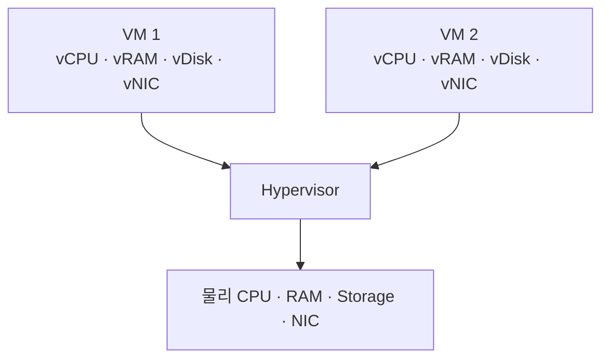

## 목차

- [[#질문|질문]]
- [[#해답|해답]]
- [[#자원별 동작|자원별 동작]]
- [[#관련 문서|관련 문서]]
- [[#출처|출처]]

## 질문

하이퍼바이저는 물리 CPU·메모리·디스크·NIC를 여러 VM에 어떻게 나누는가?

## 해답

하이퍼바이저는 물리 자원을 잘라 VM 안에 넣는 것이 아니라, 각 VM에 가상 하드웨어를 제시하고 실제 자원을 사용할 시간·주소·입출력 경로를 중재합니다. VM은 vCPU·가상 메모리·가상 디스크·vNIC를 실제 장치처럼 인식하지만, 그 뒤에서는 하이퍼바이저와 호스트가 물리 자원에 연결합니다.

## 자원별 동작

- CPU: vCPU의 실행 시간을 물리 CPU 코어에 스케줄링합니다. 필요하면 특정 vCPU를 지정한 물리 CPU에 고정할 수 있습니다.[^1]
- 메모리: 게스트가 보는 주소를 호스트의 실제 RAM 페이지에 매핑합니다. 할당량과 오버커밋 정책에 따라 여러 VM이 물리 메모리를 나누어 사용합니다.
- 디스크: VM에는 가상 디스크를 제공하고, 실제 요청은 이미지 파일·논리 볼륨·블록 장치 등의 백엔드로 전달합니다.[^2]
- 네트워크: VM의 vNIC를 가상 스위치나 브리지에 연결하고, 최종 패킷은 물리 NIC를 통해 전달합니다.

가상 자원의 합계가 물리 장비의 실제 처리 능력을 늘리지는 않습니다. 오버커밋은 모든 VM이 최대 자원을 동시에 쓰지 않는다는 가정으로 효율을 높이는 방식이므로, 경합이 발생하면 지연이나 성능 저하가 나타날 수 있습니다.

## 관련 문서

- [[Virtualization]]
- [[Hypervisor]]
- [[Virtual Machine]]
- [[CPU]]
- [[Memory]]
- [[Disk]]
- [[NIC]]

## 출처

[^1]: libvirt는 VM의 vCPU 수, 물리 CPU 집합과 vCPU 고정 방식을 정의한다. [libvirt 공식 문서, Domain XML format](https://libvirt.org/formatdomain)
[^2]: KVM 가상화 환경의 CPU·메모리·디스크 요구사항과 가상화 구성을 설명한다. [Red Hat Enterprise Linux 9, Configuring and managing virtualization](https://docs.redhat.com/en/documentation/red_hat_enterprise_linux/9/html/configuring_and_managing_virtualization/)

## 둘러보기

[[Questions/index|Questions]] · [[Knowledge Base/index|Knowledge Base]] · [[Projects/index|Projects]]
